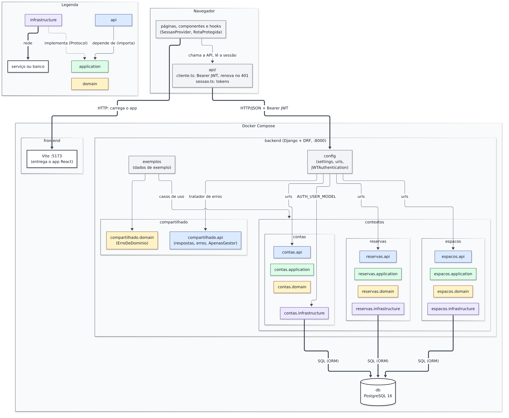
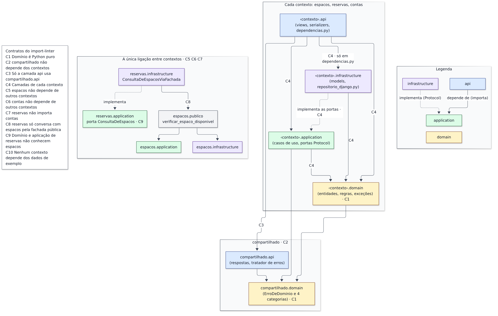

## 1. Visão do sistema

Três serviços do Docker Compose: `frontend` entrega o app React, `backend` expõe a API Django/DRF e `db` é o PostgreSQL 16. No `backend`, cada contexto (`espacos`, `reservas`, `contas`) tem as mesmas quatro camadas.

**Figura 1 — Visão geral.** Serviços e quem chama quem. As setas entre camadas e a única ligação entre contextos estão na Figura 2.

**Figura 2 — Regras de dependência.** O que cada camada pode importar e o contrato do import-linter (C1 a C10) que o garante.

| Legenda | Significado |
|---|---|
| Linha contínua · tracejada · grossa | depende de (importa ou referencia por texto) · implementa (herda a porta `Protocol`) · rede, com o protocolo no rótulo |
| Cor (sempre com o nome escrito) | azul `api`, verde `application`, amarelo `domain`, roxo `infrastructure`, cinza composição |

### Por que cada parte existe

A `api` separa o HTTP das regras (valida o formato e chama o caso de uso; só `dependencias.py` vê a infraestrutura). A `application` tem os casos de uso e as portas, testados com fakes. O `domain` concentra as regras e não importa Django. A `infrastructure` isola o ORM e o banco. `espacos.publico` é a única porta entre contextos, `compartilhado` unifica erros e respostas, `exemplos` usa os mesmos casos de uso e `config` só compõe. `contas` tem as quatro camadas porque tem regra própria (`DadosDeCadastro`, `CadastrarSolicitante` com as portas `RepositorioUsuarios` e `PoliticaDeSenha`).

### O caminho de uma requisição

(1) `api/cliente.ts` envia `POST /api/reservas/` com o Bearer; (2) `config` roteia a `reservas.api`, que chama `CriarReserva` com o `Solicitante` de `request.user`; (3) o caso de uso aplica `Reserva.solicitar` (`reservas.domain`) e consulta o espaço por `ConsultaDeEspacos` → `espacos.publico`; (4) `RepositorioReservasDjango` grava, com a restrição de exclusão do PostgreSQL contra corridas. A rejeição está na seção 3.

**Fora do diagrama:** testes, migrations, `models.py` e `apps.py` de reexportação, a administração do Django e o interior do frontend. Um script do grupo confere cada seta contra os imports do código.
