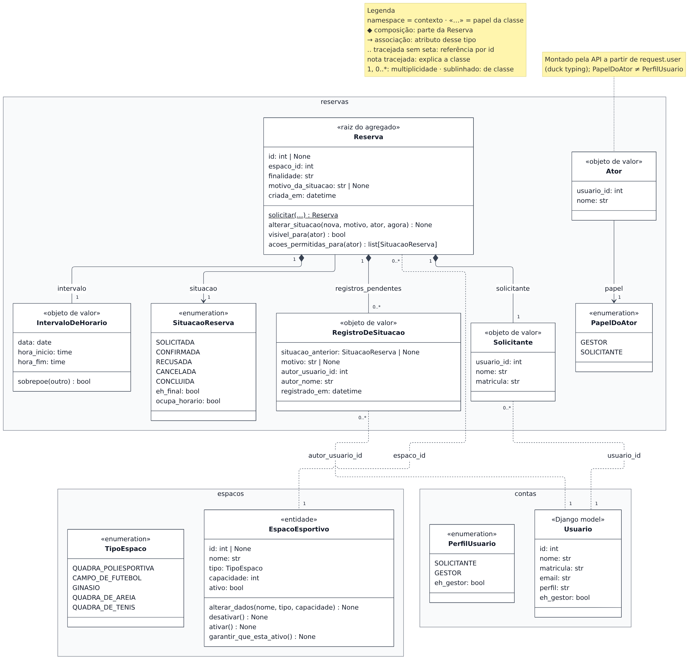
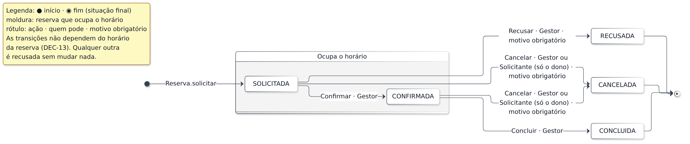

## 2. Modelo do domínio

**Figura 3 — Modelo do domínio.** Classes de cada contexto, com os nomes do código.

**Figura 4 — Estados da reserva.** Exatamente as transições de `TRANSICOES_PERMITIDAS`.

| Legenda | ◆ composição · → associação · tracejada sem seta: referência por id · «…» papel da classe · 1, 0..* multiplicidade · sublinhado: método de classe |
|---|---|

**O que cada classe garante sozinha.** `EspacoEsportivo` nunca tem nome vazio, tipo fora de `TipoEspaco` nem capacidade abaixo de `CAPACIDADE_MINIMA`, e só muda por `alterar_dados`, `desativar` e `ativar`; inativo, recusa reservas novas (DEC-06). Reserva nova só nasce por `Reserva.solicitar`, em `SOLICITADA`, no futuro e dentro das regras de agenda; o construtor só reconstitui. `alterar_situacao` aceita apenas o que a tabela e o papel do `Ator` permitem, exige motivo para recusar ou cancelar e gera um `RegistroDeSituacao` a cada mudança; `acoes_permitidas_para` usa a mesma regra. `IntervaloDeHorario` sempre termina depois de começar; o conflito entre reservas é a função `garantir_horario_livre`, porque depende das já gravadas. `Usuario`, único model do Django na figura, delega `eh_gestor` a `PerfilUsuario.eh_gestor`.

**Decisões de modelagem.**

- **Referência por id entre contextos**, sem chave estrangeira; o espaço é conferido por `espacos.publico`.
- **`Solicitante` é cópia** de id, nome e matrícula no momento do pedido: a lista e o histórico mostram quem pediu mesmo que o cadastro mude.
- **`PapelDoAtor` ≠ `PerfilUsuario`**, pelo contrato `reservas não importa contas`; a API monta o `Ator` a partir de `request.user`.
- **`RegistroDeSituacao` sai da `Reserva`**, gravado na mesma transação e só nas mudanças aceitas (DEC-05). As transições não dependem do horário (DEC-13).

**No banco** repetem-se as regras que uma corrida furaria: `ExclusionConstraint`, `UniqueConstraint(Lower("nome"))`, `CheckConstraint`. **Fora do diagrama:** `EstadoDoEspaco`, `DadosDeCadastro`, exceções, repositórios, `*Model`.
