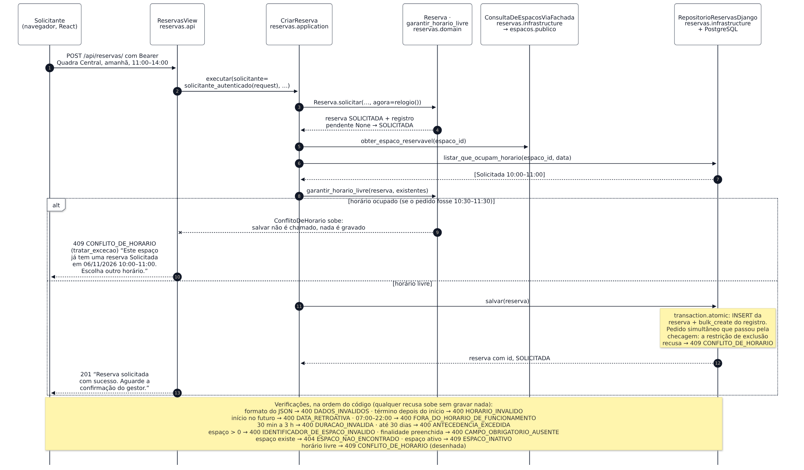
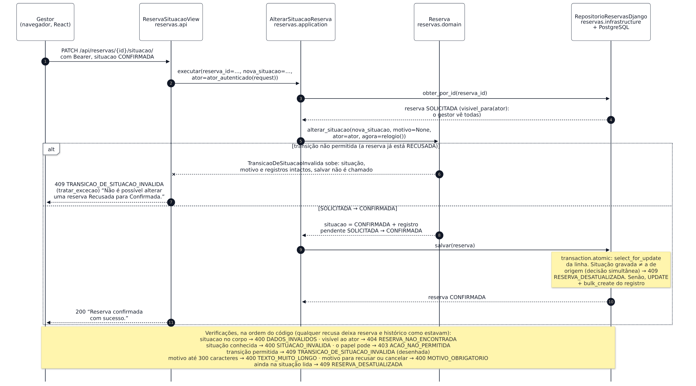

## 3. Fluxo principal

Do pedido (Solicitada) à decisão do gestor (Confirmada), com uma rejeição em cada requisição; a máquina de estados completa é a Figura 4. Os números entre parênteses são os passos dos diagramas, e o cenário é o dos dados de exemplo.

**Figura 5 — Solicitar uma reserva.** `POST /api/reservas/` até o 201, com o conflito de horário como rejeição.

O `Solicitante` sai do token, nunca do corpo (2). `Reserva.solicitar` aplica as regras do pedido e devolve a reserva com o registro de criação pendente (3–4); só então o espaço é conferido (5) e as reservas que ocupam o horário são lidas (6–7). `garantir_horario_livre` acha a sobreposição com a Solicitada das 10:00–11:00 (8): a exceção sobe antes de `salvar`, nada é gravado (9), e o formulário mostra a mensagem do 409 com os valores preservados (10). Com o horário livre, reserva e registro são gravados numa transação só (11–13).

**Figura 6 — Confirmar a reserva.** `PATCH /api/reservas/{id}/situacao/` pelo gestor, com a transição inválida como rejeição.

Reserva que quem pede não pode ver dá 404 (3–4). `alterar_situacao` confere situação, papel, `TRANSICOES_PERMITIDAS` e motivo, nessa ordem, antes de mudar qualquer coisa (5). Recusada → Confirmada não está na tabela: a exceção sobe com a reserva intacta, sem `salvar`, e o diálogo mostra o 409 com a opção de atualizar a lista (6–7). Só a mudança efetiva gera registro (DEC-05), gravado com a reserva na mesma transação (8–11).

**Concorrência e fora das figuras.** Pedidos simultâneos esbarram na restrição de exclusão do PostgreSQL (o mesmo 409 de conflito); decisões simultâneas, no bloqueio da linha com a situação lida (409 `RESERVA_DESATUALIZADA`). As demais recusas estão nas notas, a consulta e o histórico só leem, e os critérios de aceite de cada recusa estão nas histórias US-08 e US-14.
