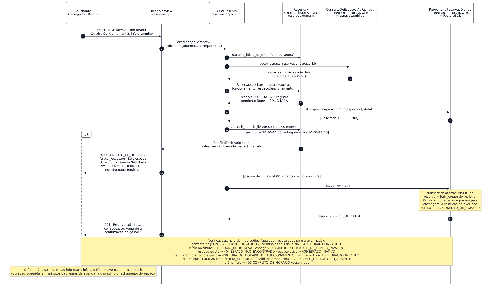
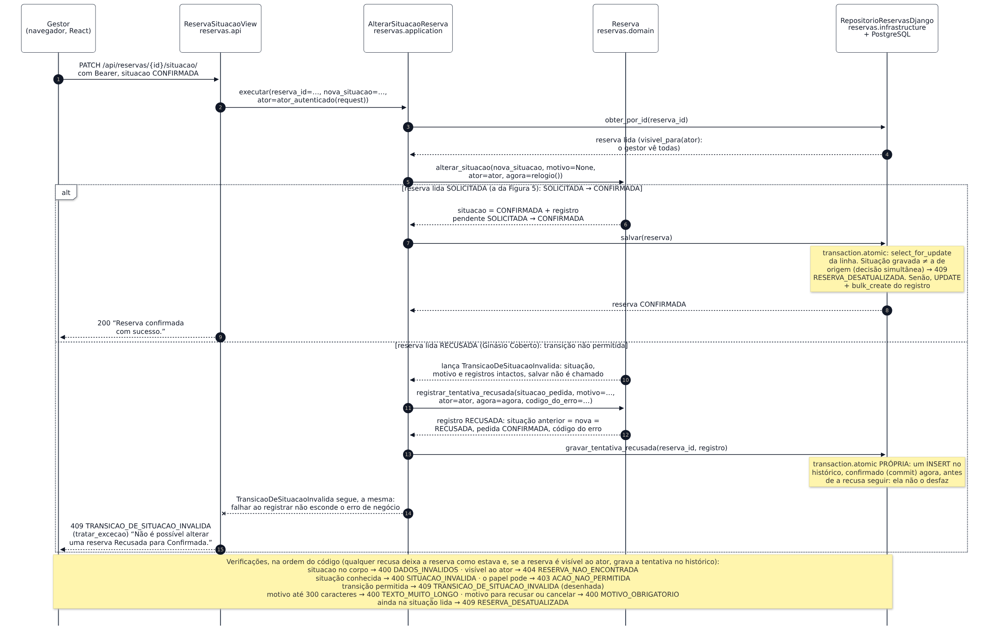

## 3. Fluxo principal

Do pedido (Solicitada) à decisão do gestor (Confirmada), com uma rejeição em cada requisição; a máquina de estados completa é a Figura 4. Os números entre parênteses são os passos dos diagramas, e o cenário é o dos dados de exemplo.

**Figura 5 — Solicitar uma reserva.** `POST /api/reservas/` até o 201, com o conflito de horário como rejeição.

O `Solicitante` sai do token, nunca do corpo (2). `CriarReserva` confere que o início ainda não passou (3) e, só então, consulta o espaço (4), que devolve o horário de funcionamento dele (5); `Reserva.solicitar` aplica as regras de agenda com esse horário e devolve a reserva com o registro de criação pendente (6–7), e as reservas que ocupam o horário são lidas (8–9). `garantir_horario_livre` acha a sobreposição com a Solicitada das 10:00–11:00 (10): a exceção sobe antes de `salvar`, nada é gravado (11), e o formulário mostra a mensagem do 409 com os valores preservados (12). Com o horário livre, reserva e registro são gravados numa transação só (13–15). O formulário só sugere o término (início mais a duração sugerida, no máximo o fechamento do espaço): quem decide é sempre a API.

**Figura 6 — Confirmar a reserva.** `PATCH /api/reservas/{id}/situacao/` pelo gestor, com a transição inválida como rejeição, que fica registrada no histórico.

Reserva que quem pede não pode ver dá 404 (3–4), sem registro. `alterar_situacao` confere situação, papel, `TRANSICOES_PERMITIDAS` e motivo, nessa ordem, antes de mudar qualquer coisa (5). Numa Solicitada, a mudança e o registro dela são gravados numa transação só (6–9). Recusada → Confirmada não está na tabela: a exceção sobe com a reserva intacta, sem `salvar` (10). Como a reserva é visível ao ator, o caso de uso monta o registro da tentativa recusada (11–12) e o repositório o grava numa transação própria, confirmada antes de a recusa seguir (13): a recusa não o desfaz. A mesma exceção chega à view, e o diálogo mostra o 409 com a opção de atualizar a lista (14–15).

**Concorrência e fora das figuras.** Pedidos simultâneos esbarram na restrição de exclusão do PostgreSQL (o mesmo 409 de conflito); decisões simultâneas, no bloqueio da linha com a situação lida (409 `RESERVA_DESATUALIZADA`). As demais recusas estão nas notas, a consulta e o histórico só leem, e os critérios de aceite de cada recusa estão nas histórias US-08 e US-14.
