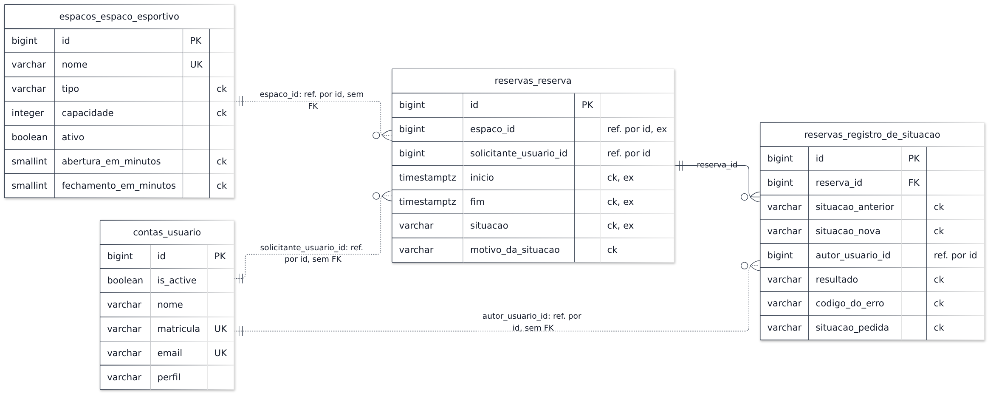

## 5. Banco de dados (DER)

**Figura 7 — Diagrama entidade-relacionamento**, gerado dos models do Django. Contínua: chave estrangeira (a única do projeto, `reserva_id`, dentro de `reservas`). Pontilhada: referência por id, sem chave estrangeira. PK chave primária · FK chave estrangeira · UK único · ck sujeita a restrição de check · ex sujeita à restrição de exclusão.

O desenho mostra as quatro tabelas dos contextos, com as colunas que as regras de negócio usam. A única chave estrangeira liga o registro de situação à sua reserva, dentro de `reservas`. As linhas pontilhadas são referências por id: `reservas` guarda o espaço e os usuários como número, sem chave estrangeira, para um contexto não depender das tabelas do outro. As tabelas do framework (`django_*`, `auth_*`, sessões, administração e `token_blacklist_*`) e as colunas não essenciais (auditoria e texto livre, como a finalidade) foram omitidas. A tabela abaixo traz as restrições completas; ela e a figura são geradas dos models por `scripts/gerar_der.py` e conferidas por `scripts/verificar_der.py`.

<!-- der:restricoes:inicio -->
| Restrição | Tabela | Definição | Nome no model |
|---|---|---|---|
| único | `contas_usuario` | matricula único | sem nome no model (`unique=True`) |
| único | `contas_usuario` | email único | sem nome no model (`unique=True`) |
| único | `contas_usuario` | LOWER(email) único (sem diferenciar maiúsculas) | `contas_usuario_email_unico_sem_caixa` |
| único | `espacos_espaco_esportivo` | LOWER(nome) único (sem diferenciar maiúsculas) | `espacos_espaco_esportivo_nome_unico_sem_caixa` |
| check | `espacos_espaco_esportivo` | capacidade ≥ 1 | `espacos_espaco_esportivo_capacidade_minima` |
| check | `espacos_espaco_esportivo` | tipo ∈ {"QUADRA_POLIESPORTIVA", "CAMPO_DE_FUTEBOL", "GINASIO", "QUADRA_DE_AREIA", "QUADRA_DE_TENIS"} | `espacos_espaco_esportivo_tipo_valido` |
| check | `espacos_espaco_esportivo` | abertura_em_minutos < 1440 E fechamento_em_minutos ≤ 1440 E fechamento_em_minutos ≥ abertura_em_minutos + 30 | `espacos_espaco_esportivo_horario_valido` |
| check | `reservas_reserva` | fim > inicio | `reservas_reserva_fim_apos_inicio` |
| check | `reservas_reserva` | situacao ∈ {"SOLICITADA", "CONFIRMADA", "RECUSADA", "CANCELADA", "CONCLUIDA"} | `reservas_reserva_situacao_valida` |
| check | `reservas_reserva` | (situacao ∉ {"CANCELADA", "RECUSADA"}) OU (motivo_da_situacao ≠ "") | `reservas_reserva_motivo_obrigatorio` |
| exclusão | `reservas_reserva` | entre linhas com situacao ∈ {"CONFIRMADA", "SOLICITADA"}, nenhum par pode ter ao mesmo tempo: TSTZRANGE(inicio, fim, '[)') sobrepõe (&&) e espaco_id igual (=) | `reservas_reserva_sem_sobreposicao_no_espaco` |
| check | `reservas_registro_de_situacao` | situacao_nova ∈ {"SOLICITADA", "CONFIRMADA", "RECUSADA", "CANCELADA", "CONCLUIDA"} E (situacao_anterior = "" OU situacao_anterior ∈ {"SOLICITADA", "CONFIRMADA", "RECUSADA", "CANCELADA", "CONCLUIDA"}) | `reservas_registro_de_situacao_situacoes_validas` |
| check | `reservas_registro_de_situacao` | resultado = "RECUSADA" OU (situacao_anterior ≠ situacao_nova) | `reservas_registro_de_situacao_anterior_diferente_da_nova` |
| check | `reservas_registro_de_situacao` | (resultado = "ACEITA" E codigo_do_erro = "" E situacao_pedida = situacao_nova) OU (resultado = "RECUSADA" E (codigo_do_erro ≠ "") E (situacao_pedida ≠ "") E situacao_anterior = situacao_nova) | `reservas_registro_de_situacao_resultado_coerente` |
<!-- der:restricoes:fim -->
