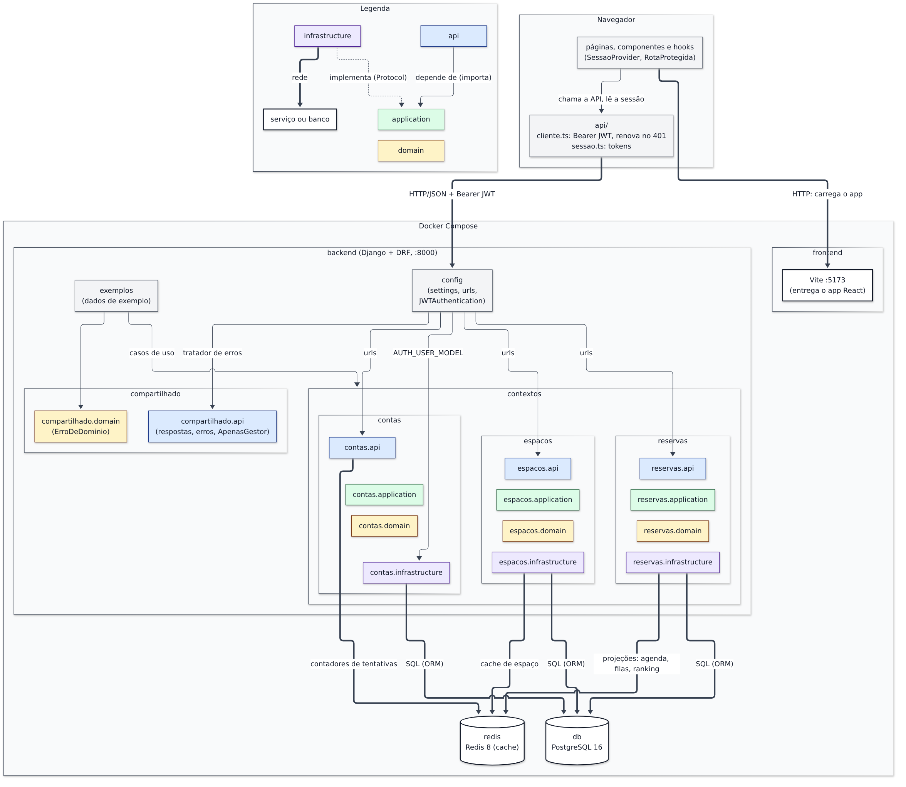
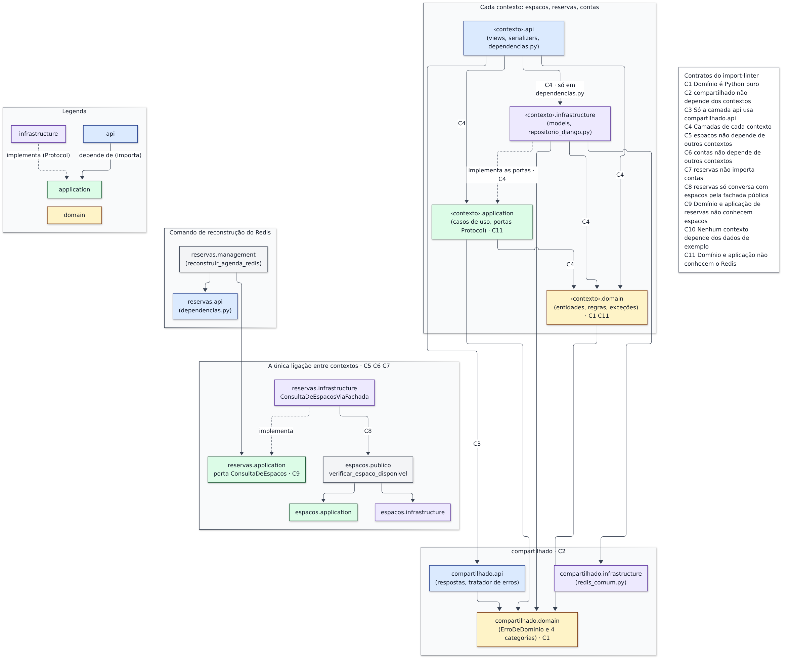
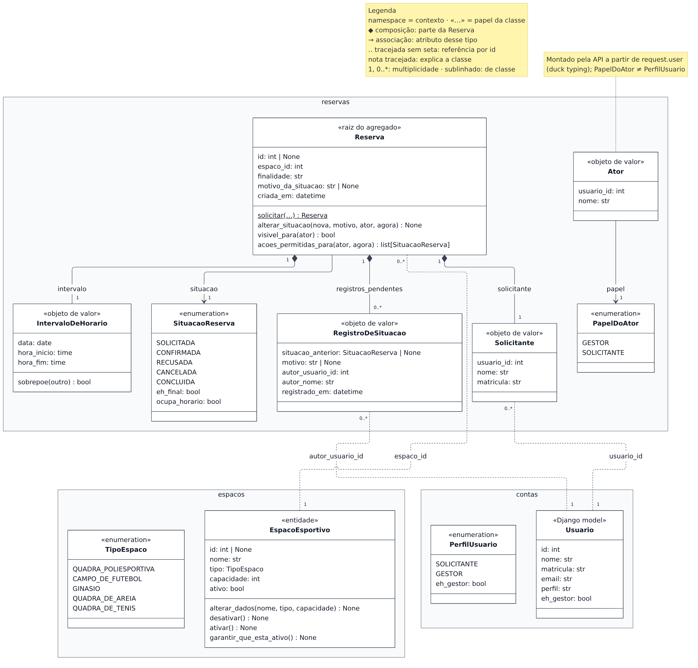
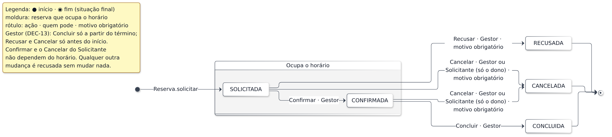
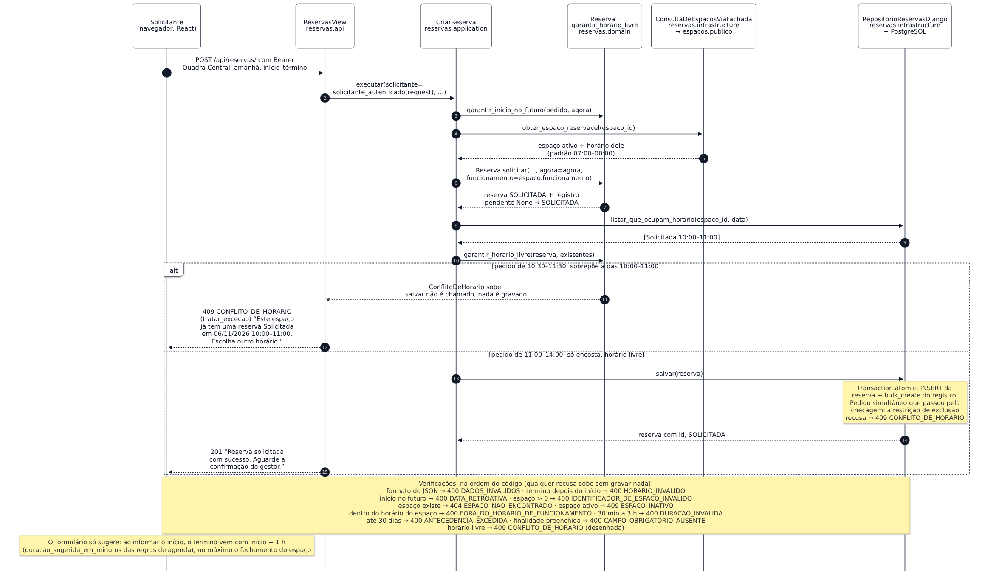
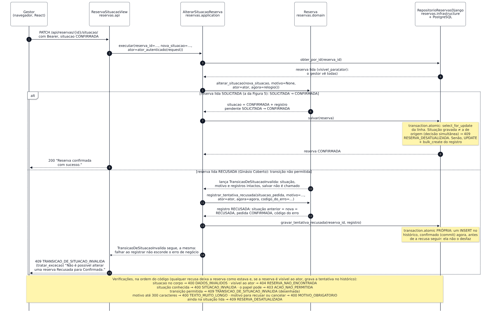

# Decisões técnicas e modelagem — texto do `docs/modelagem.pdf`

**MOD-04 • 0.1 • Rascunho**

| Papel | Nome |
|---|---|
| Autor | Max Zimmermann dos Reis |
| Revisor | Matheus Cezar Santos |
| Aprovador | Eduardo Almeida da Cunha |
| Integrante | Kelvin Fraga da Silva |

| Versão | Data | Autor | Mudança |
|---|---|---|---|
| 0.1 | 19/11/2026 | Max Zimmermann dos Reis | Criação (DOC-04): texto único do PDF, com as decisões técnicas, a organização, a modelagem e as Figuras 1 a 6; o DER fica fora do PDF (ver o README da pasta). Sem aprovação. |

Este cabeçalho não entra no PDF. O PDF é montado à mão a partir do trecho entre os marcadores `corpo:inicio` e `corpo:fim`, com as figuras pelo `.png`; a verificação é `python scripts/verificar_documento_modelagem.py`.

<!-- corpo:inicio -->

# Decisões técnicas e modelagem

Conecta Campus, reserva de quadras e espaços esportivos. Grupo 03, Projeto de Programação, Unilasalle RS, 2026/2.
Integrantes: Max Zimmermann dos Reis, Matheus Cezar Santos e Eduardo Almeida da Cunha [PENDENTE: confirmar os nomes completos de todos os integrantes].

## 1. Decisões técnicas

| Tecnologia | Versão | Papel no sistema |
|---|---|---|
| Python | 3.12 (`python:3.12-slim`) | linguagem do backend |
| Django | 5.2.18 LTS | ORM, migrations, administração e configuração |
| Django REST Framework | 3.18.3 | API REST |
| Simple JWT | 5.5.1 | tokens de acesso e de renovação |
| PostgreSQL | 16 (`postgres:16-alpine`) | persistência |
| Redis | 8 (`redis:8-alpine`) | contadores dos limites de tentativas e projeções do PostgreSQL |
| Node | 24 (`node:24-alpine`) | execução e build do frontend |
| React | 19.3.1 | interface |
| TypeScript | 6.0.3 | linguagem do frontend |
| Vite | 8.3.4 | servidor de desenvolvimento e build |
| Vitest | 5.0.5 | testes do frontend |
| gunicorn | 27.0.1 | servidor da API (modo de produção opcional) |
| nginx | 1.29 (`nginx:1.29-alpine`) | tela compilada e encaminhamento da API (modo de produção opcional) |

Backend. A disciplina exige Python; o backend usa Python 3.12, Django 5.2, a versão de suporte longo, e o Django REST Framework. O Django dá o ORM com migrations, a administração e as restrições do PostgreSQL; o DRF dá serializers que validam só o formato e um tradutor único de erros, `tratar_excecao`, que leva as quatro categorias de erro de domínio a 400, 403, 404 e 409. [CONFIRMAR COM O GRUPO: motivo da escolha de Django e DRF em vez de outro framework ou de uma solução sem framework]. A alternativa registrada é a do enunciado: memória ou JSON, com venv e pip (DEC-02). O custo é um framework grande para um sistema pequeno; por isso o domínio não importa Django, e o import-linter garante isso (contrato `Domínio é Python puro`).

Banco de dados. O PostgreSQL 16 veio com a liberação do Docker na DEC-02 (a resposta fala do Docker; o banco é inferência do grupo, registrada na decisão). O motivo técnico é a restrição de exclusão `reservas_reserva_sem_sobreposicao_no_espaco`: o banco recusa duas reservas sobrepostas do mesmo espaço que passaram juntas pela checagem em código, e o repositório traduz a recusa no mesmo `ConflitoDeHorario` do domínio; o nome único de espaço, sem diferenciar maiúsculas, também é garantido no banco (`espacos_espaco_esportivo_nome_unico_sem_caixa`). Memória ou JSON não dariam essa garantia, e o SQLite das aulas não tem restrição de exclusão. O custo é um serviço a mais e restrições presas ao PostgreSQL (`BtreeGistExtension`).

Autenticação. A DEC-04 decidiu cadastro, login e dois perfis, para só o Gestor decidir as reservas e o solicitante ser sempre quem está logado (um extra da disciplina). A API usa JWT com o Simple JWT: o token de acesso dura 30 minutos (`JWT_ACCESS_MINUTES`) e o de renovação, 1 dia (`JWT_REFRESH_DAYS`); cada renovação troca o token de renovação e põe o anterior numa lista negra, e sair revoga o atual. [CONFIRMAR COM O GRUPO: motivo de JWT em vez da sessão do Django]. O custo aceito é que o token de acesso não é revogável: uma cópia feita antes de sair vale até expirar.

Redis. O Redis 8 tem dois usos. Os contadores dos limites de login, cadastro, troca de senha e alteração de usuários pelo Gestor rodam num script atômico (`_REGISTRAR_TENTATIVA`) que vale para todos os processos da API, inclusive os workers do gunicorn (`GUNICORN_WORKERS`); fora do ar, essas operações respondem 503 `SERVICO_INDISPONIVEL` em vez de liberar sem limite. O outro uso são projeções do PostgreSQL, a fonte da verdade (DEC-28): a agenda do dia, a fila de pendentes com as contagens por situação, o ranking de espaços e uma cópia do espaço por 5 minutos. O banco decide o conflito de horário; a consulta volta a ele se a chave faltar ou o Redis cair. Sem persistência, os contadores zeram quando ele reinicia, e as projeções se refazem pelo comando `reconstruir_agenda_redis`. As chaves, os padrões e as falhas estão em `docs/fontes/modelagem/06-redis.md`.

Frontend. O professor liberou o React (DEC-01), e o plano B com templates do Django foi descartado. A tela usa React 19, TypeScript e Vite, com os testes no Vitest sobre a mesma configuração (`vite.config.ts`). [CONFIRMAR COM O GRUPO: motivo da escolha de TypeScript e de Vite]. Ela não valida regra de negócio: mostra as ações e as mensagens que a API devolve. O custo é um segundo projeto, com Node, e o CORS entre as portas (`CORS_ALLOWED_ORIGINS`).

Execução. Docker e Docker Compose foram liberados na DEC-02, com os arquivos dentro de src/ pela estrutura do ZIP (DEC-03). Um comando sobe os quatro serviços (`db`, `backend`, `frontend` e `redis`) e aplica as migrations, com as mesmas versões em qualquer máquina; a alternativa era venv e pip sem banco, e o custo é exigir o Docker de quem corrige. O modo de produção, opcional e fora da avaliação (`docker-compose.prod.yml`), roda a API no gunicorn, sem privilégios, e o nginx serve a tela compilada e encaminha a API na mesma porta (`nginx.conf`); não tem HTTPS, backup nem réplica.

## 2. Organização do sistema

O backend tem três contextos com as mesmas quatro camadas, `espacos`, `reservas` e `contas`, mais `compartilhado` (erros e respostas comuns), `exemplos` (dados de exemplo carregados pelos mesmos casos de uso) e `config`, que só compõe. A api valida o formato e chama o caso de uso (só o `dependencias.py` monta a infraestrutura); a application tem os casos de uso e as portas, testados com fakes; o domain, as regras em Python puro; a infrastructure, o ORM. Contextos não se importam: `reservas` guarda o espaço só pelo id e o consulta pela porta `ConsultaDeEspacos`, implementada por `ConsultaDeEspacosViaFachada`, que chama `espacos.publico`. O import-linter confere essas regras em 11 contratos, e a DEC-08 fixa a cobertura dos testes: 100% de linhas e ramos nas camadas domain e application de `espacos` e `reservas` e, no total, 99%.

Figura 1 — Visão geral. Serviços do Docker Compose, contextos com as camadas e quem chama quem.

Figura 2 — Regras de dependência. O que cada camada pode importar e o contrato do import-linter que o garante.

## 3. Modelagem do domínio

Figura 3 — Modelo do domínio. Classes de cada contexto, com os nomes do código; tracejado sem seta é referência por id.

Cada classe garante as próprias invariantes no construtor. `EspacoEsportivo` tem nome, tipo e capacidade válidos e um `HorarioDeFuncionamento` próprio (padrão das 07:00 às 00:00), e só muda pelos métodos da figura. Por convenção da aplicação, `Reserva.solicitar` é o único caminho de uma reserva nova: exige início no futuro e aplica as regras de agenda (1 h sugerida, de 30 min a 3 h, até 30 dias de antecedência); o conflito entre reservas é a função `garantir_horario_livre`. `alterar_situacao` aceita só o que `TRANSICOES_PERMITIDAS` e `DESTINOS_POR_PAPEL` permitem e gera um `RegistroDeSituacao`. O `Solicitante` é cópia de nome e matrícula (até 20 dígitos) no momento do pedido, e `PapelDoAtor` é separado de `PerfilUsuario` para `reservas` não importar `contas`.

Figura 4 — Estados da reserva. As transições de `TRANSICOES_PERMITIDAS`, com a ação, quem pode e o motivo.

Figura 5 — Solicitar uma reserva. Do pedido à Solicitada, com o conflito de horário como rejeição.

Figura 6 — Confirmar a reserva. O Gestor confirma; a transição inválida é recusada e registrada.

## 4. Modelo de dados

O diagrama entidade-relacionamento do banco e a tabela das restrições ficaram fora, para caber nas 6 páginas; estão no repositório, como material complementar, em `docs/fontes/modelagem/der-do-banco.png` e `docs/fontes/modelagem/05-der-do-banco.md`.

## 5. Qualidade e limitações assumidas

Testes com pytest, na meta da DEC-08, e Vitest, ruff, ESLint, o import-linter e scripts que conferem as figuras e os requisitos contra o código. Limitações assumidas: o token de acesso não é revogável; os contadores de tentativas zeram quando o Redis reinicia (as projeções se refazem) e, sem ele, as quatro operações limitadas respondem 503; desativar um espaço não cancela as reservas dele (DEC-06); o fuso é sempre o de Brasília; e o modo de produção não tem HTTPS.

<!-- corpo:fim -->
