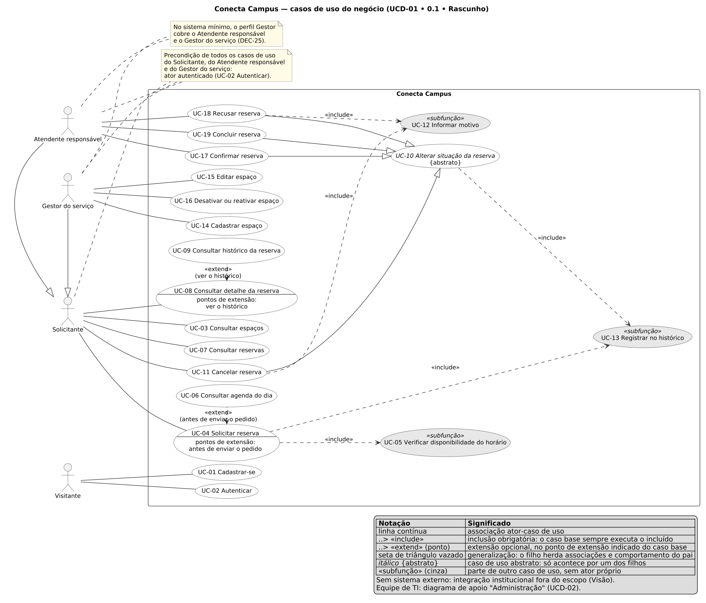
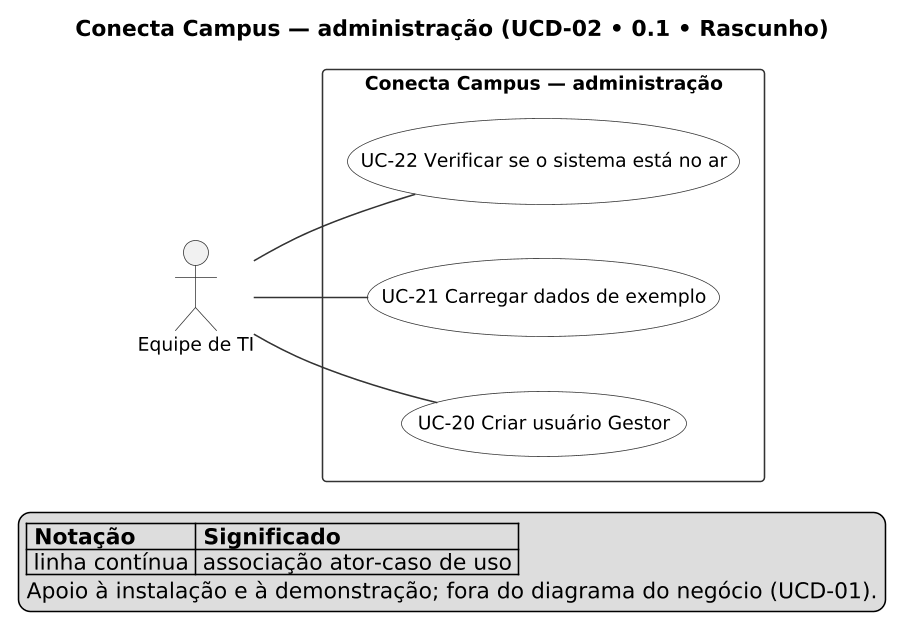

# Casos de uso

| Identificação | Responsabilidade | Fonte oficial |
|---|---|---|
| **UCD-01 • 0.1 • Rascunho** (diagrama do negócio) e **UCD-02 • 0.1 • Rascunho** (diagrama de apoio "Administração") | Autor: Max Zimmermann dos Reis • Revisor: Matheus Cezar Santos • Aprovador: Eduardo Almeida da Cunha | `docs/fontes/requisitos/casos-de-uso/` |

Diagrama UML de casos de uso do Conecta Campus, índice dos casos de uso (UC-xx) e rastreabilidade RF → UC. Os atores são os da [Visão](../visao.md#2-usuários-atores-e-stakeholders) e da [SRS, seção 2](../requisitos/srs.md#atores-e-perfis); os nomes de atores e casos de uso saem do [glossário](../glossario.md#7-casos-de-uso). As fichas Cockburn (ator primário, meta, precondições, fluxo principal numerado, alternativas e exceções ligadas ao passo, pós-condições e garantias) estão nesta pasta desde a **REQ-04**: ver [Fichas dos casos de uso](#fichas-dos-casos-de-uso). Índice da fonte oficial: [README](../README.md).

## Histórico de revisões

| Versão | Data | Autor | Alteração e referência da aprovação |
|---|---|---|---|
| 0.1 | 04/11/2026 | Max Zimmermann dos Reis | Criação: diagrama do negócio (UC-01 a UC-19), diagrama de apoio "Administração" (UC-20 a UC-22), decisões de modelagem, índice dos UCs e rastreabilidade RF → UC dos 60 RF (REQ-03). Sem aprovação. |
| 0.1 | 04/11/2026 | Max Zimmermann dos Reis | Fichas Cockburn: completas de UC-02, UC-04, UC-10 e UC-14, resumidas dos demais objetivos e do apoio; fluxo de decisão de UC-04; decisões h e i; coluna Estado do índice com o link de cada ficha; "Como entra" com o passo, a alternativa ou a exceção exata de cada RF (REQ-04). Sem aprovação. |
| 0.1 | 04/11/2026 | Max Zimmermann dos Reis | Coluna Histórias no índice, linha "Histórias derivadas" nas fichas e ponteiro para as histórias (REQ-05), sem mudar o fluxo. Sem aprovação. |
| 0.1 | 05/11/2026 | Max Zimmermann dos Reis | Link para a [matriz de rastreabilidade gerada](../rastreabilidade/matriz.md), que lê a tabela RF → UC; a SRS 6.4 não repete mais o UC (REQ-06). Sem aprovação. |
| 0.1 | 06/11/2026 | Max Zimmermann dos Reis | Pontos 4 e 5 das Pendências e a decisão i apontam para as respostas da Aula 7 ([DEC-19](../decisoes/DEC-19.md) e [DEC-14](../decisoes/DEC-14.md)) (GES-02). Os pontos 2 e 3 não foram perguntados e seguem adotados provisoriamente. Nenhum diagrama, ficha ou fluxo muda. Sem aprovação. |
| 0.1 | 07/11/2026 | Max Zimmermann dos Reis | RF → UC: RF-33.2 em UC-02 E3.1 e RF-33.1 em E3.3, renumerada (AUT-08). Sem aprovação. |
| 0.1 | 07/11/2026 | Max Zimmermann dos Reis | Meta de UC-22 com o cache (AUT-08). Sem aprovação. |
| 0.1 | 09/11/2026 | Max Zimmermann dos Reis | RF → UC: RF-12.2 (consulta em páginas) em UC-07 passo 2, A2.3, A2.4 e A3.2, e no índice; a contagem passa a 62 RF (estava em 60 desde a AUT-08, que acrescentou o RF-33.2) (RES-10). Sem aprovação. |

## Sumário

1. [Diagrama do negócio (UCD-01)](#diagrama-do-negócio-ucd-01)
2. [Diagrama de apoio "Administração" (UCD-02)](#diagrama-de-apoio-administração-ucd-02)
3. [Legenda](#legenda)
4. [Decisões de modelagem](#decisões-de-modelagem)
5. [Fichas dos casos de uso](#fichas-dos-casos-de-uso)
6. [Como gerar as imagens](#como-gerar-as-imagens)
7. [Índice dos casos de uso](#índice-dos-casos-de-uso)
8. [Rastreabilidade RF → UC](#rastreabilidade-rf--uc)
9. [Pendências](#pendências)

## Diagrama do negócio (UCD-01)



Fonte: [`diagrama-casos-de-uso.puml`](diagrama-casos-de-uso.puml) · imagem vetorial: [`diagrama-casos-de-uso.svg`](diagrama-casos-de-uso.svg).

## Diagrama de apoio "Administração" (UCD-02)



Fonte: [`diagrama-administracao.puml`](diagrama-administracao.puml) · imagem vetorial: [`diagrama-administracao.svg`](diagrama-administracao.svg).

## Legenda

A mesma do próprio diagrama (A2·s24–27):

| Notação | Significado |
|---|---|
| Retângulo "Conecta Campus" | Fronteira do sistema. Tudo dentro é comportamento do sistema; os atores ficam fora. |
| Boneco | Ator: um papel externo ao sistema (sentido da UML, não o `Ator` do código; ver o [glossário](../glossario.md#ator)). |
| Elipse com "UC-xx Verbo …" | Caso de uso, nomeado pela meta, no infinitivo, com o ID visível. |
| Linha contínua ator–elipse | Associação: o ator inicia o caso de uso. |
| Seta tracejada `«include»` (base → incluído) | Inclusão **obrigatória**: toda execução do caso base executa o incluído. |
| Seta tracejada `«extend»` (extensão → base), com o ponto entre parênteses | Extensão **opcional**: acontece só quando o ator escolhe, no **ponto de extensão** declarado na elipse da base. |
| Seta contínua com triângulo vazado | Generalização: o filho herda as associações e o comportamento do pai (Gestor → Solicitante; Confirmar, Recusar, Concluir e Cancelar → Alterar situação). |
| Nome em itálico com `{abstrato}` | Caso de uso abstrato: não acontece sozinho, só por um dos filhos. |
| Elipse cinza com `«subfunção»` | Caso de uso de subfunção (Cockburn): parte de outro caso de uso, sem ator próprio. As brancas são do nível do objetivo do usuário. |
| Nota (folha dobrada) | Restrição que vale para os atores ligados a ela (aqui, a precondição de autenticação). |

A cor só reforça o estereótipo `«subfunção»`, que já aparece escrito: o diagrama não depende de cor (como o [RNF-U05](../requisitos/rnf.md#rnf-u05) exige das telas).

## Decisões de modelagem

<a id="decisao-a"></a>**a) Granularidade no nível do objetivo do usuário** (o "nível do mar" de Cockburn). Um caso de uso é algo que o ator quer alcançar numa sessão, e começa pela meta, não pela tela (A3·s13): "Solicitar reserva", e não "preencher a data". Consequências:

- **Recusas viram exceções, não elipses.** Os 27 RF de recusa (F5: os filhos `RF-xx.n` e RF-09, RF-10, RF-23 a RF-27) entram como **exceções** do caso de uso que protegem, detalhadas nas fichas da REQ-04 (coluna "Como entra" da [rastreabilidade](#rastreabilidade-rf--uc)). Um "Recusar pedido em conflito de horário" não é meta de ninguém.
- **Consultas de apoio viram passos, não elipses.** Consultar um espaço (RF-03), os tipos de espaço (RF-04), as situações de reserva (RF-15) e as regras de agenda (RF-28) são passos ou alternativas dos casos de uso que os usam. Por isso o [vocabulário público](../glossario.md#vocabulario-publico) não gera um caso de uso próprio do Visitante: ele é dado de apoio a outros casos de uso, não uma meta.
- **Sessão faz parte de Autenticar.** Continuar identificado (RF-34), sessão expirada (RF-34.1), consultar os próprios dados ao voltar (RF-35) e sair (RF-36) são alternativas e exceções de UC-02.
- **RF transversais não são casos de uso.** O [RF-38](../requisitos/rf-gerais.md#rf-38) (ver o resultado de cada operação) é uma qualidade de todos os casos de uso, como um RNF: não tem elipse, e a rastreabilidade o marca como "transversal".
- **Subfunções só quando dizem algo.** As três elipses cinza ("Verificar disponibilidade do horário", "Informar motivo", "Registrar no histórico") existem porque são comportamento observável e obrigatório que mais de um caso de uso compartilha, ou que concentra as recusas principais (UC-05 reúne as três recusas do pedido que dependem do estado: espaço não reservável, conflito e regras de agenda).
- **Contagem.** 19 elipses no diagrama do negócio, acima das ~16 previstas: as quatro especializações de UC-10 são metas distintas (confirmar, recusar, concluir e cancelar têm atores, motivos e efeitos diferentes) e o caso de uso abstrato é o alvo da ficha "Alterar situação" da REQ-04. Mesmo assim o diagrama cabe numa A4 deitada, sem cruzamento entre as relações dos casos de uso (só as linhas tracejadas da nota de precondição cruzam associações).

<a id="decisao-b"></a>**b) Notação UML padrão.** Só associações ator–caso de uso, `«include»`, `«extend»` com ponto de extensão nomeado e generalização. **Não** ligamos casos de uso em sequência, como no diagrama de referência do slide A2·s24 ("Passo 1 → Passo 4"): a UML não prevê essa seta, e a ordem dos passos é assunto da ficha (fluxo principal numerado) e da jornada, não do diagrama. É o ponto 3 dos pontos a confirmar, ainda em aberto; se o professor pedir o estilo do slide, muda só o `.puml`, sem mudar IDs.

<a id="decisao-c"></a>**c) Generalização de atores.** O Gestor faz tudo o que o Solicitante faz, e mais ([SRS, seção 2](../requisitos/srs.md#atores-e-perfis)): pede reservas em nome próprio, consulta, cancela. Por isso o Gestor **herda** do Solicitante, e o diagrama não repete as associações (UC-03, UC-04, UC-07, UC-08 e UC-11 valem para os dois). As diferenças de alcance (o Solicitante vê e cancela só as próprias; o Gestor, todas) são regra de negócio, ficam nas fichas e já estão nos RF ([RF-13](../requisitos/rf-reservas.md#rf-13), [RF-20](../requisitos/rf-reservas.md#rf-20), [RF-21](../requisitos/rf-reservas.md#rf-21), [RF-23](../requisitos/rf-reservas.md#rf-23)). Do mesmo modo, Confirmar, Recusar, Concluir e Cancelar **especializam** o caso de uso abstrato "Alterar situação da reserva": as recusas comuns (transição não permitida, situação desconhecida, perfil sem permissão, reserva de outra pessoa) e a inclusão de "Registrar no histórico" ficam uma vez só, no pai.

<a id="decisao-d"></a>**d) Autenticação como precondição, numa nota.** O login é o caso de uso UC-02 do Visitante. Os casos de uso do Solicitante e do Gestor exigem um [usuário autenticado](../glossario.md#usuario-autenticado), mas o diagrama **não** desenha `«include»` para Autenticar, e sim uma nota UML ligada aos dois atores: "Precondição de todos os casos de uso do Solicitante e do Gestor: ator autenticado (UC-02 Autenticar)". Motivos:

- `«include»` diz que **toda** execução do caso base executa o incluído. Quem já está identificado não se autentica de novo a cada pedido; identificar-se é uma condição de entrada, não um passo.
- Tirar o include de só alguns casos de uso "âncora" (a primeira proposta) deixaria os outros parecendo livres de login, o que contradiz o [RNF-F04](../requisitos/rnf.md#rnf-f04) (identificação obrigatória por padrão). Pôr o include em todos os 13 casos de uso dos dois atores tornaria o diagrama ilegível.
- A nota diz a regra inteira com um só elemento, e a precondição "usuário autenticado" entra em cada ficha na REQ-04. Isso atende ao que a [DEC-04](../decisoes/DEC-04.md) lista como artefato afetado ("ator Gestor e `<<include>>` Autenticar"): o Gestor está no diagrama, e a dependência de Autenticar está expressa como precondição.

<a id="decisao-e"></a>**e) Equipe de TI num diagrama de apoio.** A [Equipe de TI](../glossario.md#equipe-de-ti) não é ator dos casos de uso do negócio ([Visão, seção 2](../visao.md#2-usuários-atores-e-stakeholders)). Os RF dela (criar usuário Gestor, carregar dados de exemplo, verificar se o sistema está no ar) ficam no diagrama separado "Administração" (UCD-02, UC-20 a UC-22), para a rastreabilidade RF → UC ficar completa sem misturar instalação e operação com o negócio.

<a id="decisao-f"></a>**f) Sem sistema externo.** O professor pede os atores "incluindo sistemas externos" quando existirem. Aqui não existe nenhum: o Conecta Campus não se integra a sistemas da instituição, de pagamento nem de notificação ([Visão, fora do escopo](../visao.md#fora-do-escopo); [SRS, seção 4.2](../requisitos/srs.md#42-com-outros-sistemas)). A legenda do diagrama registra essa ausência para ela não parecer esquecimento. Pelo mesmo motivo, nenhum caso de uso tem ator secundário.

<a id="decisao-g"></a>**g) Ferramenta: PlantUML.** Tem suporte nativo a diagrama de casos de uso UML (fronteira, atores, `«include»`, `«extend»`, generalização, notas e legenda); o Mermaid não tem. A fonte `.puml` é texto versionado no Git, como o resto da pasta (A4·s12). Os `.svg` e `.png` também são versionados, porque o `.png` entra nos PDFs e o Markdown o exibe; eles são **gerados** a partir do `.puml` e nunca editados à mão. A ferramenta e a notação são o ponto 2 dos pontos a confirmar, ainda em aberto.

<a id="decisao-h"></a>**h) Dois formatos de ficha, como no Cockburn** (REQ-04). **Completa** (todos os campos do A3·s10–15: escopo, nível, ator primário, stakeholders e interesses, meta, precondições, disparador, fluxo principal, alternativas, exceções, pós-condições, garantia de sucesso e mínima, regras, RF e RNF, questões em aberto e o anexo de evidência) para os quatro casos de uso que concentram as regras e as recusas: UC-02, UC-04, UC-10 e UC-14. **Resumida** (ator, meta, precondição, fluxo principal curto, alternativas e exceções principais e os RF) para os outros casos de uso de objetivo (UC-01, UC-03, UC-06 a UC-09, UC-15, UC-16) e, num bloco separado, para os de apoio (UC-20 a UC-22). As subfunções UC-05, UC-12 e UC-13 e os filhos de UC-10 (UC-11, UC-17, UC-18, UC-19) não têm ficha própria: aparecem como passos e como a tabela de variações das fichas que os incluem (coluna Estado do [índice](#índice-dos-casos-de-uso)). As fichas descrevem intenção e resultado observável, nunca interface (A3·s12–14), e as exceções seguem a **ordem real das verificações** do sistema, conferida no código e nos testes, porque ela decide qual mensagem a pessoa vê primeiro.

<a id="decisao-i"></a>**i) Numeração dos passos, alternativas e exceções** (REQ-04). Passos `1, 2, 3…`; alternativas `A<passo>.<n>` (a meta ainda é alcançada); exceções `E<passo>.<n>` (a meta é interrompida), como no A3·s12. Cada um tem âncora estável: `p3`, `a3-1`, `e9-1` nas fichas completas; nas resumidas, com o prefixo do caso de uso, porque estão todas num arquivo (`uc07-e3-1`). Toda exceção diz a condição, o resultado observável para o ator (o que ele fica sabendo e o que corrigir), o estado depois (o que não mudou) e o requisito que ela atende (o RF "Recusar…" ou, quando não há RF, o RNF ou a lacuna). O **ponto 5** dos pontos a confirmar (A × E: o A3·s15 numera uma exceção como `A2.2`) foi respondido na Aula 7: `A` e `E` como aqui ([DEC-14](../decisoes/DEC-14.md)).

## Fichas dos casos de uso

| Ficha | Formato | Casos de uso cobertos |
|---|---|---|
| [UC-02 Autenticar](UC-02-autenticar.md) | completa | UC-02 |
| [UC-04 Solicitar reserva](UC-04-solicitar-reserva.md) | completa, com o [fluxo de decisão](UC-04-solicitar-reserva.md#fluxo-de-decisão) | UC-04, com UC-05 e UC-13 (passos) e a extensão UC-06 (alternativa A3.1) |
| [UC-10 Alterar situação da reserva](UC-10-alterar-situacao-da-reserva.md) | completa, com a tabela de variações | UC-10 e os filhos UC-11, UC-17, UC-18 e UC-19, com UC-12 e UC-13 (passos) |
| [UC-14 Cadastrar espaço](UC-14-cadastrar-espaco.md) | completa | UC-14 |
| [Fichas resumidas](fichas-resumidas.md) | resumida | UC-01, UC-03, UC-06, UC-07, UC-08, UC-09, UC-15, UC-16; apoio: UC-20, UC-21, UC-22 |

Fonte do fluxo de decisão: [`fluxo-solicitar-reserva.puml`](fluxo-solicitar-reserva.puml) (diagrama de atividade, A3·s17), com as imagens geradas como as dos diagramas de casos de uso.

## Como gerar as imagens

Pelo Docker, com a imagem oficial do PlantUML numa versão fixa, sem instalar Java. Na raiz do repositório, rode os dois comandos (um para SVG, outro para PNG):

Git Bash:

```bash
MSYS_NO_PATHCONV=1 docker run --rm -v "$(pwd)/docs/fontes/requisitos/casos-de-uso:/data" -w /data plantuml/plantuml:1.2026.9 -charset UTF-8 -tsvg diagrama-casos-de-uso.puml diagrama-administracao.puml fluxo-solicitar-reserva.puml
MSYS_NO_PATHCONV=1 docker run --rm -v "$(pwd)/docs/fontes/requisitos/casos-de-uso:/data" -w /data plantuml/plantuml:1.2026.9 -charset UTF-8 -tpng diagrama-casos-de-uso.puml diagrama-administracao.puml fluxo-solicitar-reserva.puml
```

PowerShell:

```powershell
docker run --rm -v "${PWD}/docs/fontes/requisitos/casos-de-uso:/data" -w /data plantuml/plantuml:1.2026.9 -charset UTF-8 -tsvg diagrama-casos-de-uso.puml diagrama-administracao.puml fluxo-solicitar-reserva.puml
docker run --rm -v "${PWD}/docs/fontes/requisitos/casos-de-uso:/data" -w /data plantuml/plantuml:1.2026.9 -charset UTF-8 -tpng diagrama-casos-de-uso.puml diagrama-administracao.puml fluxo-solicitar-reserva.puml
```

Os seis arquivos gerados (o `.svg` e o `.png` de `diagrama-casos-de-uso`, `diagrama-administracao` e `fluxo-solicitar-reserva`) ficam nesta pasta, ao lado das fontes. Toda mudança num `.puml` regera as imagens dele no mesmo PR. Depois, na raiz:

```bash
python scripts/verificar_casos_de_uso.py
```

O script confere o diagrama contra este README, a SRS e as fichas de RF (UCs, RF → UC, notação e imagens desatualizadas) e, desde a REQ-04, as fichas de caso de uso (RF ligados a passos, alternativas e exceções; passos citados existentes; as quatro partes de cada exceção; termos de interface; o fluxo de decisão de UC-04). As ligações invisíveis e as setas mais longas do `.puml` (comentadas lá) servem só ao layout e não são relações UML.

## Índice dos casos de uso

Nível: **objetivo** = objetivo do usuário (o "nível do mar"); **subfunção** = parte de outro caso de uso, alcançada por `«include»`; **abstrato** = generalização, só acontece por um dos filhos. Estado: o link para a ficha completa ou resumida ([decisão h](#decisao-h)), ou, nas subfunções e nos filhos de UC-10, para o trecho da ficha que os descreve. Nenhum caso de uso tem ator secundário ([decisão f](#decisao-f)).

| ID | Caso de uso | Meta | Ator primário | Atores secundários | Nível | RF | Histórias | Estado |
|---|---|---|---|---|---|---|---|---|
| <a id="uc-01"></a>UC-01 | Cadastrar-se | Obter acesso ao sistema como Solicitante, sem depender de um Gestor. | Visitante | — | objetivo | [RF-32](../requisitos/rf-contas.md#rf-32), [RF-32.1](../requisitos/rf-contas.md#rf-32-1), [RF-32.2](../requisitos/rf-contas.md#rf-32-2), [RF-32.3](../requisitos/rf-contas.md#rf-32-3) | [US-01 Criar minha conta](../historias/US-01-criar-minha-conta.md) | [Ficha resumida](fichas-resumidas.md#uc-01) |
| <a id="uc-02"></a>UC-02 | Autenticar | Ser identificado pelo sistema para agir com o próprio perfil, e deixar de sê-lo ao sair. | Visitante | — | objetivo | [RF-33](../requisitos/rf-contas.md#rf-33), [RF-33.1](../requisitos/rf-contas.md#rf-33-1), [RF-34](../requisitos/rf-contas.md#rf-34), [RF-34.1](../requisitos/rf-contas.md#rf-34-1), [RF-35](../requisitos/rf-contas.md#rf-35), [RF-36](../requisitos/rf-contas.md#rf-36) | [US-02 Entrar no sistema](../historias/US-02-entrar-no-sistema.md), [US-03 Manter e encerrar a sessão](../historias/US-03-manter-e-encerrar-a-sessao.md) | [Ficha completa](UC-02-autenticar.md) |
| <a id="uc-03"></a>UC-03 | Consultar espaços | Saber quais espaços esportivos existem, de que tipo são e quais aceitam pedidos. | Solicitante (e o Gestor, por herança) | — | objetivo | [RF-01](../requisitos/rf-espacos.md#rf-01), [RF-02](../requisitos/rf-espacos.md#rf-02), [RF-02.1](../requisitos/rf-espacos.md#rf-02-1), [RF-03](../requisitos/rf-espacos.md#rf-03), [RF-04](../requisitos/rf-espacos.md#rf-04), [RF-09](../requisitos/rf-espacos.md#rf-09) | [US-04 Consultar os espaços](../historias/US-04-consultar-os-espacos.md) | [Ficha resumida](fichas-resumidas.md#uc-03) |
| <a id="uc-04"></a>UC-04 | Solicitar reserva | Garantir o uso de um espaço num intervalo de um dia, com o pedido registrado na situação Solicitada. | Solicitante (e o Gestor, por herança) | — | objetivo | [RF-11](../requisitos/rf-reservas.md#rf-11), [RF-11.1](../requisitos/rf-reservas.md#rf-11-1), [RF-11.2](../requisitos/rf-reservas.md#rf-11-2), [RF-28](../requisitos/rf-agenda.md#rf-28) | [US-08 Solicitar reserva](../historias/US-08-solicitar-reserva.md), [US-09 Ver a agenda do dia antes de pedir](../historias/US-09-ver-a-agenda-do-dia.md) | [Ficha completa](UC-04-solicitar-reserva.md) |
| <a id="uc-05"></a>UC-05 | Verificar disponibilidade do horário | Garantir que só é aceito o pedido num espaço reservável, dentro das regras de agenda e sem conflito de horário. | — (incluído por UC-04) | — | subfunção | [RF-11.3](../requisitos/rf-reservas.md#rf-11-3), [RF-11.4](../requisitos/rf-reservas.md#rf-11-4), [RF-11.5](../requisitos/rf-reservas.md#rf-11-5) | [US-08 Solicitar reserva](../historias/US-08-solicitar-reserva.md) | Parte da ficha completa de UC-04 ([passos 6, 8 e 9](UC-04-solicitar-reserva.md#p6)) |
| <a id="uc-06"></a>UC-06 | Consultar agenda do dia | Escolher um horário que será aceito, vendo antes do pedido o que está ocupado e livre no espaço e no dia. | Solicitante (e o Gestor, por herança), pela extensão de UC-04 | — | objetivo | [RF-28](../requisitos/rf-agenda.md#rf-28), [RF-29](../requisitos/rf-agenda.md#rf-29), [RF-29.1](../requisitos/rf-agenda.md#rf-29-1), [RF-29.2](../requisitos/rf-agenda.md#rf-29-2), [RF-30](../requisitos/rf-agenda.md#rf-30), [RF-31](../requisitos/rf-agenda.md#rf-31) | [US-09 Ver a agenda do dia antes de pedir](../historias/US-09-ver-a-agenda-do-dia.md) | [Ficha resumida](fichas-resumidas.md#uc-06); extensão na ficha de UC-04 ([A3.1](UC-04-solicitar-reserva.md#a3-1)) |
| <a id="uc-07"></a>UC-07 | Consultar reservas | Localizar reservas por critérios combinados (o Solicitante, só as próprias) e ver as ações disponíveis em cada uma. | Solicitante (e o Gestor, por herança) | — | objetivo | [RF-12](../requisitos/rf-reservas.md#rf-12), [RF-12.1](../requisitos/rf-reservas.md#rf-12-1), [RF-12.2](../requisitos/rf-reservas.md#rf-12-2), [RF-13](../requisitos/rf-reservas.md#rf-13), [RF-15](../requisitos/rf-reservas.md#rf-15), [RF-16](../requisitos/rf-reservas.md#rf-16) | [US-10 Acompanhar minhas reservas](../historias/US-10-acompanhar-minhas-reservas.md), [US-11 Acompanhar todas as reservas](../historias/US-11-acompanhar-todas-as-reservas.md) | [Ficha resumida](fichas-resumidas.md#uc-07) |
| <a id="uc-08"></a>UC-08 | Consultar detalhe da reserva | Acompanhar uma reserva: os dados, a situação atual com o motivo e as ações disponíveis. | Solicitante (e o Gestor, por herança) | — | objetivo | [RF-14](../requisitos/rf-reservas.md#rf-14), [RF-16](../requisitos/rf-reservas.md#rf-16), [RF-23](../requisitos/rf-reservas.md#rf-23) | [US-12 Ver o detalhe e o histórico de uma reserva](../historias/US-12-ver-detalhe-e-historico.md) | [Ficha resumida](fichas-resumidas.md#uc-08) |
| <a id="uc-09"></a>UC-09 | Consultar histórico da reserva | Saber quem mudou a situação da reserva, quando, de qual para qual e por quê. | Solicitante (e o Gestor, por herança), pela extensão de UC-08 | — | objetivo | [RF-22](../requisitos/rf-reservas.md#rf-22), [RF-23](../requisitos/rf-reservas.md#rf-23) | [US-12 Ver o detalhe e o histórico de uma reserva](../historias/US-12-ver-detalhe-e-historico.md) | [Ficha resumida](fichas-resumidas.md#uc-09) |
| <a id="uc-10"></a>UC-10 | *Alterar situação da reserva* {abstrato} | Levar uma reserva a uma situação permitida pela tabela de transições e pelo perfil, com a mudança registrada no histórico. | — (abstrato: pelos filhos UC-11, UC-17, UC-18 e UC-19) | — | abstrato | [RF-23](../requisitos/rf-reservas.md#rf-23), [RF-24](../requisitos/rf-reservas.md#rf-24), [RF-25](../requisitos/rf-reservas.md#rf-25), [RF-27](../requisitos/rf-reservas.md#rf-27) | [US-13 Cancelar uma reserva](../historias/US-13-cancelar-uma-reserva.md), [US-14 Confirmar uma reserva](../historias/US-14-confirmar-uma-reserva.md), [US-15 Recusar uma reserva com motivo](../historias/US-15-recusar-uma-reserva.md), [US-16 Concluir uma reserva](../historias/US-16-concluir-uma-reserva.md) | [Ficha completa](UC-10-alterar-situacao-da-reserva.md) |
| <a id="uc-11"></a>UC-11 | Cancelar reserva | Desistir do uso pedido (o Solicitante, só na própria; o Gestor, em qualquer uma), com motivo, liberando o horário. | Solicitante (e o Gestor, por herança) | — | objetivo | [RF-20](../requisitos/rf-reservas.md#rf-20), [RF-21](../requisitos/rf-reservas.md#rf-21) | [US-13 Cancelar uma reserva](../historias/US-13-cancelar-uma-reserva.md) | Variação na ficha completa de UC-10 ([Cancelar](UC-10-alterar-situacao-da-reserva.md#v-uc-11)) |
| <a id="uc-12"></a>UC-12 | Informar motivo | Deixar justificada ao solicitante uma recusa ou um cancelamento. | — (incluído por UC-11 e UC-18) | — | subfunção | [RF-26](../requisitos/rf-reservas.md#rf-26) | [US-13 Cancelar uma reserva](../historias/US-13-cancelar-uma-reserva.md), [US-15 Recusar uma reserva com motivo](../historias/US-15-recusar-uma-reserva.md) | Parte da ficha completa de UC-10 ([passos 4 e 5, E6.6 e E6.7](UC-10-alterar-situacao-da-reserva.md#p4)) |
| <a id="uc-13"></a>UC-13 | Registrar no histórico | Guardar, na mesma gravação, a criação e cada mudança de situação aceita, como fato que não muda mais. | — (incluído por UC-04 e UC-10) | — | subfunção | [RF-22](../requisitos/rf-reservas.md#rf-22) | [US-08 Solicitar reserva](../historias/US-08-solicitar-reserva.md), [US-12 Ver o detalhe e o histórico de uma reserva](../historias/US-12-ver-detalhe-e-historico.md), [US-13 Cancelar uma reserva](../historias/US-13-cancelar-uma-reserva.md), [US-14 Confirmar uma reserva](../historias/US-14-confirmar-uma-reserva.md), [US-15 Recusar uma reserva com motivo](../historias/US-15-recusar-uma-reserva.md), [US-16 Concluir uma reserva](../historias/US-16-concluir-uma-reserva.md) | Parte das fichas completas de UC-04 ([passo 10](UC-04-solicitar-reserva.md#p10)) e UC-10 ([passo 7](UC-10-alterar-situacao-da-reserva.md#p7)) |
| <a id="uc-14"></a>UC-14 | Cadastrar espaço | Incluir um espaço novo na lista, para que passe a aceitar pedidos. | Gestor | — | objetivo | [RF-04](../requisitos/rf-espacos.md#rf-04), [RF-05](../requisitos/rf-espacos.md#rf-05), [RF-05.1](../requisitos/rf-espacos.md#rf-05-1), [RF-05.2](../requisitos/rf-espacos.md#rf-05-2), [RF-10](../requisitos/rf-espacos.md#rf-10) | [US-05 Cadastrar espaço](../historias/US-05-cadastrar-espaco.md) | [Ficha completa](UC-14-cadastrar-espaco.md) |
| <a id="uc-15"></a>UC-15 | Editar espaço | Manter o nome, o tipo e a capacidade de um espaço iguais à realidade. | Gestor | — | objetivo | [RF-04](../requisitos/rf-espacos.md#rf-04), [RF-05.2](../requisitos/rf-espacos.md#rf-05-2), [RF-06](../requisitos/rf-espacos.md#rf-06), [RF-06.1](../requisitos/rf-espacos.md#rf-06-1), [RF-06.2](../requisitos/rf-espacos.md#rf-06-2), [RF-09](../requisitos/rf-espacos.md#rf-09), [RF-10](../requisitos/rf-espacos.md#rf-10) | [US-06 Editar espaço](../historias/US-06-editar-espaco.md) | [Ficha resumida](fichas-resumidas.md#uc-15) |
| <a id="uc-16"></a>UC-16 | Desativar ou reativar espaço | Impedir novos pedidos num espaço que deixou de poder ser usado, ou voltar a aceitá-los. | Gestor | — | objetivo | [RF-07](../requisitos/rf-espacos.md#rf-07), [RF-07.1](../requisitos/rf-espacos.md#rf-07-1), [RF-08](../requisitos/rf-espacos.md#rf-08), [RF-08.1](../requisitos/rf-espacos.md#rf-08-1), [RF-09](../requisitos/rf-espacos.md#rf-09), [RF-10](../requisitos/rf-espacos.md#rf-10) | [US-07 Desativar e reativar espaço](../historias/US-07-desativar-e-reativar-espaco.md) | [Ficha resumida](fichas-resumidas.md#uc-16) |
| <a id="uc-17"></a>UC-17 | Confirmar reserva | Aprovar o uso pedido, mantendo o horário ocupado. | Gestor | — | objetivo | [RF-17](../requisitos/rf-reservas.md#rf-17) | [US-14 Confirmar uma reserva](../historias/US-14-confirmar-uma-reserva.md) | Variação na ficha completa de UC-10 ([Confirmar](UC-10-alterar-situacao-da-reserva.md#v-uc-17)) |
| <a id="uc-18"></a>UC-18 | Recusar reserva | Negar o pedido, com motivo, liberando o horário. | Gestor | — | objetivo | [RF-18](../requisitos/rf-reservas.md#rf-18) | [US-15 Recusar uma reserva com motivo](../historias/US-15-recusar-uma-reserva.md) | Variação na ficha completa de UC-10 ([Recusar](UC-10-alterar-situacao-da-reserva.md#v-uc-18)) |
| <a id="uc-19"></a>UC-19 | Concluir reserva | Registrar que o uso confirmado aconteceu. | Gestor | — | objetivo | [RF-19](../requisitos/rf-reservas.md#rf-19) | [US-16 Concluir uma reserva](../historias/US-16-concluir-uma-reserva.md) | Variação na ficha completa de UC-10 ([Concluir](UC-10-alterar-situacao-da-reserva.md#v-uc-19)) |
| <a id="uc-20"></a>UC-20 | Criar usuário Gestor | Dar a uma pessoa do setor dos espaços o perfil Gestor. | Equipe de TI (UCD-02) | — | objetivo (apoio) | [RF-37](../requisitos/rf-contas.md#rf-37) | [US-17 Criar o primeiro Gestor](../historias/US-17-criar-o-primeiro-gestor.md) | [Ficha resumida, apoio](fichas-resumidas.md#uc-20) |
| <a id="uc-21"></a>UC-21 | Carregar dados de exemplo | Ter usuários, espaços e reservas coerentes para demonstrar o sistema, com um comando. | Equipe de TI (UCD-02) | — | objetivo (apoio) | [RF-39](../requisitos/rf-gerais.md#rf-39) | [US-18 Carregar os dados de exemplo](../historias/US-18-carregar-os-dados-de-exemplo.md) | [Ficha resumida, apoio](fichas-resumidas.md#uc-21) |
| <a id="uc-22"></a>UC-22 | Verificar se o sistema está no ar | Saber se o sistema, o banco de dados e o cache respondem, antes de usar ou demonstrar. | Equipe de TI (UCD-02) | — | objetivo (apoio) | [RF-40](../requisitos/rf-gerais.md#rf-40) | [US-19 Verificar se o sistema está no ar](../historias/US-19-verificar-se-o-sistema-esta-no-ar.md) | [Ficha resumida, apoio](fichas-resumidas.md#uc-22) |

## Rastreabilidade RF → UC

Todos os 62 RF da [tabela-resumo da SRS](../requisitos/srs.md#tabela-resumo). "Como entra" diz o papel do RF no caso de uso: **fluxo principal**, **alternativa** (outro caminho que ainda alcança a meta), **exceção** (a meta não é alcançada) ou **transversal** (qualidade de todos os casos de uso), seguido do passo, da alternativa ou da exceção exata nas fichas (REQ-04), com link. A coluna UC também está em cada ficha (campo "Vínculos") e na [matriz de rastreabilidade](../rastreabilidade/matriz.md), gerada a partir desta tabela (REQ-06).

| RF | Título | UC | Como entra | Também em |
|---|---|---|---|---|
| [RF-01](../requisitos/rf-espacos.md#rf-01) | Listar espaços | [UC-03 Consultar espaços](#uc-03) | fluxo principal — [UC-03 passo 2](fichas-resumidas.md#uc03-p2) | — |
| [RF-02](../requisitos/rf-espacos.md#rf-02) | Filtrar espaços | [UC-03 Consultar espaços](#uc-03) | alternativa (filtrar a lista) — [UC-03 A2.1](fichas-resumidas.md#uc03-a2-1) | — |
| [RF-02.1](../requisitos/rf-espacos.md#rf-02-1) | Recusar filtro com tipo inexistente | [UC-03 Consultar espaços](#uc-03) | exceção — [UC-03 E2.1](fichas-resumidas.md#uc03-e2-1) | — |
| [RF-03](../requisitos/rf-espacos.md#rf-03) | Consultar um espaço | [UC-03 Consultar espaços](#uc-03) | alternativa (ver um espaço) — [UC-03 A2.2](fichas-resumidas.md#uc03-a2-2) | — |
| [RF-04](../requisitos/rf-espacos.md#rf-04) | Consultar os tipos de espaço | [UC-03 Consultar espaços](#uc-03) | alternativa (os tipos do filtro; no cadastro e na edição, passo 2 de UC-14 e UC-15) — [UC-03 A2.1](fichas-resumidas.md#uc03-a2-1), [UC-14 passo 2](UC-14-cadastrar-espaco.md#p2), [UC-15 passo 2](fichas-resumidas.md#uc15-p2) | [UC-14](#uc-14), [UC-15](#uc-15) |
| [RF-05](../requisitos/rf-espacos.md#rf-05) | Cadastrar espaço | [UC-14 Cadastrar espaço](#uc-14) | fluxo principal — [UC-14 passos 1 a 8](UC-14-cadastrar-espaco.md#p1) | — |
| [RF-05.1](../requisitos/rf-espacos.md#rf-05-1) | Recusar espaço com dados inválidos | [UC-14 Cadastrar espaço](#uc-14) | exceção — [UC-14 E5.1 a E5.5](UC-14-cadastrar-espaco.md#e5-1) | — |
| [RF-05.2](../requisitos/rf-espacos.md#rf-05-2) | Recusar nome de espaço repetido | [UC-14 Cadastrar espaço](#uc-14) | exceção — [UC-14 E6.1](UC-14-cadastrar-espaco.md#e6-1), [UC-14 E7.1](UC-14-cadastrar-espaco.md#e7-1), [UC-15 E4.5](fichas-resumidas.md#uc15-e4-5) | [UC-15](#uc-15) |
| [RF-06](../requisitos/rf-espacos.md#rf-06) | Editar espaço | [UC-15 Editar espaço](#uc-15) | fluxo principal — [UC-15 passos 1 a 5](fichas-resumidas.md#uc15-p1) | — |
| [RF-06.1](../requisitos/rf-espacos.md#rf-06-1) | Recusar edição sem alteração | [UC-15 Editar espaço](#uc-15) | exceção — [UC-15 E4.3](fichas-resumidas.md#uc15-e4-3) | — |
| [RF-06.2](../requisitos/rf-espacos.md#rf-06-2) | Recusar edição que viola as regras do cadastro | [UC-15 Editar espaço](#uc-15) | exceção — [UC-15 E4.1](fichas-resumidas.md#uc15-e4-1), [UC-15 E4.4](fichas-resumidas.md#uc15-e4-4) | — |
| [RF-07](../requisitos/rf-espacos.md#rf-07) | Desativar espaço | [UC-16 Desativar ou reativar espaço](#uc-16) | fluxo principal (desativar) — [UC-16 passos 1 a 5](fichas-resumidas.md#uc16-p1) | — |
| [RF-07.1](../requisitos/rf-espacos.md#rf-07-1) | Recusar desativar espaço já inativo | [UC-16 Desativar ou reativar espaço](#uc-16) | exceção — [UC-16 E4.2](fichas-resumidas.md#uc16-e4-2) | — |
| [RF-08](../requisitos/rf-espacos.md#rf-08) | Reativar espaço | [UC-16 Desativar ou reativar espaço](#uc-16) | alternativa (reativar) — [UC-16 A1.1](fichas-resumidas.md#uc16-a1-1) | — |
| [RF-08.1](../requisitos/rf-espacos.md#rf-08-1) | Recusar reativar espaço já ativo | [UC-16 Desativar ou reativar espaço](#uc-16) | exceção — [UC-16 E4.3](fichas-resumidas.md#uc16-e4-3) | — |
| [RF-09](../requisitos/rf-espacos.md#rf-09) | Recusar operação sobre espaço inexistente | [UC-03 Consultar espaços](#uc-03) | exceção (recusa comum) — [UC-03 E2.2](fichas-resumidas.md#uc03-e2-2), [UC-15 E4.2](fichas-resumidas.md#uc15-e4-2), [UC-16 E4.1](fichas-resumidas.md#uc16-e4-1) | [UC-15](#uc-15), [UC-16](#uc-16) |
| [RF-10](../requisitos/rf-espacos.md#rf-10) | Recusar manutenção de espaço por quem não é Gestor | [UC-14 Cadastrar espaço](#uc-14) | exceção (recusa comum) — [UC-14 E1.1](UC-14-cadastrar-espaco.md#e1-1), [UC-15 E1.1](fichas-resumidas.md#uc15-e1-1), [UC-16 E1.1](fichas-resumidas.md#uc16-e1-1) | [UC-15](#uc-15), [UC-16](#uc-16) |
| [RF-11](../requisitos/rf-reservas.md#rf-11) | Solicitar reserva | [UC-04 Solicitar reserva](#uc-04) | fluxo principal — [UC-04 passos 1 a 11](UC-04-solicitar-reserva.md#p1) | — |
| [RF-11.1](../requisitos/rf-reservas.md#rf-11-1) | Recusar pedido com dados inválidos | [UC-04 Solicitar reserva](#uc-04) | exceção — [UC-04 E5.1](UC-04-solicitar-reserva.md#e5-1), [E5.2](UC-04-solicitar-reserva.md#e5-2), [E7.1](UC-04-solicitar-reserva.md#e7-1), [E7.2](UC-04-solicitar-reserva.md#e7-2) | — |
| [RF-11.2](../requisitos/rf-reservas.md#rf-11-2) | Recusar pedido com data retroativa | [UC-04 Solicitar reserva](#uc-04) | exceção — [UC-04 E5.3](UC-04-solicitar-reserva.md#e5-3) | — |
| [RF-11.3](../requisitos/rf-reservas.md#rf-11-3) | Recusar pedido para espaço que não é reservável | [UC-05 Verificar disponibilidade do horário](#uc-05) | exceção — [UC-04 E8.1](UC-04-solicitar-reserva.md#e8-1), [E8.2](UC-04-solicitar-reserva.md#e8-2) | — |
| [RF-11.4](../requisitos/rf-reservas.md#rf-11-4) | Recusar pedido em conflito de horário | [UC-05 Verificar disponibilidade do horário](#uc-05) | exceção — [UC-04 E9.1](UC-04-solicitar-reserva.md#e9-1), [E10.1](UC-04-solicitar-reserva.md#e10-1) | — |
| [RF-11.5](../requisitos/rf-reservas.md#rf-11-5) | Recusar pedido fora das regras de agenda | [UC-05 Verificar disponibilidade do horário](#uc-05) | exceção — [UC-04 E6.1](UC-04-solicitar-reserva.md#e6-1), [E6.2](UC-04-solicitar-reserva.md#e6-2), [E6.3](UC-04-solicitar-reserva.md#e6-3) | — |
| [RF-12](../requisitos/rf-reservas.md#rf-12) | Consultar reservas por critérios combináveis | [UC-07 Consultar reservas](#uc-07) | fluxo principal — [UC-07 passos 3 e 4](fichas-resumidas.md#uc07-p3) | — |
| [RF-12.1](../requisitos/rf-reservas.md#rf-12-1) | Recusar critério de consulta em formato inválido | [UC-07 Consultar reservas](#uc-07) | exceção — [UC-07 E3.1](fichas-resumidas.md#uc07-e3-1) | — |
| [RF-12.2](../requisitos/rf-reservas.md#rf-12-2) | Apresentar o resultado da consulta em páginas | [UC-07 Consultar reservas](#uc-07) | fluxo principal — [UC-07 passo 2](fichas-resumidas.md#uc07-p2), [A2.3](fichas-resumidas.md#uc07-a2-3), [A2.4](fichas-resumidas.md#uc07-a2-4), [A3.2](fichas-resumidas.md#uc07-a3-2) | — |
| [RF-13](../requisitos/rf-reservas.md#rf-13) | Consultar as próprias reservas | [UC-07 Consultar reservas](#uc-07) | fluxo principal (o Solicitante vê só as próprias; para o Gestor, alternativa "somente as minhas") — [UC-07 passo 2](fichas-resumidas.md#uc07-p2), [A3.1](fichas-resumidas.md#uc07-a3-1) | — |
| [RF-14](../requisitos/rf-reservas.md#rf-14) | Consultar o detalhe de uma reserva | [UC-08 Consultar detalhe da reserva](#uc-08) | fluxo principal — [UC-08 passo 3](fichas-resumidas.md#uc08-p3) | — |
| [RF-15](../requisitos/rf-reservas.md#rf-15) | Consultar as situações de reserva | [UC-07 Consultar reservas](#uc-07) | fluxo principal (as situações do critério) — [UC-07 passo 3](fichas-resumidas.md#uc07-p3) | — |
| [RF-16](../requisitos/rf-reservas.md#rf-16) | Ver as ações disponíveis em cada reserva | [UC-07 Consultar reservas](#uc-07) | fluxo principal — [UC-07 passo 2](fichas-resumidas.md#uc07-p2), [UC-08 passo 3](fichas-resumidas.md#uc08-p3), [UC-10 passo 2](UC-10-alterar-situacao-da-reserva.md#p2) | [UC-08](#uc-08) |
| [RF-17](../requisitos/rf-reservas.md#rf-17) | Confirmar reserva | [UC-17 Confirmar reserva](#uc-17) | fluxo principal — [UC-10 passos 1 a 8, variação UC-17](UC-10-alterar-situacao-da-reserva.md#v-uc-17) | — |
| [RF-18](../requisitos/rf-reservas.md#rf-18) | Recusar reserva com motivo | [UC-18 Recusar reserva](#uc-18) | fluxo principal — [UC-10 passos 1 a 8, variação UC-18](UC-10-alterar-situacao-da-reserva.md#v-uc-18) | — |
| [RF-19](../requisitos/rf-reservas.md#rf-19) | Concluir reserva | [UC-19 Concluir reserva](#uc-19) | fluxo principal — [UC-10 passos 1 a 8, variação UC-19](UC-10-alterar-situacao-da-reserva.md#v-uc-19) | — |
| [RF-20](../requisitos/rf-reservas.md#rf-20) | Cancelar reserva (Gestor) | [UC-11 Cancelar reserva](#uc-11) | fluxo principal (pelo Gestor) — [UC-10 passos 1 a 8, variação UC-11](UC-10-alterar-situacao-da-reserva.md#v-uc-11) | — |
| [RF-21](../requisitos/rf-reservas.md#rf-21) | Cancelar a própria reserva (Solicitante) | [UC-11 Cancelar reserva](#uc-11) | fluxo principal (pelo Solicitante, na própria) — [UC-10 passos 1 a 8, variação UC-11](UC-10-alterar-situacao-da-reserva.md#v-uc-11) | — |
| [RF-22](../requisitos/rf-reservas.md#rf-22) | Consultar o histórico da reserva | [UC-09 Consultar histórico da reserva](#uc-09) | fluxo principal (UC-13 grava o que UC-09 mostra) — [UC-09 passo 3](fichas-resumidas.md#uc09-p3), [UC-04 passo 10](UC-04-solicitar-reserva.md#p10), [UC-10 passo 7](UC-10-alterar-situacao-da-reserva.md#p7) | [UC-13](#uc-13) |
| [RF-23](../requisitos/rf-reservas.md#rf-23) | Recusar operação sobre reserva inexistente ou de outra pessoa | [UC-08 Consultar detalhe da reserva](#uc-08) | exceção (recusa comum) — [UC-08 E2.1](fichas-resumidas.md#uc08-e2-1), [UC-09 E2.1](fichas-resumidas.md#uc09-e2-1), [UC-10 E6.2](UC-10-alterar-situacao-da-reserva.md#e6-2) | [UC-09](#uc-09), [UC-10](#uc-10) |
| [RF-24](../requisitos/rf-reservas.md#rf-24) | Recusar transição de situação não permitida | [UC-10 Alterar situação da reserva](#uc-10) | exceção (herdada pelos filhos) — [UC-10 E6.5](UC-10-alterar-situacao-da-reserva.md#e6-5), [E2.1](UC-10-alterar-situacao-da-reserva.md#e2-1) | — |
| [RF-25](../requisitos/rf-reservas.md#rf-25) | Recusar situação ausente ou desconhecida | [UC-10 Alterar situação da reserva](#uc-10) | exceção (herdada pelos filhos) — [UC-10 E6.1](UC-10-alterar-situacao-da-reserva.md#e6-1), [E6.3](UC-10-alterar-situacao-da-reserva.md#e6-3) | — |
| [RF-26](../requisitos/rf-reservas.md#rf-26) | Recusar recusa ou cancelamento sem motivo válido | [UC-12 Informar motivo](#uc-12) | exceção — [UC-10 E6.6](UC-10-alterar-situacao-da-reserva.md#e6-6), [E6.7](UC-10-alterar-situacao-da-reserva.md#e6-7) | — |
| [RF-27](../requisitos/rf-reservas.md#rf-27) | Recusar mudança de situação que o perfil não pode fazer | [UC-10 Alterar situação da reserva](#uc-10) | exceção (herdada pelos filhos) — [UC-10 E6.4](UC-10-alterar-situacao-da-reserva.md#e6-4) | — |
| [RF-28](../requisitos/rf-agenda.md#rf-28) | Consultar as regras de agenda | [UC-04 Solicitar reserva](#uc-04) | fluxo principal (as regras aparecem no pedido) — [UC-04 passo 2](UC-04-solicitar-reserva.md#p2), [A2.1](UC-04-solicitar-reserva.md#a2-1), [UC-06 passo 5](fichas-resumidas.md#uc06-p5) | [UC-06](#uc-06) |
| [RF-29](../requisitos/rf-agenda.md#rf-29) | Ver os horários ocupados de um espaço num dia | [UC-06 Consultar agenda do dia](#uc-06) | fluxo principal — [UC-06 passo 3](fichas-resumidas.md#uc06-p3), [UC-04 A3.1](UC-04-solicitar-reserva.md#a3-1) | — |
| [RF-29.1](../requisitos/rf-agenda.md#rf-29-1) | Recusar consulta da agenda sem espaço ou sem data | [UC-06 Consultar agenda do dia](#uc-06) | exceção — [UC-06 E2.1](fichas-resumidas.md#uc06-e2-1) | — |
| [RF-29.2](../requisitos/rf-agenda.md#rf-29-2) | Recusar agenda de espaço que não é reservável | [UC-06 Consultar agenda do dia](#uc-06) | exceção — [UC-06 E2.2](fichas-resumidas.md#uc06-e2-2) | — |
| [RF-30](../requisitos/rf-agenda.md#rf-30) | Ver os horários livres de um espaço num dia | [UC-06 Consultar agenda do dia](#uc-06) | fluxo principal — [UC-06 passos 4 e 5](fichas-resumidas.md#uc06-p4), [UC-04 A3.1](UC-04-solicitar-reserva.md#a3-1) | — |
| [RF-31](../requisitos/rf-agenda.md#rf-31) | Saber que uma data não é reservável | [UC-06 Consultar agenda do dia](#uc-06) | alternativa (data que não é reservável) — [UC-06 A4.1](fichas-resumidas.md#uc06-a4-1), [UC-04 A3.1](UC-04-solicitar-reserva.md#a3-1) | — |
| [RF-32](../requisitos/rf-contas.md#rf-32) | Cadastrar-se como Solicitante | [UC-01 Cadastrar-se](#uc-01) | fluxo principal — [UC-01 passos 1 a 4](fichas-resumidas.md#uc01-p1) | — |
| [RF-32.1](../requisitos/rf-contas.md#rf-32-1) | Recusar cadastro com dados inválidos | [UC-01 Cadastrar-se](#uc-01) | exceção — [UC-01 E3.1](fichas-resumidas.md#uc01-e3-1) | — |
| [RF-32.2](../requisitos/rf-contas.md#rf-32-2) | Recusar senha fraca | [UC-01 Cadastrar-se](#uc-01) | exceção — [UC-01 E3.2](fichas-resumidas.md#uc01-e3-2) | — |
| [RF-32.3](../requisitos/rf-contas.md#rf-32-3) | Recusar e-mail ou matrícula já cadastrados | [UC-01 Cadastrar-se](#uc-01) | exceção — [UC-01 E3.3](fichas-resumidas.md#uc01-e3-3) | — |
| [RF-33](../requisitos/rf-contas.md#rf-33) | Entrar com e-mail e senha | [UC-02 Autenticar](#uc-02) | fluxo principal — [UC-02 passos 1 a 4](UC-02-autenticar.md#p1) | — |
| [RF-33.1](../requisitos/rf-contas.md#rf-33-1) | Recusar credenciais inválidas | [UC-02 Autenticar](#uc-02) | exceção — [UC-02 E3.3](UC-02-autenticar.md#e3-3) | — |
| [RF-33.2](../requisitos/rf-contas.md#rf-33-2) | Recusar tentativas de entrada em excesso | [UC-02 Autenticar](#uc-02) | exceção — [UC-02 E3.1](UC-02-autenticar.md#e3-1) | — |
| [RF-34](../requisitos/rf-contas.md#rf-34) | Continuar identificado sem informar a senha de novo | [UC-02 Autenticar](#uc-02) | alternativa (continuar identificado) — [UC-02 A4.1](UC-02-autenticar.md#a4-1) | — |
| [RF-34.1](../requisitos/rf-contas.md#rf-34-1) | Encerrar a sessão expirada | [UC-02 Autenticar](#uc-02) | exceção (sessão expirada) — [UC-02 E4.1](UC-02-autenticar.md#e4-1), [E4.2](UC-02-autenticar.md#e4-2) | — |
| [RF-35](../requisitos/rf-contas.md#rf-35) | Consultar os próprios dados | [UC-02 Autenticar](#uc-02) | alternativa (confirmar a identificação ao voltar) — [UC-02 A4.2](UC-02-autenticar.md#a4-2) | — |
| [RF-36](../requisitos/rf-contas.md#rf-36) | Sair | [UC-02 Autenticar](#uc-02) | alternativa (sair) — [UC-02 A4.3](UC-02-autenticar.md#a4-3) | — |
| [RF-37](../requisitos/rf-contas.md#rf-37) | Criar usuário Gestor | [UC-20 Criar usuário Gestor](#uc-20) | fluxo principal — [UC-20 passos 1 a 4](fichas-resumidas.md#uc20-p1) | — |
| [RF-38](../requisitos/rf-gerais.md#rf-38) | Ver o resultado de cada operação | — (todos) | transversal (qualidade de todos os casos de uso) | — |
| [RF-39](../requisitos/rf-gerais.md#rf-39) | Carregar dados de exemplo | [UC-21 Carregar dados de exemplo](#uc-21) | fluxo principal — [UC-21 passos 1 a 4](fichas-resumidas.md#uc21-p1) | — |
| [RF-40](../requisitos/rf-gerais.md#rf-40) | Verificar se o sistema está no ar | [UC-22 Verificar se o sistema está no ar](#uc-22) | fluxo principal — [UC-22 passos 1 a 3](fichas-resumidas.md#uc22-p1) | — |

## Pendências

Pontos a confirmar com o professor que afetam esta pasta (de `.claude/requisitos.md`, seção "Pontos de Atenção / A Confirmar com o Professor", arquivo local fora do Git):

- **Ponto 2, ferramenta e notação:** "UML é exigida, mas não a ferramenta (draw.io, PlantUML, Mermaid, Astah) nem a versão (UML 2.5?). Diagrama feito à mão é aceito?" Adotado provisoriamente: PlantUML e UML 2.5 ([decisão g](#decisao-g)).
- **Ponto 3, estilo do diagrama de referência:** o exemplo de A2·s24 liga os casos de uso principais com setas em sequência, que a UML estrita não prevê. Adotado provisoriamente: notação UML padrão ([decisão b](#decisao-b)).
- **Ponto 4, outros diagramas:** respondido na Aula 7: o professor não exigiu outros diagramas, e o grupo decidiu fazer o DER ([DEC-19](../decisoes/DEC-19.md), tarefa DOC-10). Nesta pasta continuam o diagrama de casos de uso e o fluxo de decisão de UC-04 (atividade, A3·s17), como apoio.
- **Ponto 5, numeração de alternativas × exceções:** "A3·s12 sugere `A3` / `E5`, mas A3·s15 numera 'central offline' (uma exceção, pois bloqueia a meta) como `A2.2`." Respondido na Aula 7: `A` para alternativas e `E` para exceções ([DEC-14](../decisoes/DEC-14.md); [decisão i](#decisao-i)).

Quando um ponto for respondido, a resposta vira uma DEC em [`decisoes/`](../decisoes/README.md) e esta pasta muda no mesmo PR.

**Histórias (REQ-05):** as US-01 a US-19, fatiadas destas fichas, com os critérios e os testes de aceite, estão em [`historias/`](../historias/README.md); a coluna Histórias do [índice](#índice-dos-casos-de-uso) e a linha "Histórias derivadas" de cada ficha apontam para elas, e a [cobertura UC → US/CA](../historias/README.md#cobertura-uc--usca) liga cada alternativa e exceção ao CA que a verifica.
