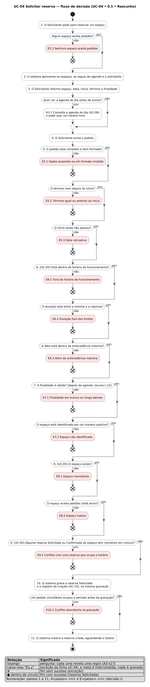

# UC-04 · Solicitar reserva

| Identificação | Responsabilidade | Fonte oficial |
|---|---|---|
| **UC-04 • 0.1 • Rascunho** (ficha completa, formato Cockburn) | Autor: Max Zimmermann dos Reis • Revisor: Matheus Cezar Santos • Aprovador: Eduardo Almeida da Cunha | `docs/fontes/requisitos/casos-de-uso/UC-04-solicitar-reserva.md` |

Ficha do caso de uso UC-04 do [índice](README.md#uc-04), com as subfunções incluídas UC-05 [Verificar disponibilidade do horário](README.md#uc-05) e UC-13 [Registrar no histórico](README.md#uc-13) descritas como passos, e a extensão UC-06 [Consultar agenda do dia](README.md#uc-06) como a alternativa [A3.1](#a3-1). Como ler a numeração: [decisões h e i](README.md#decisao-h) do README da pasta.

## Histórico de revisões

| Versão | Data | Autor | Alteração e referência da aprovação |
|---|---|---|---|
| 0.1 | 04/11/2026 | Max Zimmermann dos Reis | Criação: fluxo principal, alternativas, exceções na ordem real das verificações, garantias, RF cobertos, evidência e fluxo de decisão (REQ-04). Sem aprovação. |

## Sumário

1. [Identificação do caso de uso](#identificação-do-caso-de-uso)
2. [Stakeholders e interesses](#stakeholders-e-interesses)
3. [Fluxo principal](#fluxo-principal)
4. [Alternativas](#alternativas)
5. [Exceções](#exceções)
6. [Fluxo de decisão](#fluxo-de-decisão)
7. [Pós-condições e garantias](#pós-condições-e-garantias)
8. [Regras de negócio](#regras-de-negócio)
9. [RFs cobertos](#rfs-cobertos)
10. [RNFs relacionados](#rnfs-relacionados)
11. [Questões em aberto](#questões-em-aberto)
12. [Anexo — Evidência (complementar)](#anexo--evidência-complementar)

## Identificação do caso de uso

| Campo | Conteúdo |
|---|---|
| **Escopo** | Conecta Campus (o sistema inteiro, caixa-preta). |
| **Nível** | Objetivo do usuário. Inclui duas subfunções (UC-05, UC-13) e é estendido por UC-06. |
| **Ator primário** | [Solicitante](../glossario.md#solicitante). O [Gestor](../glossario.md#gestor) também solicita, por herança, sempre em nome próprio ([decisão c](README.md#decisao-c)). |
| **Atores secundários** | Nenhum ([decisão f](README.md#decisao-f)). |
| **Meta de contexto** | Garantir o uso de um espaço num intervalo de um dia: o pedido fica registrado na situação [Solicitada](../glossario.md#solicitada), ocupando o horário até o Gestor decidir. |
| **Precondições** | O ator é um [usuário autenticado](../glossario.md#usuario-autenticado) com o perfil Solicitante ou Gestor ([UC-02 Autenticar](UC-02-autenticar.md); [decisão d](README.md#decisao-d)). |
| **Disparador** | A pessoa decide usar um espaço esportivo numa data e num horário. |
| **Ponto de extensão** | "antes de enviar o pedido", no [passo 3](#p3) (UC-06, alternativa [A3.1](#a3-1)). |

## Stakeholders e interesses

| Stakeholder | Interesse neste caso de uso |
|---|---|
| **Solicitante** | Pedir sem procurar ninguém; saber, antes de enviar, o que já está ocupado; quando o pedido for recusado, saber qual regra impediu e o que corrigir, sem redigitar o resto; não ter o próprio pedido exposto a outros solicitantes. |
| **Gestor** | Receber só pedidos dentro das regras de uso e sem conflito, para decidir sem conferir o calendário à mão; saber quem pediu (nome e matrícula), para qual finalidade e quando. |
| **Cliente** (instituição) | Nenhum espaço comprometido duas vezes no mesmo período; as regras de uso (funcionamento, duração, antecedência) aplicadas a todos igualmente; o registro de quem pediu e quando, para a rastreabilidade das decisões. |

## Fluxo principal

1. O Solicitante pede para reservar um espaço.
2. O sistema apresenta os espaços que aceitam pedidos (pelo nome e pelo tipo), as [regras de agenda](../glossario.md#regras-de-agenda) vigentes (horário de funcionamento, duração mínima e máxima, data limite) e quem constará como solicitante: o próprio usuário, com nome e matrícula.
3. O Solicitante escolhe o espaço e informa a data, a hora de início, a hora de término e a [finalidade](../glossario.md#finalidade). *(Ponto de extensão "antes de enviar o pedido": [A3.1](#a3-1).)*
4. O Solicitante envia o pedido.
5. O sistema confere que o pedido está completo e bem formado, que o término vem depois do início e que o início ainda não passou.
6. O sistema confere que o pedido respeita as regras de agenda, nesta ordem: horário de funcionamento, duração e antecedência. *(UC-05.)*
7. O sistema confere a finalidade e a identificação do espaço.
8. O sistema confere que o espaço existe e aceita pedidos ([espaço reservável](../glossario.md#espaco-reservavel)). *(UC-05.)*
9. O sistema confere que nenhuma [reserva que ocupa horário](../glossario.md#reserva-que-ocupa-horario) do mesmo espaço tem algum momento em comum com o intervalo pedido (o intervalo é semiaberto: encostar não é conflito). *(UC-05.)*
10. O sistema grava a reserva na situação Solicitada, com o usuário autenticado como solicitante e o momento do pedido, e, na mesma gravação, o [registro de situação](../glossario.md#registro-de-situacao) da criação: sem situação anterior, nova Solicitada, autor = solicitante, momento = o do pedido. *(UC-13.)*
11. O sistema mostra a reserva criada (espaço, data e horário, finalidade, situação Solicitada e solicitante) e informa que o pedido aguarda a decisão do Gestor.

**Subfunções incluídas.** UC-05 *Verificar disponibilidade do horário* = passos [6](#p6), [8](#p8) e [9](#p9): as três condições que dependem das regras de uso e do estado do sistema. UC-13 *Registrar no histórico* = a segunda metade do passo [10](#p10). O passo [7](#p7) fica entre as verificações de UC-05 porque essa é a ordem real do sistema ([lacuna L-12](../requisitos/srs.md#l-12)): a finalidade e a identificação do espaço são conferidas depois das regras de agenda.

**Uma regra por vez.** No passo 5, os dados ausentes ou mal formados são apontados todos de uma vez, cada um junto ao dado correspondente ([E5.1](#e5-1)). Daí em diante, a primeira regra violada interrompe o pedido, na ordem dos passos, e é a única informada.

## Alternativas

A meta ainda é alcançada.

#### A1.1 · Pedir a partir de um espaço já consultado

No passo 1, o Solicitante chega ao pedido a partir de um espaço que consultou em [UC-03 Consultar espaços](fichas-resumidas.md#uc-03). No passo 2, o sistema já traz esse espaço escolhido, se ele aceitar pedidos; se ele não existir ou estiver inativo, o sistema ignora a escolha e o Solicitante escolhe outro. Segue no passo 3.

#### A2.1 · Regras de agenda não puderam ser obtidas

No passo 2, o sistema não consegue apresentar as regras de agenda. O Solicitante segue sem elas: o pedido continua conferido por inteiro nos passos 5 a 9, e uma regra violada aparece como a exceção correspondente. Segue no passo 3.

#### A3.1 · Consultar a agenda do dia antes de enviar (extensão UC-06)

No ponto de extensão "antes de enviar o pedido" do passo 3, com o espaço e a data escolhidos:

1. o Solicitante pede para ver a [agenda do dia](../glossario.md#agenda-do-dia) daquele espaço;
2. o sistema mostra os [horários ocupados](../glossario.md#horario-ocupado) (só início, término e situação, nunca quem reservou nem para quê; [DEC-11](../decisoes/DEC-11.md)) e os [horários livres](../glossario.md#horario-livre) dentro do funcionamento, com pelo menos a duração mínima e, para hoje, a partir do próximo múltiplo de 5 minutos;
3. o Solicitante pode usar um horário livre: o sistema preenche o início com o começo dele e o término com o [término sugerido](../glossario.md#termino-sugerido);
4. segue no passo 3, com o horário que o Solicitante quiser.

Variações: se a data não é reservável (o fechamento daquele dia já passou ou ela passa da data limite), o sistema informa o motivo, não mostra horário livre e mantém os ocupados; se a agenda não puder ser obtida, o sistema informa que o Solicitante ainda pode solicitar normalmente. **A agenda é ajuda, não regra:** o pedido continua conferido por inteiro nos passos 5 a 9. Detalhe e exceções próprias em [UC-06](fichas-resumidas.md#uc-06).

#### A11.1 · Solicitar outra reserva

Depois do passo 11, o Solicitante pede outra reserva. O sistema volta ao passo 3 com o mesmo espaço escolhido e os demais dados em branco.

#### A11.2 · Acompanhar o pedido criado

Depois do passo 11, o Solicitante pede para ver a reserva ou as próprias reservas. O sistema segue em [UC-08 Consultar detalhe da reserva](fichas-resumidas.md#uc-08) ou em [UC-07 Consultar reservas](fichas-resumidas.md#uc-07).

## Exceções

A meta é interrompida: **nenhuma reserva e nenhum registro de histórico são gravados**, e os dados informados continuam com o Solicitante para ele corrigir só o que foi apontado e enviar de novo (volta ao passo 3). A ordem abaixo é a ordem real das verificações: ela decide qual mensagem a pessoa vê primeiro ([evidência da ordem](#evidencia-da-ordem)).

#### E2.1 · Nenhum espaço aceita pedidos

- **Condição:** no passo 2, não há nenhum espaço ativo.
- **Resultado para o ator:** o sistema informa que nenhum espaço está aceitando reservas e indica a consulta de espaços; não há o que escolher.
- **Estado depois:** nada é gravado; os espaços continuam como estavam.
- **Requisito:** [RF-11.3](../requisitos/rf-reservas.md#rf-11-3) (prevenção: o pedido seria recusado no passo 8).

#### E5.1 · Dados ausentes ou em formato inválido

- **Condição:** no passo 5, falta o espaço, a data, a hora de início, a hora de término ou a finalidade, ou um deles não está no formato esperado (data que não existe, hora mal escrita, espaço que não é um número).
- **Resultado para o ator:** o sistema informa "Verifique os dados informados." e, junto a cada dado com problema, o que está errado (por exemplo, que é obrigatório). Todos os dados com problema são apontados de uma vez.
- **Estado depois:** nada é gravado e nenhuma outra regra é conferida; o período continua livre ou ocupado como estava.
- **Requisito:** [RF-11.1](../requisitos/rf-reservas.md#rf-11-1).

#### E5.2 · Término igual ou anterior ao início

- **Condição:** no passo 5, a hora de término é igual ou anterior à de início.
- **Resultado para o ator:** junto ao término, "O horário de término deve ser posterior ao de início."
- **Estado depois:** nada é gravado.
- **Requisito:** [RF-11.1](../requisitos/rf-reservas.md#rf-11-1).

#### E5.3 · Data retroativa

- **Condição:** no passo 5, o início do intervalo pedido é igual ou anterior ao momento do pedido ([data retroativa](../glossario.md#data-retroativa), comparando instantes no [fuso de São Paulo](../glossario.md#fuso-horario)).
- **Resultado para o ator:** junto à data, "Não é possível reservar um horário que já passou."
- **Estado depois:** nada é gravado; o espaço nem é consultado.
- **Requisito:** [RF-11.2](../requisitos/rf-reservas.md#rf-11-2).

#### E6.1 · Fora do horário de funcionamento

- **Condição:** no passo 6, o pedido começa antes da abertura (07:00) ou termina depois do fechamento (22:00). As bordas valem: começar às 07:00 e terminar às 22:00 é aceito.
- **Resultado para o ator:** junto ao início (se começa cedo demais) ou ao término (se termina tarde demais), "Os espaços funcionam das 07:00 às 22:00. Escolha um horário dentro desse período."
- **Estado depois:** nada é gravado.
- **Requisito:** [RF-11.5](../requisitos/rf-reservas.md#rf-11-5).

#### E6.2 · Duração fora dos limites

- **Condição:** no passo 6, dentro do funcionamento, o pedido dura menos que a [duração mínima](../glossario.md#duracao-minima) (30 min) ou mais que a [máxima](../glossario.md#duracao-maxima) (3 h).
- **Resultado para o ator:** junto ao término, "A reserva deve durar entre 30 minutos e 3 horas."
- **Estado depois:** nada é gravado.
- **Requisito:** [RF-11.5](../requisitos/rf-reservas.md#rf-11-5).

#### E6.3 · Além da antecedência máxima

- **Condição:** no passo 6, a data passa da [data limite](../glossario.md#data-limite) (hoje em São Paulo mais 30 dias).
- **Resultado para o ator:** junto à data, "Só é possível reservar com até 30 dias de antecedência (até «data limite»)."
- **Estado depois:** nada é gravado.
- **Requisito:** [RF-11.5](../requisitos/rf-reservas.md#rf-11-5).

#### E7.1 · Finalidade em branco ou longa demais

- **Condição:** no passo 7, a finalidade só tem espaços, ou passa de 200 caracteres depois de tirar os espaços das pontas e os repetidos.
- **Resultado para o ator:** junto à finalidade, 'O campo "Finalidade" é obrigatório.' ou 'O campo "Finalidade" deve ter no máximo 200 caracteres.'
- **Estado depois:** nada é gravado.
- **Requisito:** [RF-11.1](../requisitos/rf-reservas.md#rf-11-1) (ordem divergente do RF-11: [lacuna L-12](../requisitos/srs.md#l-12)).

#### E7.2 · Espaço não identificado

- **Condição:** no passo 7, o espaço informado é um número, mas não positivo (zero ou negativo).
- **Resultado para o ator:** junto ao espaço, "O espaço deve ser informado por um número inteiro positivo."
- **Estado depois:** nada é gravado.
- **Requisito:** [RF-11.1](../requisitos/rf-reservas.md#rf-11-1) ([lacuna L-12](../requisitos/srs.md#l-12)).

#### E8.1 · Espaço inexistente

- **Condição:** no passo 8, não existe espaço com a identificação informada.
- **Resultado para o ator:** "Espaço de código «n» não encontrado." O Solicitante escolhe outro espaço.
- **Estado depois:** nada é gravado.
- **Requisito:** [RF-11.3](../requisitos/rf-reservas.md#rf-11-3).

#### E8.2 · Espaço inativo

- **Condição:** no passo 8, o espaço existe, mas está [inativo](../glossario.md#espaco-inativo) (desativado pelo Gestor).
- **Resultado para o ator:** "Este espaço está inativo e não aceita reservas." O Solicitante escolhe outro espaço.
- **Estado depois:** nada é gravado; as reservas que o espaço já tinha continuam valendo ([DEC-06](../decisoes/DEC-06.md)).
- **Requisito:** [RF-11.3](../requisitos/rf-reservas.md#rf-11-3).

#### E9.1 · Conflito com uma reserva que ocupa o horário

- **Condição:** no passo 9, uma reserva Solicitada ou Confirmada do mesmo espaço tem algum momento em comum com o intervalo pedido. Reservas Recusadas, Canceladas e Concluídas não contam; encostar (uma termina quando a outra começa) não é conflito.
- **Resultado para o ator:** "Este espaço já tem uma reserva «situação» em «data» «início»–«fim». Escolha outro horário." A mensagem cita a de início mais cedo, se houver várias, e **nunca** diz quem a pediu nem para quê. Se a agenda do dia estiver sendo consultada ([A3.1](#a3-1)), ela é atualizada para mostrar o período ocupado.
- **Estado depois:** nada é gravado; a reserva que ocupa o período continua exatamente como estava.
- **Requisito:** [RF-11.4](../requisitos/rf-reservas.md#rf-11-4).

#### E10.1 · Conflito descoberto na gravação, por um pedido simultâneo

- **Condição:** no passo 10, outro pedido para o mesmo espaço, com algum momento em comum, foi gravado depois da conferência do passo 9 deste pedido (dois pedidos quase ao mesmo tempo).
- **Resultado para o ator:** a mesma mensagem de [E9.1](#e9-1), com a data, o horário e a situação do pedido que chegou primeiro.
- **Estado depois:** só o primeiro pedido existe; deste, nem a reserva nem o registro de criação ficam gravados (a gravação é uma só).
- **Requisito:** [RF-11.4](../requisitos/rf-reservas.md#rf-11-4) e [RNF-R01](../requisitos/rnf.md#rnf-r01) (sem teste de duas threads na criação: [lacuna L-07](../requisitos/srs.md#l-07)).

**Fora das exceções:** um pedido de quem não está identificado não chega ao passo 1; é a precondição, tratada em [UC-02 E4.1](UC-02-autenticar.md#e4-1) (sessão expirada). Um solicitante informado no próprio pedido é ignorado: o solicitante é sempre o usuário autenticado ([RNF-F09](../requisitos/rnf.md#rnf-f09)).

## Fluxo de decisão

Cada pergunta revela uma regra e leva à exceção da ficha que a trata (A3·s17). Fonte: [`fluxo-solicitar-reserva.puml`](fluxo-solicitar-reserva.puml) · imagem vetorial: [`fluxo-solicitar-reserva.svg`](fluxo-solicitar-reserva.svg) (gerados pelo comando do [README da pasta](README.md#como-gerar-as-imagens)).

## Pós-condições e garantias

| Campo | Conteúdo |
|---|---|
| **Pós-condições (sucesso)** | Existe uma reserva nova na situação Solicitada, do espaço escolhido, no intervalo pedido, com a finalidade normalizada e o usuário autenticado como solicitante (nome e matrícula copiados no momento do pedido). O intervalo passa a constar como ocupado na agenda do dia e a impedir outro pedido com momento em comum. O histórico da reserva tem exatamente um registro: a criação. As ações disponíveis são as do perfil de quem pediu (o Solicitante pode cancelar; o Gestor pode confirmar, recusar ou cancelar). |
| **Garantia de sucesso** | O pedido aceito respeita todas as regras de uso no momento do pedido e não compromete o espaço duas vezes; o Gestor recebe um pedido que só depende da decisão dele. |
| **Garantia mínima** | Mesmo quando a meta falha: nenhuma reserva nem registro de histórico é gravado pela metade ou fora das regras; nenhuma reserva existente muda; a pessoa fica sabendo qual regra impediu o pedido e o que corrigir; nenhum dado de quem ocupa o período é revelado. |

## Regras de negócio

- [Reserva](../glossario.md#reserva), [solicitante da reserva](../glossario.md#solicitante-da-reserva), [finalidade](../glossario.md#finalidade) (até 200 caracteres, normalizada), [Solicitada](../glossario.md#solicitada).
- [Intervalo de horário](../glossario.md#intervalo-de-horario) semiaberto, [data retroativa](../glossario.md#data-retroativa), [fuso horário](../glossario.md#fuso-horario).
- [Regras de agenda](../glossario.md#regras-de-agenda): [horário de funcionamento](../glossario.md#horario-de-funcionamento), [duração mínima](../glossario.md#duracao-minima), [duração máxima](../glossario.md#duracao-maxima), [antecedência máxima](../glossario.md#antecedencia-maxima), [data limite](../glossario.md#data-limite) — valores da [DEC-07](../decisoes/DEC-07.md), aplicados só a pedidos novos.
- [Espaço reservável](../glossario.md#espaco-reservavel) e [espaço inativo](../glossario.md#espaco-inativo) ([DEC-06](../decisoes/DEC-06.md)).
- [Conflito de horário](../glossario.md#conflito-de-horario) e [reserva que ocupa horário](../glossario.md#reserva-que-ocupa-horario).
- [Histórico](../glossario.md#historico) e [registro de situação](../glossario.md#registro-de-situacao), gravados com a reserva.
- O solicitante é sempre quem está identificado, e o Gestor também pede em nome próprio ([DEC-04](../decisoes/DEC-04.md)).

## RFs cobertos

Todos os RF que a [rastreabilidade RF → UC](README.md#rastreabilidade-rf--uc) atribui a UC-04, às subfunções UC-05 e UC-13 e, para RF-28 a RF-31, à extensão UC-06 (detalhada em [UC-06](fichas-resumidas.md#uc-06)).

| RF | Título | Onde entra nesta ficha |
|---|---|---|
| [RF-11](../requisitos/rf-reservas.md#rf-11) | Solicitar reserva | fluxo principal, [passos 1 a 11](#p1) |
| [RF-11.1](../requisitos/rf-reservas.md#rf-11-1) | Recusar pedido com dados inválidos | [E5.1](#e5-1), [E5.2](#e5-2), [E7.1](#e7-1), [E7.2](#e7-2) |
| [RF-11.2](../requisitos/rf-reservas.md#rf-11-2) | Recusar pedido com data retroativa | [E5.3](#e5-3) |
| [RF-11.3](../requisitos/rf-reservas.md#rf-11-3) | Recusar pedido para espaço que não é reservável | [E8.1](#e8-1), [E8.2](#e8-2) (UC-05); prevenção em [E2.1](#e2-1) |
| [RF-11.4](../requisitos/rf-reservas.md#rf-11-4) | Recusar pedido em conflito de horário | [E9.1](#e9-1), [E10.1](#e10-1) (UC-05) |
| [RF-11.5](../requisitos/rf-reservas.md#rf-11-5) | Recusar pedido fora das regras de agenda | [E6.1](#e6-1), [E6.2](#e6-2), [E6.3](#e6-3) (UC-05) |
| [RF-22](../requisitos/rf-reservas.md#rf-22) | Consultar o histórico da reserva | [passo 10](#p10) (UC-13 grava a criação que UC-09 mostra) |
| [RF-28](../requisitos/rf-agenda.md#rf-28) | Consultar as regras de agenda | [passo 2](#p2); [A2.1](#a2-1) quando não puderem ser obtidas |
| [RF-29](../requisitos/rf-agenda.md#rf-29) | Ver os horários ocupados de um espaço num dia | [A3.1](#a3-1) (UC-06) |
| [RF-30](../requisitos/rf-agenda.md#rf-30) | Ver os horários livres de um espaço num dia | [A3.1](#a3-1) (UC-06) |
| [RF-31](../requisitos/rf-agenda.md#rf-31) | Saber que uma data não é reservável | [A3.1](#a3-1) (UC-06, variação) |

[RF-38](../requisitos/rf-gerais.md#rf-38) (ver o resultado de cada operação) é transversal: vale para o [passo 11](#p11) e para todas as exceções.

## RNFs relacionados

| RNF | Onde pesa nesta ficha |
|---|---|
| [RNF-F04](../requisitos/rnf.md#rnf-f04) · Identificação obrigatória por padrão | precondição |
| [RNF-F06](../requisitos/rnf.md#rnf-f06) · Privacidade das reservas de outras pessoas | [E9.1](#e9-1), [E10.1](#e10-1), [A3.1](#a3-1): conflito e agenda sem dados de quem reservou |
| [RNF-F09](../requisitos/rnf.md#rnf-f09) · Identidade e perfil nunca vêm do pedido | [passo 10](#p10): o solicitante é o usuário autenticado |
| [RNF-U01](../requisitos/rnf.md#rnf-u01) · Mensagens em português que orientam a correção | todas as exceções |
| [RNF-U06](../requisitos/rnf.md#rnf-u06) · Datas e horas no formato brasileiro | [passo 11](#p11), [E6.3](#e6-3), [E9.1](#e9-1) |
| [RNF-R01](../requisitos/rnf.md#rnf-r01) · Nenhum espaço comprometido duas vezes | [passo 9](#p9), [E10.1](#e10-1) |
| [RNF-R02](../requisitos/rnf.md#rnf-r02) · Histórico completo e na mesma gravação | [passo 10](#p10) |
| [RNF-R03](../requisitos/rnf.md#rnf-r03) · Operação recusada não muda nada | garantia mínima |
| [RNF-R06](../requisitos/rnf.md#rnf-r06) · Nenhuma regra violada vira erro interno | todas as exceções |
| [RNF-P02](../requisitos/rnf.md#rnf-p02) · Tempo da agenda do dia | [A3.1](#a3-1) |
| [RNF-S05](../requisitos/rnf.md#rnf-s05) · Horário de Brasília em todo o sistema | [E5.3](#e5-3), [E6.3](#e6-3) |

## Questões em aberto

| DEC | Como afeta este caso de uso |
|---|---|
| [DEC-07](../decisoes/DEC-07.md) · Valores das regras de agenda | Os números de [E6.1](#e6-1) a [E6.3](#e6-3) (07:00–22:00, 30 min a 3 h, 30 dias) mudam se o cliente decidir outros; as mensagens já saem das constantes. |
| [DEC-11](../decisoes/DEC-11.md) · Períodos ocupados por outras pessoas na agenda do dia | Se recusada, [A3.1](#a3-1) deixa de mostrar os ocupados de outras pessoas, e o Solicitante só descobre o conflito em [E9.1](#e9-1). |
| [DEC-06](../decisoes/DEC-06.md) · Reservas de um espaço desativado | Define o estado depois de [E8.2](#e8-2) (as reservas existentes continuam valendo). |
| [DEC-13](../decisoes/DEC-13.md) · Mudança de situação × horário | Uma Solicitada não decidida continua ocupando o horário depois da data e, portanto, entrando em [E9.1](#e9-1); a opção c) mudaria isso. |
| [DEC-04](../decisoes/DEC-04.md) · Autenticação e perfis (decidida) | O Gestor pede em nome próprio; não há pedido em nome de outra pessoa. |

A ordem do passo 7 (finalidade depois das regras de agenda) diverge do texto do RF-11 e está registrada como [lacuna L-12](../requisitos/srs.md#l-12), não como decisão: não muda o que é aceito, só qual mensagem aparece primeiro.

## Anexo — Evidência (complementar)

Ponte para os critérios e testes de aceite (REQ-05 e REQ-06). Testes a partir de `src/backend/`, salvo os do frontend (`src/frontend/src/`); `[x]` = teste parametrizado. Fontes: [`testes_de_reservas.md`](../../testes_de_reservas.md) e as fichas [rf-reservas](../requisitos/rf-reservas.md) e [rf-agenda](../requisitos/rf-agenda.md).

| Item | Testes que o comprovam |
|---|---|
| [Fluxo principal](#p1) | `reservas/tests/test_api_reservas.py::test_solicitacao_valida_responde_201_com_a_reserva`, `::test_token_jwt_do_login_autoriza_solicitacao`; `reservas/tests/test_criar_reserva.py::test_solicitacao_valida_e_salva_como_solicitada`; `reservas/tests/test_reserva.py::test_solicitar_cria_reserva_solicitada_com_criada_em_igual_a_agora`; `reservas/tests/test_api_permissoes.py::test_gestor_tambem_solicita_reserva`, `::test_resposta_da_solicitacao_traz_as_acoes_de_quem_solicitou`; `pages/PaginaNovaReserva.test.tsx` |
| [Passo 2](#p2) (regras de agenda) | `reservas/tests/test_api_regras_de_agenda.py::test_regras_de_agenda_sem_login_respondem_200_com_as_constantes_do_dominio`; `components/reservas/dicaDaAgenda.test.ts` |
| [Passo 10](#p10) (UC-13) | `reservas/tests/test_reserva.py::test_solicitar_gera_o_registro_de_criacao_pendente`; `reservas/tests/test_repositorio_reservas.py::test_conflito_ao_salvar_nao_grava_registro_e_mantem_os_pendentes`; `reservas/tests/test_api_historico.py::test_fluxo_completo_aparece_no_historico_em_ordem` |
| Solicitante vem da identificação | `reservas/tests/test_api_reservas.py::test_solicitante_enviado_no_corpo_e_ignorado` |
| [A3.1](#a3-1) (UC-06) | `reservas/tests/test_api_ocupacao_do_dia.py::test_solicitante_ve_a_reserva_de_outra_pessoa_sem_nenhum_dado_pessoal`, `::test_livres_sao_coerentes_com_os_ocupados`, `::test_ontem_nao_e_reservavel_e_traz_a_mensagem_do_dominio`; `reservas/tests/test_propriedades_da_agenda.py::test_agenda_mostra_livre_exatamente_o_que_o_backend_aceitaria`; `components/reservas/AgendaDoDia.test.tsx` |
| [E5.1](#e5-1) | `reservas/tests/test_api_reservas.py::test_campos_ausentes_respondem_400_com_cada_campo`, `::test_dado_invalido_responde_400_sem_salvar [data-inexistente]` |
| [E5.2](#e5-2) | `reservas/tests/test_intervalo_de_horario.py::test_fim_igual_ou_antes_do_inicio_e_recusado [x]`; `reservas/tests/test_criar_reserva.py::test_fim_igual_ou_antes_do_inicio_lanca_horario_invalido [x]`; `reservas/tests/test_api_reservas.py::test_dado_invalido_responde_400_sem_salvar [fim-antes-do-inicio]` |
| [E5.3](#e5-3) | `reservas/tests/test_reserva.py::test_solicitar_com_inicio_igual_a_agora_e_recusado`, `::test_solicitar_um_minuto_depois_de_agora_e_aceito`, `::test_solicitar_para_ontem_e_recusado`; `reservas/tests/test_criar_reserva.py::test_horario_no_passado_lanca_data_retroativa_antes_de_consultar_o_espaco`; `reservas/tests/test_api_reservas.py::test_dado_invalido_responde_400_sem_salvar [data-retroativa]` |
| [E6.1](#e6-1) | `reservas/tests/test_regras_de_agenda.py::test_horario_nas_bordas_do_funcionamento_e_aceito [x]`, `::test_horario_fora_do_funcionamento_e_recusado_no_campo_certo [x]`; `reservas/tests/test_api_reservas.py::test_dado_invalido_responde_400_sem_salvar [antes-da-abertura]` |
| [E6.2](#e6-2) | `reservas/tests/test_regras_de_agenda.py::test_duracao_nas_bordas_e_aceita [x]`, `::test_duracao_fora_dos_limites_e_recusada_no_termino [x]`; `reservas/tests/test_api_reservas.py::test_dado_invalido_responde_400_sem_salvar [duracao-acima-da-maxima]` |
| [E6.3](#e6-3) | `reservas/tests/test_regras_de_agenda.py::test_data_no_limite_da_antecedencia_e_aceita`, `::test_data_alem_da_antecedencia_e_recusada_com_a_data_limite`, `::test_data_limite_conta_hoje_no_fuso_de_sao_paulo`; `reservas/tests/test_api_reservas.py::test_dado_invalido_responde_400_sem_salvar [alem-da-antecedencia]` |
| [E7.1](#e7-1) | `reservas/tests/test_reserva.py::test_finalidade_vazia_e_recusada [x]`, `::test_finalidade_no_limite_e_aceita`, `::test_finalidade_acima_do_limite_e_recusada`; `reservas/tests/test_api_reservas.py::test_dado_invalido_responde_400_sem_salvar [sem-finalidade]` |
| [E7.2](#e7-2) | `reservas/tests/test_reserva.py::test_espaco_id_vazio_e_recusado_como_obrigatorio`, `::test_espaco_id_que_nao_e_inteiro_positivo_e_recusado [x]` |
| [E8.1](#e8-1), [E8.2](#e8-2) | `reservas/tests/test_api_reservas.py::test_espaco_inexistente_responde_404`; `espacos/tests/test_api_desativacao_e_reservas.py::test_espaco_desativado_recusa_nova_reserva_com_409`; `reservas/tests/test_criar_reserva.py::test_espaco_indisponivel_propaga_o_erro_sem_salvar [x]` |
| [E2.1](#e2-1) | `pages/PaginaNovaReserva.test.tsx` ("sem espaços ativos, mostra o estado vazio com um link para os espaços") |
| [A1.1](#a1-1) | `pages/PaginaNovaReserva.test.tsx` ("pré-seleciona o espaço ativo informado em ?espaco=", "ignora ?espaco= de um espaço inexistente ou inativo") |
| [A11.1](#a11-1) | `pages/PaginaNovaReserva.test.tsx` ("com sucesso, mostra o toast e o resumo; …volta ao formulário com o espaço mantido") |
| [E9.1](#e9-1) | `reservas/tests/test_api_reservas.py::test_horario_ocupado_responde_409_e_preserva_as_reservas`; `reservas/tests/test_conflito_de_horario.py::test_sobreposicao_com_reserva_que_ocupa_horario_e_conflito [x]`, `::test_sobreposicao_com_reserva_que_nao_ocupa_horario_e_aceita [x]`, `::test_horario_encostado_e_aceito [x]`, `::test_mesmo_horario_em_outro_espaco_e_aceito`, `::test_varias_em_conflito_a_mensagem_cita_a_de_inicio_mais_cedo`, `::test_mensagem_mostra_horario_e_situacao_sem_dados_do_outro_solicitante`; `reservas/tests/test_criar_reserva.py::test_horario_ocupado_lanca_conflito_sem_salvar [x]`; `exemplos/tests/test_carregar_dados_exemplo.py::test_horario_de_conflito_documentado_responde_409` |
| [E10.1](#e10-1) | `reservas/tests/test_repositorio_reservas.py::test_banco_barra_sobreposicao_que_escapou_da_checagem_em_codigo`, `::test_conflito_barrado_pelo_banco_nao_grava_registro` |

**Ordem das exceções.** A ordem 5 → 6 → 8 → 9 está fixada por `reservas/tests/test_reserva.py::test_data_retroativa_e_checada_antes_do_horario_de_funcionamento`, `::test_horario_de_funcionamento_e_checado_antes_da_duracao`, `::test_duracao_e_checada_antes_da_antecedencia`; `reservas/tests/test_propriedades_da_agenda.py::test_solicitar_aceita_so_o_que_respeita_as_regras_e_recusa_pela_primeira_violada`; e `reservas/tests/test_criar_reserva.py::test_horario_no_passado_lanca_data_retroativa_antes_de_consultar_o_espaco`. A posição do passo 7 vem do código (`Reserva.solicitar` aplica as regras de agenda antes de chamar o construtor, que confere `espaco_id` e a finalidade) e não tem teste que a fixe ([L-12](../requisitos/srs.md#l-12)).
