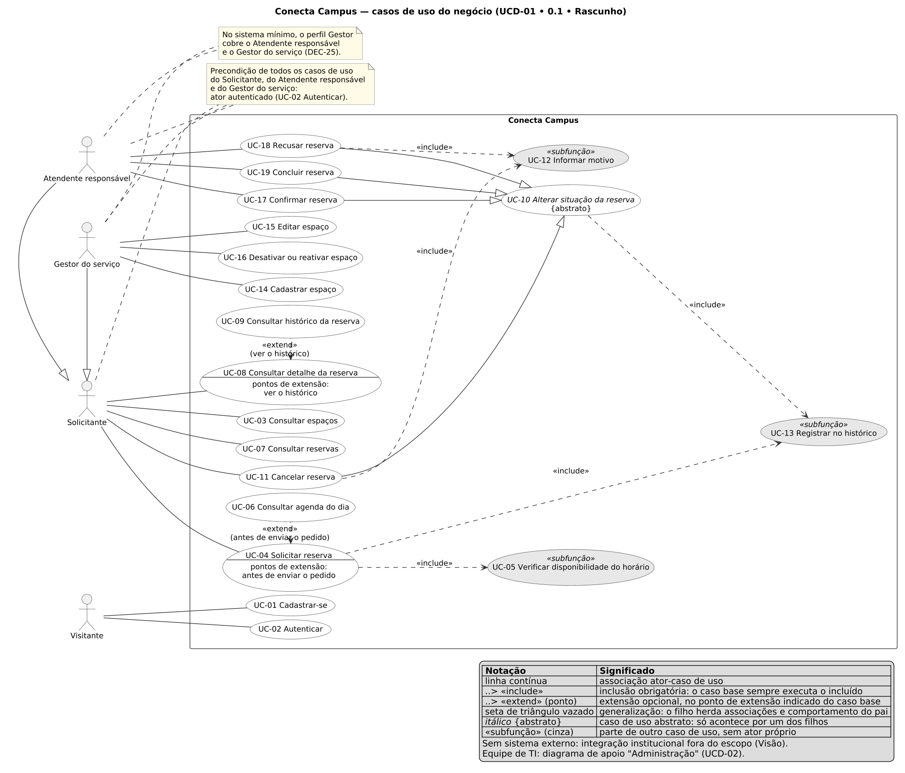

# Conecta Campus: Especificação de Requisitos

| Identificação | Responsabilidade |
|---|---|
| **RS-GRUPO03 • 0.1 • Rascunho** | Autor: Max Zimmermann dos Reis • Revisor: Matheus Cezar Santos • Aprovador: Eduardo Almeida da Cunha |

Recorte: reserva de quadras e espaços esportivos

Requisitos de Software, semestre 2026/2

Professor Luis Antonio Leite Francisco da Costa, Unilasalle RS

Grupo 03

Turma: [PENDENTE: preencher a turma]

Integrantes: Max Zimmermann dos Reis; Matheus Cezar Santos; Eduardo Almeida da Cunha [PENDENTE: confirmar os nomes completos de todos os integrantes; os três nomes vêm do cabeçalho dos documentos da fonte]

Data: 13/11/2026

<div style="page-break-after: always;"></div>

## 1. Contexto e problema

Na comunidade acadêmica, o uso das quadras e dos demais espaços esportivos é combinado de maneira informal, por conversa, mensagem ou anotação de quem cuida do espaço. Quem quer usar um espaço não sabe, antes de pedir, quais períodos já estão comprometidos, e dois grupos podem combinar o mesmo espaço no mesmo horário e só descobrir o choque na hora do uso. Depois que o uso é combinado, não fica registrado quem pediu, quem aprovou, quando, nem por que um pedido foi negado ou desfeito.

O problema atinge três públicos. Alunos e servidores que pedem espaços perdem tempo procurando quem decide, não sabem se o pedido foi aceito e podem chegar a um espaço ocupado ou fechado. Quem administra os espaços decide sem ver o conjunto dos pedidos, resolve conflitos depois que eles acontecem e não tem como mostrar o que decidiu. A instituição não sabe como os espaços são usados e não consegue explicar uma decisão contestada. O resultado são choques de uso, pedidos sem resposta, decisões que dependem da memória de uma pessoa e nenhuma evidência para resolver uma reclamação.

O levantamento confirmou esse quadro: entre os respondentes do questionário, a prática mais comum é ir até o local e ver se está livre ou combinar por mensagem ou telefone, e 14 de 18 já chegaram a um espaço ocupado ou fechado ao menos uma vez em três meses. O Atendente descreve anotação em papel, resposta em um a três dias e a pergunta que mais se repete: quais horários estão livres.

A solução proposta, o Conecta Campus, registra cada pedido de uso de um espaço num período, impede que um espaço seja comprometido duas vezes no mesmo período e registra cada decisão sobre o pedido, com autor, momento e motivo. Ela justifica-se porque troca mensagens, planilhas e formulários isolados por um registro único, consultável por quem pede e por quem decide, no recorte escolhido de reserva de quadras e espaços esportivos.

## 2. Objetivo e escopo

O objetivo geral é permitir que a comunidade acadêmica solicite o uso de espaços esportivos e acompanhe a situação de cada pedido, e que quem atende decida cada pedido com registro, sem que um espaço seja comprometido com dois usos que tenham algum momento em comum.

Dentro do escopo estão o cadastro dos espaços esportivos, com consulta, edição, desativação e reativação; o pedido de reserva de um espaço num intervalo de um dia, com finalidade; a consulta dos pedidos por espaço, situação, data e solicitante, sozinhos ou combinados; a mudança da situação do pedido entre Solicitada, Confirmada, Recusada, Cancelada e Concluída, só pelas transições permitidas; a recusa de operações inválidas sem alterar nada; a mensagem de resultado de cada operação; a identificação por e-mail e senha com perfis de acesso; o histórico de cada reserva; as regras de agenda de cada espaço; a agenda do dia, sem dados pessoais; e os dados de exemplo para demonstração.

Estão explicitamente fora do escopo o pagamento ou a cobrança pelo uso, a integração com sistemas da instituição, as notificações por e-mail, SMS ou aplicativo, as reservas recorrentes, o empréstimo de material esportivo, a lista de espera, o limite de pedidos por pessoa, o bloqueio de períodos para manutenção ou eventos, as regras diferentes por dia da semana ou em feriados, a alteração de data, horário ou espaço de um pedido já feito, a exclusão de reservas ou espaços, a recuperação de senha, o controle de presença, os relatórios, o aplicativo de celular e a publicação na internet.

O grupo trabalha com premissas, que valem até serem confirmadas. Não há cliente real nomeado: o grupo representa a instituição e o professor é a referência para as dúvidas de regra (P-01). Solicitantes e gestores têm e-mail e matrícula (P-02), todos os horários são de Brasília (P-03), um pedido é de um espaço, num único dia, num intervalo contínuo (P-05), os usuários com perfil de gestão são criados pela equipe de TI e nunca pelo cadastro público (P-06), e o acesso é por navegador, em português (P-07). A premissa de regras de agenda iguais para todos os espaços (P-04) deixou de valer no que toca ao horário de funcionamento, que passou a ser por espaço.

As decisões de escopo registradas são, em essência, três. Desativar um espaço bloqueia novos pedidos e preserva as reservas que ele já tinha (DEC-06). A necessidade de ser avisado quando a situação de um pedido muda, surgida no levantamento, fica fora desta versão (DEC-24). E o sistema mínimo tem um perfil de gestão que cobre os papéis de Atendente responsável e de Gestor do serviço (DEC-25).

## 3. Stakeholders e papéis

O Solicitante é o aluno ou servidor, com matrícula, que pede o uso de espaços em nome próprio. Seu interesse é pedir sem procurar ninguém, saber antes de pedir o que já está ocupado, acompanhar a situação do próprio pedido, inclusive o motivo de uma recusa ou de um cancelamento, desistir quando precisar e não ter os próprios pedidos expostos a outros solicitantes. Ele usa o sistema e é ator dos casos de uso.

O Atendente responsável é o servidor do setor que opera os espaços no dia a dia. Ele acompanha todos os pedidos, confirma, recusa, conclui ou cancela cada um, precisa decidir sem conflito de horário, justificar recusas e cancelamentos e desfazer o que foi combinado quando necessário. É usuário e ator do sistema, e aplica as regras de uso, mas quem as define é a instituição.

O Gestor do serviço é a pessoa do setor que mantém o cadastro dos espaços, isto é, cadastra, corrige, desativa e reativa, e mantém no sistema as regras de uso definidas pela instituição. Seu interesse é que a lista de espaços corresponda à realidade e que retirar um espaço de uso não faça perder o que já foi combinado.

A instituição é o cliente. Ela patrocina o sistema, aprova o escopo e define as regras de uso, mas não o opera. Interessam a ela espaços sem conflito de horário, decisões rastreáveis, o registro de quem pediu e de quem decidiu e um custo de operação baixo. O Visitante é a pessoa ainda não identificada, que só pode se cadastrar, entrar e consultar o vocabulário público, como os tipos de espaço, as situações e as regras de agenda. A equipe de TI instala o sistema, cria os usuários de gestão e carrega os dados de exemplo; é stakeholder, mas não ator dos casos de uso do negócio.

No sistema mínimo, um perfil só, o Gestor, cobre os papéis de Atendente responsável e de Gestor do serviço (DEC-25). Por isso os requisitos que tratam de decidir sobre reservas ou de manter espaços falam em Gestor, o perfil, e os casos de uso falam no papel que o exerce. O Atendente responsável e o Gestor do serviço herdam tudo o que o Solicitante faz.

## 4. Levantamento

Aplicamos duas técnicas: a entrevista semiestruturada e o questionário anônimo. A entrevista seguiu um roteiro por papel, o ROT-01 para o representante do cliente, o ROT-02 para o Solicitante e o ROT-03 para o Atendente responsável, e foi conduzida por um integrante do grupo. Participaram quatro entrevistados em três papéis: um representante do cliente, dois Solicitantes, um estudante de graduação que usa as quadras toda semana e um servidor que usa o ginásio de vez em quando, e um Atendente responsável, servidor do setor há mais de um ano. A entrevista com o representante do cliente (ENT-01) foi presencial, na Aula 7, em 06/11/2026, com o professor no papel de representante da instituição, conforme a premissa P-01. As outras três (ENT-02 a ENT-04) foram simuladas, sem encontro com pessoa real, o que o enunciado admite para a interação com ao menos dois representantes de stakeholders. O questionário (QST-01, com 11 perguntas, nove obrigatórias) reúne 18 respostas de Solicitantes, 13 de estudantes de graduação, três de pós-graduação, um servidor técnico-administrativo e um docente. Essas respostas também foram simuladas em 09/11/2026, sem período de campo; os números a seguir descrevem esses dados simulados e não devem ser lidos como medida de pessoas reais. Nenhum dado pessoal foi coletado, e os instrumentos e registros sintéticos seguem no arquivo de evidências.

As entrevistas mostraram que o representante do cliente definiu as regras que mudaram na Aula 7 e confirmou as demais opções adotadas; que os Solicitantes descrevem um pedido informal, por mensagem, telefone ou indo até o local, com resposta em dias e sem saber o que está livre; e que o Atendente anota em papel e recebe sempre a mesma pergunta, quais horários estão livres. No questionário, 12 de 18 vão até o local e veem, 9 de 18 combinam por mensagem ou telefone e apenas 2 de 18 pedem por e-mail ou formulário; 14 de 18 chegaram a um espaço ocupado ou fechado ao menos uma vez em três meses; saber se o pedido foi aceito foi a informação mais marcada, por 12 de 18; o uso típico dura de 30 minutos a 1 hora para 10 de 18, e ninguém marcou mais de 2 horas; o uso à noite é comum, com 7 de 18 depois das 22 horas; e 9 de 18 não comunicam a desistência.

Os achados levaram a decisões. A entrevista da Aula 7 mudou quatro regras, que o grupo aplicou na especificação: concluir só a partir do término e recusar ou cancelar só antes do início (DEC-13), registrar no histórico as tentativas recusadas (DEC-05), funcionamento das 07:00 às 00:00 por espaço com duração sugerida de 1 hora (DEC-07) e matrícula só com dígitos (DEC-09). O questionário reforçou a DEC-07 e a DEC-11 e fez surgir uma necessidade nova, ser avisado quando a situação do pedido muda, que o grupo decidiu deixar fora desta versão (DEC-24), por exigir um canal de aviso hoje fora do escopo. Aulas e eventos da instituição que ocupam o espaço, não comparecimento e material esportivo ficaram fora do escopo. Sem base para concluir ficaram os usos acima de 3 horas, que só uma fonte descreve, e o perfil de servidores e docentes, que somam 2 de 18. As limitações são a amostra por conveniência, a ausência de pessoas reais no questionário e nas três entrevistas simuladas e o cliente sem nome.

## 5. Requisitos funcionais

Os requisitos funcionais descrevem o que o sistema faz, cada um com um identificador estável e uma obrigação verificável. Os identificadores do documento têm a forma RF01, RF02 e assim por diante, derivados dos da fonte oficial por uma regra única, descrita no Anexo A, em que o requisito de uma recusa específica mantém o ponto do requisito de origem, como RF11.4. A coluna de referência cruzada traz o caso de uso e as histórias de usuário de que o requisito se origina; RF38 é transversal, pois vale para todos os casos de uso. A prioridade é Normal, Esperado ou Fascinante, conforme o que o cliente espera do sistema.

| ID | Descrição | Prioridade | UC · US |
|---|---|---|---|
| RF01 | O sistema deve permitir ao usuário autenticado listar os espaços esportivos e ver, de cada um, o nome, o tipo, a capacidade e se está ativo, ordenados pelo nome, com a quantidade encontrada. | Normal | UC-03 · US-04 |
| RF02 | O sistema deve permitir ao usuário autenticado filtrar a lista de espaços por tipo de espaço, por "somente ativos" ou pelos dois juntos, e ver só os espaços que atendem a todos os critérios informados. | Esperado | UC-03 · US-04 |
| RF02.1 | O sistema deve impedir que o usuário autenticado filtre a lista de espaços por um tipo fora da lista de tipos de espaço e informar, no critério tipo, que o valor não é aceito. | Esperado | UC-03 · US-04 |
| RF03 | O sistema deve permitir ao usuário autenticado escolher um espaço esportivo e ver o nome, o tipo, a capacidade e se ele está ativo. | Normal | UC-03 · US-04 |
| RF04 | O sistema deve permitir ao visitante consultar os tipos de espaço e ver o nome de cada um, na ordem da lista fechada de cinco tipos. | Esperado | UC-03 · US-04, US-05, US-06 |
| RF05 | O sistema deve permitir ao Gestor cadastrar um espaço esportivo com nome, tipo, capacidade e horário de funcionamento (padrão: 07:00 às 00:00) e ver o espaço cadastrado, ativo, na lista de espaços. | Normal | UC-14 · US-05 |
| RF05.1 | O sistema deve impedir que o Gestor cadastre um espaço sem nome, com nome de mais de 100 caracteres, sem tipo, com tipo fora da lista ou com capacidade que não seja um número inteiro de pelo menos 1, sem gravar nada, e informar a regra violada no campo correspondente. | Normal | UC-14 · US-05 |
| RF05.2 | O sistema deve impedir que o Gestor cadastre um espaço com o nome de outro espaço já cadastrado, sem diferenciar maiúsculas de minúsculas e depois de tirar os espaços repetidos, sem gravar nada, e informar no campo nome que o nome já existe. | Esperado | UC-14 · US-05, US-06 |
| RF06 | O sistema deve permitir ao Gestor alterar o nome, o tipo, a capacidade ou o horário de funcionamento de um espaço, em qualquer combinação, e ver o espaço com os valores novos e os não informados mantidos. | Esperado | UC-15 · US-06 |
| RF06.1 | O sistema deve impedir que o Gestor envie uma edição de espaço sem nome, tipo nem capacidade e informar que é preciso informar ao menos um campo para alterar. | Esperado | UC-15 · US-06 |
| RF06.2 | O sistema deve impedir que o Gestor altere um espaço para um valor que o cadastro recusaria (RF05.1) ou para o nome de outro espaço (RF05.2), sem alterar nenhum campo do espaço, e informar a regra violada no campo correspondente. | Esperado | UC-15 · US-06 |
| RF07 | O sistema deve permitir ao Gestor desativar um espaço ativo e ver o espaço como inativo, sem aceitar novas reservas, enquanto as reservas que ele já tinha continuam com a mesma situação. | Esperado | UC-16 · US-07 |
| RF07.1 | O sistema deve impedir que o Gestor desative um espaço que já está inativo, sem alterar o espaço, e informar que ele já está inativo. | Esperado | UC-16 · US-07 |
| RF08 | O sistema deve permitir ao Gestor reativar um espaço inativo e ver o espaço como ativo, aceitando novas reservas de novo. | Esperado | UC-16 · US-07 |
| RF08.1 | O sistema deve impedir que o Gestor reative um espaço que já está ativo, sem alterar o espaço, e informar que ele já está ativo. | Esperado | UC-16 · US-07 |
| RF09 | O sistema deve impedir que o usuário autenticado consulte, edite, desative ou reative um espaço que não existe, sem alterar nenhum espaço, e informar que o espaço não foi encontrado. | Normal | UC-03 · US-04, US-06, US-07 |
| RF10 | O sistema deve impedir que o Solicitante cadastre, edite, desative ou reative um espaço, sem alterar nenhum espaço, e informar que ele não tem permissão para a ação. | Esperado | UC-14 · US-04, US-05, US-06, US-07 |
| RF11 | O sistema deve permitir ao usuário autenticado solicitar, em nome próprio, a reserva de um espaço para uma data, uma hora de início, uma hora de término e uma finalidade e ver a reserva criada na situação Solicitada, com o próprio nome e matrícula como solicitante. | Normal | UC-04 · US-08 |
| RF11.1 | O sistema deve impedir que o usuário autenticado solicite uma reserva sem espaço, data, hora de início, hora de término ou finalidade, com finalidade de mais de 200 caracteres ou com o término igual ou anterior ao início, sem gravar nada, e informar a regra violada no campo correspondente. | Normal | UC-04 · US-08 |
| RF11.2 | O sistema deve impedir que o usuário autenticado solicite uma reserva cujo início seja igual ou anterior ao momento do pedido, sem gravar nada, e informar no campo data que não é possível reservar um horário que já passou. | Esperado | UC-04 · US-08 |
| RF11.3 | O sistema deve impedir que o usuário autenticado solicite uma reserva num espaço que não existe ou que está inativo, sem gravar nada, e informar qual dos dois casos impediu o pedido. | Normal | UC-05 · US-08 |
| RF11.4 | O sistema deve impedir que o usuário autenticado solicite uma reserva que tenha algum momento em comum com uma reserva Solicitada ou Confirmada do mesmo espaço, sem gravar nada, e informar a data, o horário e a situação da reserva que ocupa o período, sem dizer quem a pediu. | Normal | UC-05 · US-08 |
| RF11.5 | O sistema deve impedir que o usuário autenticado solicite uma reserva que comece antes da abertura ou termine depois do fechamento do espaço pedido (padrão: 07:00 às 00:00, com o término à meia-noite como fim do dia da reserva), que dure menos de 30 minutos ou mais de 3 horas, ou cuja data passe da data limite (hoje mais 30 dias), sem gravar nada, e informar no campo correspondente a primeira regra violada, nesta ordem: funcionamento, duração, antecedência. | Esperado | UC-05 · US-08 |
| RF12 | O sistema deve permitir ao Gestor consultar as reservas por espaço, situação, data, solicitante (trecho do nome ou da matrícula) e "somente as minhas", sozinhos ou combinados, e ver só as reservas que atendem a todos os critérios informados, ordenadas pelo início, com a quantidade encontrada (em páginas: RF12.2). | Normal | UC-07 · US-10, US-11 |
| RF12.1 | O sistema deve impedir que o usuário autenticado consulte reservas com uma situação fora da lista, uma data que não existe, um espaço que não seja um número, uma página que não seja um número inteiro a partir de 1 ou um tamanho de página fora de 1 a 100, e informar o critério com problema. | Esperado | UC-07 · US-10, US-11 |
| RF12.2 | O sistema deve permitir ao usuário autenticado ver o resultado da consulta de reservas em páginas de até 20 reservas, mantendo a ordem pelo início, e informar o total encontrado, a página atual e o número de páginas; as páginas juntas trazem cada reserva uma vez só, e uma página além da última vem sem reservas, com o total. | Esperado | UC-07 · US-10, US-11 |
| RF13 | O sistema deve permitir ao Solicitante consultar as próprias reservas por espaço, situação e data, sozinhos ou combinados, e ver só as reservas que ele pediu e que atendem aos critérios, com a situação e o motivo de cada uma. | Normal | UC-07 · US-10, US-11 |
| RF14 | O sistema deve permitir ao usuário autenticado consultar uma reserva que ele pode ver e ver o espaço, a data e o horário, o solicitante com a matrícula, o momento do pedido, a finalidade, a situação com o motivo e as ações disponíveis para ele. | Normal | UC-08 · US-12 |
| RF15 | O sistema deve permitir ao visitante consultar as situações de reserva e ver o nome de cada uma, na ordem do ciclo de vida (Solicitada, Confirmada, Recusada, Cancelada, Concluída). | Esperado | UC-07 · US-10, US-11 |
| RF16 | O sistema deve permitir ao usuário autenticado ver, em cada reserva que ele pode ver, as mudanças de situação que o perfil dele pode executar a partir da situação atual e do momento da consulta (concluir só a partir do término; recusar e cancelar, pelo Gestor, só antes do início), com a indicação das que exigem motivo, e nenhuma numa situação final. | Esperado | UC-07 · US-10, US-11, US-12, US-13, US-14, US-16 |
| RF17 | O sistema deve permitir ao Gestor confirmar uma reserva Solicitada, com motivo opcional, e ver a reserva na situação Confirmada, ainda ocupando o horário. | Normal | UC-17 · US-14 |
| RF18 | O sistema deve permitir ao Gestor recusar uma reserva Solicitada cujo início ainda não chegou, informando um motivo de até 300 caracteres e ver a reserva na situação Recusada, com o motivo, sem ocupar mais o horário. | Normal | UC-18 · US-15 |
| RF19 | O sistema deve permitir ao Gestor concluir uma reserva Confirmada cujo término já chegou, com motivo opcional, e ver a reserva na situação Concluída, sem nenhuma ação disponível depois disso. | Normal | UC-19 · US-16 |
| RF20 | O sistema deve permitir ao Gestor cancelar uma reserva Solicitada ou Confirmada cujo início ainda não chegou, informando um motivo de até 300 caracteres e ver a reserva na situação Cancelada, com o motivo, sem ocupar mais o horário. | Normal | UC-11 · US-07, US-13, US-20 |
| RF21 | O sistema deve permitir ao Solicitante cancelar uma reserva própria Solicitada ou Confirmada informando um motivo de até 300 caracteres e ver a reserva na situação Cancelada, com o motivo, sem ocupar mais o horário. | Esperado | UC-11 · US-13 |
| RF22 | O sistema deve permitir ao usuário autenticado consultar o histórico de uma reserva que ele pode ver e ver, em ordem cronológica, a criação, cada mudança de situação aceita e cada tentativa recusada de mudar a situação, com data e hora, nome do autor, situação anterior e nova (ou a pedida, na tentativa), motivo e, na tentativa, o resultado e o código do erro. | Normal | UC-09 · US-08, US-12, US-13, US-14, US-15, US-16, US-20 |
| RF23 | O sistema deve impedir que o usuário autenticado consulte, consulte o histórico ou mude a situação de uma reserva que não existe ou, no caso do Solicitante, que é de outra pessoa, sem alterar nada, e informar que a reserva não foi encontrada, com a mesma resposta nos dois casos. | Normal | UC-08 · US-10, US-11, US-12, US-13, US-14 |
| RF24 | O sistema deve impedir que o usuário autenticado leve uma reserva a uma situação que a tabela de transições não permite a partir da situação atual, sem alterar a situação nem o motivo da reserva (a tentativa recusada fica no histórico, RF22), e informar a situação atual e a pedida. | Normal | UC-10 · US-13, US-14, US-15, US-16, US-20 |
| RF24.1 | O sistema deve impedir que o Gestor conclua uma reserva antes do término dela ou a recuse ou cancele a partir do início dela, sem mudar a reserva, e informar a partir de quando é possível concluir ou que recusar e cancelar só valem antes do início. | Normal | UC-10 · US-15, US-16, US-20 |
| RF25 | O sistema deve impedir que o usuário autenticado peça a mudança de situação de uma reserva sem informar a situação nova ou com uma situação fora da lista, sem alterar a reserva, e informar no campo situação que ela é obrigatória ou, para um valor desconhecido, quais situações são aceitas. | Normal | UC-10 · US-14 |
| RF26 | O sistema deve impedir que o usuário autenticado recuse ou cancele uma reserva sem motivo, com motivo só de espaços ou com motivo de mais de 300 caracteres, sem alterar a situação nem o motivo da reserva (a tentativa recusada fica no histórico, RF22), e informar a regra violada no campo motivo. | Esperado | UC-12 · US-13, US-15 |
| RF27 | O sistema deve impedir que o Solicitante confirme, recuse ou conclua uma reserva própria, sem alterar a situação nem o motivo da reserva (a tentativa recusada fica no histórico, RF22), e informar que só o Gestor pode fazer essa ação, sem revelar se a transição seria permitida. | Esperado | UC-10 · US-14, US-15, US-16 |
| RF28 | O sistema deve permitir ao visitante consultar as regras de agenda e ver o horário de abertura e de fechamento de cada espaço, a duração sugerida (1 hora), a duração mínima e máxima de uma reserva, a antecedência máxima em dias e a data limite para reservar a partir de hoje. | Fascinante | UC-04 · US-08, US-09 |
| RF29 | O sistema deve permitir ao usuário autenticado escolher um espaço e uma data e ver os horários ocupados por reservas Solicitadas ou Confirmadas desse espaço nesse dia, em ordem de início, cada um só com início, término e situação, com a quantidade de horários ocupados. | Fascinante | UC-06 · US-09 |
| RF29.1 | O sistema deve impedir que o usuário autenticado consulte a agenda do dia sem informar o espaço ou sem informar a data e informar o critério que falta. | Esperado | UC-06 · US-09 |
| RF29.2 | O sistema deve impedir que o usuário autenticado consulte a agenda do dia de um espaço que não existe ou está inativo e informar qual dos dois casos impediu a consulta, com as mesmas mensagens do pedido de reserva. | Esperado | UC-06 · US-09 |
| RF30 | O sistema deve permitir ao usuário autenticado ver, na agenda do dia de um espaço, os horários livres dentro do funcionamento do espaço, cada um com pelo menos 30 minutos e, para hoje, começando no próximo múltiplo de 5 minutos depois do momento da consulta, e usar um deles para preencher o início e o término do pedido. | Fascinante | UC-06 · US-09 |
| RF31 | O sistema deve permitir ao usuário autenticado consultar a agenda do dia de uma data que não é reservável (o fechamento daquele dia já passou ou a data passa da data limite) e ver o motivo, sem nenhum horário livre, com os horários ocupados mantidos. | Esperado | UC-06 · US-09 |
| RF32 | O sistema deve permitir ao visitante cadastrar-se com nome, matrícula, e-mail e senha e entrar no sistema identificado com o perfil Solicitante. | Esperado | UC-01 · US-01, US-02 |
| RF32.1 | O sistema deve impedir que o visitante se cadastre sem nome, matrícula, e-mail ou senha, com nome de mais de 150 caracteres, com matrícula que não seja formada só por dígitos ou de mais de 20 caracteres (limite técnico), ou com e-mail em formato inválido, sem criar a conta, e informar a regra violada no campo correspondente. | Esperado | UC-01 · US-01 |
| RF32.2 | O sistema deve impedir que o visitante se cadastre com uma senha que a política de senha recusa (RNF02), sem criar a conta, e informar no campo senha cada motivo da recusa. | Esperado | UC-01 · US-01 |
| RF32.3 | O sistema deve impedir que o visitante se cadastre com um e-mail (sem diferenciar maiúsculas de minúsculas) ou uma matrícula que já pertencem a outro usuário, sem criar a conta, e informar no campo correspondente que o valor já está cadastrado. | Esperado | UC-01 · US-01 |
| RF33 | O sistema deve permitir ao visitante cadastrado entrar com e-mail e senha e ver-se identificado pelo nome e pelo perfil. | Esperado | UC-02 · US-02 |
| RF33.1 | O sistema deve impedir que o visitante entre com e-mail inexistente, senha errada ou conta desativada e informar "E-mail ou senha incorretos.", com a mesma resposta nos três casos. | Esperado | UC-02 · US-02 |
| RF33.2 | O sistema deve impedir que o visitante tente entrar mais de 5 vezes com o mesmo e-mail, ou mais de 20 vezes a partir da mesma origem, dentro de 1 minuto, sem conferir as credenciais (nem a senha certa) e sem iniciar sessão, e informar em quantos segundos ele pode tentar de novo, sem dizer qual limite foi atingido nem se o e-mail existe. | Esperado | UC-02 · US-02 |
| RF34 | O sistema deve permitir ao usuário autenticado continuar usando o sistema, inclusive depois de recarregar a página ou abrir outra aba, sem informar a senha de novo enquanto a sessão não expirar (1 dia depois da entrada). | Esperado | UC-02 · US-03 |
| RF34.1 | O sistema deve impedir que o usuário continue usando uma sessão expirada ou recusada e informar "Sua sessão expirou. Faça login novamente.", levando-o a entrar de novo e depois de volta à tela em que estava. | Esperado | UC-02 · US-03 |
| RF35 | O sistema deve permitir ao usuário autenticado consultar os próprios dados e ver o nome, o e-mail, a matrícula e o perfil atuais. | Esperado | UC-02 · US-03 |
| RF36 | O sistema deve permitir ao usuário autenticado sair e ver a página inicial sem nenhuma identificação, com a mensagem "Você saiu da sua conta."; depois de sair, a sessão não pode mais ser renovada, em nenhum lugar. | Esperado | UC-02 · US-03 |
| RF37 | O sistema deve permitir à Equipe de TI criar um usuário com nome, matrícula, e-mail e senha e perfil Gestor e ver o usuário com acesso à administração do sistema. | Normal | UC-20 · US-17 |
| RF38 | O sistema deve permitir ao usuário que executou uma operação ver, ao final dela, uma mensagem em português com o resultado: o que foi feito, quando a operação é aceita; o motivo, quando é recusada; e, quando a recusa vem de um campo, a mensagem ao lado desse campo. | Normal | Transversal (todos os UC) |
| RF39 | O sistema deve permitir à Equipe de TI carregar, com um único comando, um Gestor, dois Solicitantes, um espaço de cada tipo mais um inativo e uma reserva de cada situação, e ver o resumo do que foi criado e do que já existia. | Esperado | UC-21 · US-18 |
| RF40 | O sistema deve permitir ao visitante verificar se o sistema está em funcionamento e ver "API no ar." quando o banco de dados e o cache respondem, "Não foi possível conectar ao banco de dados." quando o banco não responde, ou "Não foi possível conectar ao cache." quando o cache não responde. | Esperado | UC-22 · US-19 |

## 6. Requisitos não funcionais

Cada requisito não funcional traz a classe do modelo FURPS+ (Funcionalidade, Usabilidade, Confiabilidade, Desempenho e Suportabilidade) e uma condição observável. Os identificadores RNF01 a RNF33 seguem a ordem das classes e, dentro de cada uma, a ordem da fonte (Anexo A). A coluna de origem remete às necessidades e às decisões que os motivam.

| ID | Classe FURPS+ | Descrição | Origem |
|---|---|---|---|
| RNF01 | Funcionalidade | Nenhuma senha é guardada nem devolvida em texto: o banco guarda só o resultado de uma função de hash com sal, e nenhuma resposta traz a senha ou o hash. | NS-11, NS-15; DEC-04 |
| RNF02 | Funcionalidade | Uma senha nova tem pelo menos 8 caracteres e não pode ser só de números, estar numa lista de senhas comuns nem ser parecida com o e-mail, o nome ou a matrícula da pessoa. | NS-15, NS-11; DEC-04 |
| RNF03 | Funcionalidade | A credencial de acesso de uma sessão vale 30 minutos e pode ser renovada sem senha por até 1 dia depois da entrada; depois disso, a pessoa precisa entrar de novo. Os dois prazos são configuráveis sem mudar o código. | NS-11; DEC-04 |
| RNF04 | Funcionalidade | Toda operação exige um usuário autenticado, exceto as oito operações públicas: verificar se o sistema está no ar, entrar, renovar a sessão, sair, cadastrar-se e consultar os tipos de espaço, as situações de reserva e as regras de agenda. Toda operação tem a regra de acesso declarada e testada por perfil. | NS-11, NS-14; DEC-04 |
| RNF05 | Funcionalidade | A resposta a uma tentativa de entrada com e-mail inexistente, senha errada ou conta desativada é idêntica nos três casos. | NS-14, NS-11 |
| RNF06 | Funcionalidade | Um Solicitante nunca recebe o nome, a matrícula, a finalidade nem o motivo de uma reserva de outra pessoa. Fora da agenda do dia e da mensagem de conflito, que mostram só o período e a situação, essa reserva é tratada como inexistente. | NS-14; DEC-11 |
| RNF07 | Funcionalidade | Quando a Equipe de TI desativa ou exclui um usuário, a sessão dele deixa de valer na próxima operação, sem esperar o fim do prazo da credencial. | NS-11 |
| RNF08 | Funcionalidade | Uma mudança de perfil feita pela Equipe de TI vale na próxima operação da pessoa, com a mesma sessão. | NS-11 |
| RNF09 | Funcionalidade | O solicitante de uma reserva é sempre o usuário autenticado, e o perfil de uma conta nova é sempre Solicitante: valores de solicitante, perfil ou privilégio enviados junto com o pedido são ignorados. | NS-11; DEC-04 |
| RNF10 | Funcionalidade | Uma credencial de sessão alterada, assinada com outra chave, sem assinatura, de outro tipo (a de renovação no lugar da de acesso) ou enviada fora do formato esperado é recusada. | NS-11 |
| RNF11 | Funcionalidade | O navegador só autoriza chamadas à API vindas da origem configurada para as telas do sistema. | NS-14 |
| RNF12 | Funcionalidade | O sistema limita as tentativas de entrada por e-mail e por origem, e os pedidos de cadastro por origem, numa janela de tempo. A tentativa acima do limite é recusada antes de qualquer outra conferência, com o tempo de espera, e a origem é o endereço da conexão, nunca um dado que o próprio pedido informa. | NS-11, NS-14 |
| RNF13 | Funcionalidade | Sair revoga no servidor a credencial de renovação da sessão, e cada renovação a troca por outra e revoga a usada, na mesma gravação. Uma credencial de renovação revogada ou já trocada nunca renova de novo, em nenhum lugar. A credencial de acesso não é revogada: vale até expirar. Duas janelas que dividem a sessão e precisam renovar ao mesmo tempo continuam identificadas: só uma renova, e a outra espera e usa a credencial nova. | NS-11, NS-14; DEC-04 |
| RNF14 | Usabilidade | Toda mensagem de resultado está em português; toda recusa traz um código próprio, diz o que impediu a operação e, quando a causa é um campo, indica o campo e o que corrigir nele. | NS-13; critério CS-05 da Visão |
| RNF15 | Usabilidade | Todas as telas podem ser usadas, sem rolagem horizontal da página inteira, numa largura de 360 px; tabelas largas rolam dentro da própria área. | NS-03, NS-07; premissa P-07 da Visão |
| RNF16 | Usabilidade | Todas as operações das telas podem ser feitas só com o teclado, com o foco sempre visível, e um diálogo devolve o foco a quem o abriu. | NS-13; premissa P-07 |
| RNF17 | Usabilidade | O texto tem contraste de pelo menos 4,5:1 com o fundo, e as bordas de controles, de pelo menos 3:1 (nível AA das WCAG 2.1). | NS-13; premissa P-07 |
| RNF18 | Usabilidade | A situação de uma reserva, o estado de um espaço e o tipo de cada aviso aparecem sempre como texto, além da cor. | NS-07, NS-13 |
| RNF19 | Usabilidade | As telas mostram datas como dd/mm/aaaa e horas como HH:MM, no horário de Brasília, sem mudar o dia por causa do fuso do computador. | NS-07; premissa P-03 |
| RNF20 | Confiabilidade | Nunca existem duas reservas que ocupam horário no mesmo espaço com algum momento em comum, inclusive quando dois pedidos para o mesmo período chegam ao mesmo tempo. | NS-04; critério CS-01 |
| RNF21 | Confiabilidade | Toda criação e toda mudança de situação aceita gera exatamente um registro no histórico, gravado junto com a reserva: ou os dois ficam gravados, ou nenhum. Toda tentativa recusada de mudar a situação de uma reserva visível ao ator também gera um registro, gravado mesmo com a mudança recusada. Registros nunca são alterados nem excluídos. | NS-12; critério CS-02; DEC-05 |
| RNF22 | Confiabilidade | Uma operação recusada deixa espaços e reservas (situação e motivo) exatamente como estavam; a única mudança é o registro da tentativa recusada de mudar a situação de uma reserva visível ao ator no histórico dela (RNF21). | NS-13, NS-09; enunciado |
| RNF23 | Confiabilidade | Quando duas pessoas alteram o mesmo espaço ou mudam a situação da mesma reserva ao mesmo tempo, só a primeira alteração é gravada; a outra é recusada, sem gravar nada, e a pessoa é orientada a atualizar e decidir de novo. | NS-02, NS-09, NS-12 |
| RNF24 | Confiabilidade | Espaços, reservas e registros do histórico não podem ser excluídos por nenhuma operação: espaços são desativados e reservas mudam de situação. | NS-02, NS-12; DEC-06 |
| RNF25 | Confiabilidade | Toda regra violada responde com a categoria certa (400, 403, 404 ou 409); só uma falha não prevista vira erro interno, e ele não mostra detalhes do sistema, mas fica registrado para a Equipe de TI. | NS-13; critério CS-05 |
| RNF26 | Desempenho | Com 1.000 e com 5.000 reservas cadastradas, a consulta de reservas responde em até 1 s no percentil 95, nos quatro usos: Gestor sem critério (primeira página), Gestor sem critério na última página (a mais cara de alcançar), Gestor com espaço e data, e Solicitante (só as próprias). | NS-08, NS-07; DEC-12 |
| RNF27 | Desempenho | Com 1.000 reservas cadastradas, a agenda do dia de um espaço num dia com horários ocupados responde em até 500 ms no percentil 95. | NS-05; DEC-12 |
| RNF28 | Suportabilidade | Num computador só com Docker, o sistema sobe com um único comando seguindo o README, sem passo fora dele. | NS-16; critério CS-03 |
| RNF29 | Suportabilidade | Os dados de exemplo são carregados por um comando, que pode ser repetido sem duplicar nada e que, se falhar no meio, não deixa nada gravado. | NS-16 |
| RNF30 | Suportabilidade | As regras de negócio de espaços e de reservas são exercitadas por inteiro pelos testes automatizados. | NS-16; DEC-08 |
| RNF31 | Suportabilidade | As regras de negócio não dependem do framework, e cada contexto (espaços, reservas, contas) só conversa com outro pela fachada pública dele. | NS-16 |
| RNF32 | Suportabilidade | Todos os horários são do fuso America/Sao_Paulo: um horário gravado volta com a mesma data e as mesmas horas, inclusive perto da meia-noite e em anos com horário de verão. | NS-03, NS-04; premissa P-03 |
| RNF33 | Suportabilidade | Senhas, chaves e endereços do ambiente ficam fora do código, em variáveis de ambiente documentadas num arquivo de exemplo, e o arquivo real nunca vai para o repositório nem para a entrega. | NS-16 |

## 7. Regras de negócio

As regras de negócio registram o que a instituição exige do uso dos espaços. A manutenção do catálogo é do Gestor do serviço, e quem as aplica ao decidir um pedido é o Atendente responsável. Cada regra aponta os requisitos funcionais que a cobram.

| ID | Regra | RF ligados |
|---|---|---|
| RN01 | Um espaço não pode ter duas reservas Solicitadas ou Confirmadas que tenham algum momento em comum; encostar (término igual ao início) não é conflito. | RF11, RF11.4, RF29, RF30 |
| RN02 | Só reservas Solicitadas ou Confirmadas ocupam horário; recusar, cancelar ou concluir uma reserva libera o horário. | RF11.4, RF17, RF18, RF19, RF20, RF21, RF29 |
| RN03 | Cada espaço funciona das 07:00 às 00:00 por padrão (o término à meia-noite é o fim do dia da reserva), e o horário é configurável por espaço. | RF11.5, RF28, RF30, RF31 |
| RN04 | Uma reserva dura no mínimo 30 minutos e no máximo 3 horas, e o pedido sugere a duração de 1 hora. | RF11.5, RF28, RF30 |
| RN05 | Só se reserva com até 30 dias de antecedência: a data limite é a data de hoje, no fuso de Brasília, mais 30 dias. | RF11.5, RF28, RF31 |
| RN06 | Não se reserva um horário cujo início seja igual ou anterior ao momento do pedido. | RF11.2 |
| RN07 | Só se reserva um espaço que existe e está ativo; desativar um espaço bloqueia novos pedidos, e as reservas que ele já tinha continuam valendo. | RF07, RF11.3, RF29.2 |
| RN08 | Uma reserva nasce Solicitada e só muda de situação nestas transições: Solicitada para Confirmada, Recusada ou Cancelada; Confirmada para Concluída ou Cancelada. Concluída, Recusada e Cancelada são finais. | RF16, RF17, RF18, RF19, RF20, RF21, RF24 |
| RN09 | Confirmar, recusar, concluir e cancelar qualquer reserva cabe ao Atendente responsável; o Solicitante só cancela uma reserva própria. | RF16, RF17, RF18, RF19, RF20, RF21, RF27 |
| RN10 | O Atendente responsável só conclui uma reserva a partir do término dela e só recusa ou cancela antes do início dela; confirmar, o cancelamento pelo Solicitante e a ocupação do horário por uma reserva Solicitada não decidida não dependem do horário. | RF16, RF17, RF18, RF19, RF20, RF21, RF24.1 |
| RN11 | Recusar ou cancelar exige um motivo de até 300 caracteres que não seja só espaços; nas outras mudanças o motivo é opcional. | RF18, RF20, RF21, RF26 |
| RN12 | O nome de um espaço é único, sem diferenciar maiúsculas de minúsculas e depois de tirar os espaços das pontas e os repetidos. | RF05.2, RF06.2 |
| RN13 | A matrícula é obrigatória, única e formada só por dígitos, sem quantidade mínima ou máxima definida pela instituição; os 20 caracteres são só um limite técnico de armazenamento. | RF32, RF32.1, RF32.3 |
| RN14 | O histórico de uma reserva registra a criação e cada mudança de situação, e também toda tentativa recusada de mudar a situação de uma reserva visível ao ator, com ator, momento, situação pedida, resultado e código do erro. | RF22 |
| RN15 | O Solicitante vê só as próprias reservas e o histórico delas, e uma reserva de outra pessoa é tratada como inexistente; o Atendente responsável vê todas. | RF12, RF13, RF14, RF22, RF23 |
| RN16 | A agenda do dia mostra a qualquer usuário identificado os horários ocupados por outras pessoas apenas com início, término e situação, nunca quem reservou, a finalidade nem o motivo. | RF29, RF30 |
| RN17 | O solicitante de uma reserva é sempre quem está identificado, e nunca é informado no pedido. | RF11 |

## 8. Casos de uso

A figura 1 mostra o diagrama geral dos casos de uso do negócio, com os três papéis de usuário, o Solicitante, o Atendente responsável e o Gestor do serviço, e o Visitante. O Atendente responsável e o Gestor do serviço herdam os casos de uso do Solicitante, e a autenticação é precondição de todos os casos de uso de quem já tem conta. A seguir estão descritos três casos de uso: o UC-04, que é o pedido de reserva; o UC-10, que é a mudança de situação da reserva; e o UC-14, que é o cadastro de espaço. No UC-10, os ajustes do CR-01 e do CR-02 já estão incorporados.



### 8.1 UC-04 Solicitar reserva

Ator. Solicitante; o Gestor também solicita, sempre em nome próprio.

Objetivo. Garantir o uso de um espaço num intervalo de um dia: o pedido fica registrado na situação Solicitada, ocupando o horário até o Atendente responsável decidir.

Pré-condição. O ator é um usuário autenticado com o perfil Solicitante ou Gestor (UC-02 Autenticar).

Fluxo principal.

1. O Solicitante pede para reservar um espaço.
2. O sistema apresenta os espaços que aceitam pedidos (pelo nome e pelo tipo), as regras de agenda vigentes (horário de funcionamento, duração mínima e máxima, data limite) e quem constará como solicitante: o próprio usuário, com nome e matrícula.
3. O Solicitante escolhe o espaço e informa a data, a hora de início, a hora de término e a finalidade. (Ponto de extensão "antes de enviar o pedido": A3.1.)
4. O Solicitante envia o pedido.
5. O sistema confere que o pedido está completo e bem formado, que o término vem depois do início e que o início ainda não passou.
6. O sistema confere que o pedido respeita as regras de agenda, nesta ordem: horário de funcionamento, duração e antecedência. (UC-05.)
7. O sistema confere a identificação do espaço e, depois, a finalidade.
8. O sistema confere que o espaço existe e aceita pedidos (espaço reservável). (UC-05.)
9. O sistema confere que nenhuma reserva que ocupa horário do mesmo espaço tem algum momento em comum com o intervalo pedido (o intervalo é semiaberto: encostar não é conflito). (UC-05.)
10. O sistema grava a reserva na situação Solicitada, com o usuário autenticado como solicitante e o momento do pedido, e, na mesma gravação, o registro de situação da criação: sem situação anterior, nova Solicitada, autor = solicitante, momento = o do pedido. (UC-13.)
11. O sistema mostra a reserva criada (espaço, data e horário, finalidade, situação Solicitada e solicitante) e informa que o pedido aguarda a decisão do Atendente responsável.

Alternativas e exceções. A meta é interrompida: nenhuma reserva e nenhum registro de histórico são gravados, e os dados informados continuam com o Solicitante para ele corrigir só o que foi apontado e enviar de novo (volta ao passo 3).

- A1.1 (Pedir a partir de um espaço já consultado). No passo 1, o Solicitante chega ao pedido a partir de um espaço que consultou em UC-03 Consultar espaços. No passo 2, o sistema já traz esse espaço escolhido, se ele aceitar pedidos; se ele não existir ou estiver inativo, o sistema ignora a escolha e o Solicitante escolhe outro. Segue no passo 3.
- A2.1 (Regras de agenda não puderam ser obtidas). No passo 2, o sistema não consegue apresentar as regras de agenda. O Solicitante segue sem elas: o pedido continua conferido por inteiro nos passos 5 a 9, e uma regra violada aparece como a exceção correspondente. Segue no passo 3.
- A3.1 (Consultar a agenda do dia antes de enviar (extensão UC-06)). No ponto de extensão "antes de enviar o pedido" do passo 3, com o espaço e a data escolhidos: 1. o Solicitante pede para ver a agenda do dia daquele espaço; 2. o sistema mostra os horários ocupados (só início, término e situação, nunca quem reservou nem para quê; DEC-11) e os horários livres dentro do funcionamento, com pelo menos a duração mínima e, para hoje, a partir do próximo múltiplo de 5 minutos; 3. o Solicitante pode usar um horário livre: o sistema preenche o início com o começo dele e o término com o término sugerido; 4. segue no passo 3, com o horário que o Solicitante quiser. Variações: se a data não é reservável (o fechamento daquele dia já passou ou ela passa da data limite), o sistema informa o motivo, não mostra horário livre e mantém os ocupados; se a agenda não puder ser obtida, o sistema informa que o Solicitante ainda pode solicitar normalmente. A agenda é ajuda, não regra: o pedido continua conferido por inteiro nos passos 5 a 9. Detalhe e exceções próprias em UC-06.
- A11.1 (Solicitar outra reserva). Depois do passo 11, o Solicitante pede outra reserva. O sistema volta ao passo 3 com o mesmo espaço escolhido e os demais dados em branco.
- A11.2 (Acompanhar o pedido criado). Depois do passo 11, o Solicitante pede para ver a reserva ou as próprias reservas. O sistema segue em UC-08 Consultar detalhe da reserva ou em UC-07 Consultar reservas.
- E2.1 (Nenhum espaço aceita pedidos). Condição: no passo 2, não há nenhum espaço ativo. Resultado: o sistema informa que nenhum espaço está aceitando reservas e indica a consulta de espaços; não há o que escolher. Estado depois: nada é gravado; os espaços continuam como estavam. Requisito: RF11.3 (prevenção: o pedido seria recusado no passo 8).
- E5.1 (Dados ausentes ou em formato inválido). Condição: no passo 5, falta o espaço, a data, a hora de início, a hora de término ou a finalidade, ou um deles não está no formato esperado (data que não existe, hora mal escrita, espaço que não é um número). Resultado: o sistema informa "Verifique os dados informados." e, junto a cada dado com problema, o que está errado (por exemplo, que é obrigatório). Todos os dados com problema são apontados de uma vez. Estado depois: nada é gravado e nenhuma outra regra é conferida; o período continua livre ou ocupado como estava. Requisito: RF11.1.
- E5.2 (Término igual ou anterior ao início). Condição: no passo 5, a hora de término é igual ou anterior à de início. Resultado: junto ao término, "O horário de término deve ser posterior ao de início." Requisito: RF11.1.
- E5.3 (Data retroativa). Condição: no passo 5, o início do intervalo pedido é igual ou anterior ao momento do pedido (data retroativa, comparando instantes no fuso de São Paulo). Resultado: junto à data, "Não é possível reservar um horário que já passou." Requisito: RF11.2.
- E6.1 (Fora do horário de funcionamento). Condição: no passo 6, o pedido começa antes da abertura ou termina depois do fechamento do espaço pedido (padrão: 07:00 e 00:00, com o término à meia-noite como fim do dia da reserva). As bordas valem: começar na abertura e terminar no fechamento é aceito. Resultado: junto ao início (se começa cedo demais) ou ao término (se termina tarde demais), a mensagem com o horário de funcionamento desse espaço. Requisito: RF11.5.
- E6.2 (Duração fora dos limites). Condição: no passo 6, dentro do funcionamento, o pedido dura menos que a duração mínima (30 min) ou mais que a máxima (3 h). Resultado: junto ao término, "A reserva deve durar entre 30 minutos e 3 horas." Requisito: RF11.5.
- E6.3 (Além da antecedência máxima). Condição: no passo 6, a data passa da data limite (hoje em São Paulo mais 30 dias). Resultado: junto à data, "Só é possível reservar com até 30 dias de antecedência (até «data limite»)." Requisito: RF11.5.
- E7.1 (Espaço não identificado). Condição: no passo 7, o espaço informado é um número, mas não positivo (zero ou negativo). É conferido antes da finalidade: com os dois problemas, só este é informado. Resultado: junto ao espaço, "O espaço deve ser informado por um número inteiro positivo." Requisito: RF11.1.
- E7.2 (Finalidade em branco ou longa demais). Condição: no passo 7, com o espaço bem identificado, a finalidade só tem espaços, ou passa de 200 caracteres depois de tirar os espaços das pontas e os repetidos. Resultado: junto à finalidade, 'O campo "Finalidade" é obrigatório.' ou 'O campo "Finalidade" deve ter no máximo 200 caracteres.' Requisito: RF11.1.
- E8.1 (Espaço inexistente). Condição: no passo 8, não existe espaço com a identificação informada. Resultado: "Espaço de código «n» não encontrado." O Solicitante escolhe outro espaço. Requisito: RF11.3.
- E8.2 (Espaço inativo). Condição: no passo 8, o espaço existe, mas está inativo (desativado pelo Gestor do serviço). Resultado: "Este espaço está inativo e não aceita reservas." O Solicitante escolhe outro espaço. Estado depois: nada é gravado; as reservas que o espaço já tinha continuam valendo (DEC-06). Requisito: RF11.3.
- E9.1 (Conflito com uma reserva que ocupa o horário). Condição: no passo 9, uma reserva Solicitada ou Confirmada do mesmo espaço tem algum momento em comum com o intervalo pedido. Reservas Recusadas, Canceladas e Concluídas não contam; encostar (uma termina quando a outra começa) não é conflito. Resultado: "Este espaço já tem uma reserva «situação» em «data» «início»–«fim». Escolha outro horário." A mensagem cita a de início mais cedo, se houver várias, e nunca diz quem a pediu nem para quê. Se a agenda do dia estiver sendo consultada (A3.1), ela é atualizada para mostrar o período ocupado. Estado depois: nada é gravado; a reserva que ocupa o período continua exatamente como estava. Requisito: RF11.4.
- E10.1 (Conflito descoberto na gravação, por um pedido simultâneo). Condição: no passo 10, outro pedido para o mesmo espaço, com algum momento em comum, foi gravado depois da conferência do passo 9 deste pedido (dois pedidos quase ao mesmo tempo). Resultado: a mesma mensagem de E9.1, com a data, o horário e a situação do pedido que chegou primeiro. Estado depois: só o primeiro pedido existe; deste, nem a reserva nem o registro de criação ficam gravados (a gravação é uma só). Requisito: RF11.4 e RNF20.

Pós-condição. Existe uma reserva nova na situação Solicitada, do espaço escolhido, no intervalo pedido, com a finalidade normalizada e o usuário autenticado como solicitante (nome e matrícula copiados no momento do pedido). O intervalo passa a constar como ocupado na agenda do dia e a impedir outro pedido com momento em comum. O histórico da reserva tem exatamente um registro: a criação. As ações disponíveis são as do perfil de quem pediu (o Solicitante pode cancelar; o Gestor pode confirmar, recusar ou cancelar). Quando a meta não é alcançada: nenhuma reserva nem registro de histórico é gravado pela metade ou fora das regras; nenhuma reserva existente muda; a pessoa fica sabendo qual regra impediu o pedido e o que corrigir; nenhum dado de quem ocupa o período é revelado.
### 8.2 UC-10 Alterar situação da reserva (abstrato; filhos UC-11, UC-17, UC-18 e UC-19)

Ator. Depende do filho: o Atendente responsável em UC-17, UC-18 e UC-19; o Atendente responsável ou o Solicitante, só na própria reserva, em UC-11.

Objetivo. Levar uma reserva a uma situação que a tabela de transições e o perfil de quem age permitem, com o motivo quando exigido, e deixar a mudança registrada no histórico.

Pré-condição. O ator é um usuário autenticado com o perfil exigido pelo filho (UC-02 Autenticar). A reserva existir e ser visível ao ator não é precondição: é conferido no passo 6.

Fluxo principal.

1. O ator localiza a reserva, pela consulta (UC-07) ou pelo detalhe (UC-08).
2. O sistema mostra a reserva com a situação atual, o motivo (se houver) e as ações disponíveis para o ator: as transições que a tabela permite a partir da situação atual, que o perfil dele pode executar e que o momento atual permite (concluir a partir do término; recusar e cancelar, pelo Atendente responsável, antes do início), com a indicação das que exigem motivo.
3. O ator escolhe uma das ações disponíveis.
4. O sistema pede que o ator confirme a decisão, mostrando o espaço, a data e o horário e o solicitante da reserva e, se a ação exige motivo, pedindo o motivo. (UC-12, nos filhos que exigem motivo.)
5. O ator confirma a decisão, com o motivo quando exigido (opcional nas outras ações).
6. O sistema confere o pedido de mudança, nesta ordem: a situação nova foi informada; a reserva existe e é visível ao ator; a situação nova é conhecida; o perfil do ator pode levar a reserva a ela; a tabela permite a transição a partir da situação atual; o momento atual permite a mudança; o motivo respeita o limite e, para recusar ou cancelar, foi informado.
7. O sistema grava a nova situação e o motivo e, na mesma gravação, o registro de situação da mudança: situação anterior e nova, motivo, autor (o ator) e momento. (UC-13.)
8. O sistema mostra a reserva na nova situação, com o motivo e as novas ações disponíveis, e informa o resultado ("Reserva «situação» com sucesso."). O horário fica ocupado ou é liberado conforme a variação.

Alternativas e exceções. A meta é interrompida: a reserva fica com a mesma situação e o mesmo motivo e a tentativa recusada sobre uma reserva visível ao ator fica no histórico, com o resultado e o código do erro; a reserva inexistente ou de outra pessoa (E6.2) não grava nada.

- Variação UC-17 Confirmar reserva. Ator: Atendente responsável. Situações de origem: Solicitada. Exige motivo: Não (opcional, até 300 caracteres). Efeito sobre o horário: Continua ocupado (Confirmada ocupa horário).
- Variação UC-18 Recusar reserva. Ator: Atendente responsável. Situações de origem: Solicitada, antes do início. Exige motivo: Sim (UC-12), até 300 caracteres. Efeito sobre o horário: Liberado (Recusada não ocupa).
- Variação UC-19 Concluir reserva. Ator: Atendente responsável. Situações de origem: Confirmada, a partir do término. Exige motivo: Não (opcional, até 300 caracteres). Efeito sobre o horário: Liberado (Concluída não ocupa; como só se conclui a partir do término, o horário já passou, DEC-13).
- Variação UC-11 Cancelar reserva. Ator: Atendente responsável (qualquer reserva, antes do início) ou Solicitante (só a própria, sem restrição de horário). Situações de origem: Solicitada ou Confirmada. Exige motivo: Sim (UC-12), até 300 caracteres. Efeito sobre o horário: Liberado (Cancelada não ocupa).

- A1.1 (Localizar pela consulta ou pelo detalhe). No passo 1, o ator parte da lista de reservas (UC-07) ou do detalhe de uma delas (UC-08). As ações oferecidas no passo 2 são as mesmas nos dois casos; o que muda é só o que o sistema mostra depois do passo 8 (a lista atualizada, ou a reserva com o histórico atualizado, em que o novo registro já aparece).
- A5.1 (O ator desiste da decisão). No passo 5, o ator desiste de confirmar a decisão. O sistema não altera nada, não registra nada e volta ao passo 2; o ator pode escolher outra ação ou nenhuma.
- A8.1 (Motivo opcional informado ao confirmar ou concluir). No passo 5 de UC-17 ou UC-19, o ator informa um motivo, mesmo sem ser exigido. O sistema o guarda sem espaços nas pontas nem repetidos, como motivo da nova situação e do registro; o motivo da situação anterior é descartado da reserva (continua no histórico). Segue no passo 8.
- E2.1 (Nenhuma ação disponível). Condição: no passo 2, a reserva está numa situação final (Concluída, Recusada ou Cancelada), ou o perfil do ator não tem nenhuma transição a partir da situação atual. Resultado: o sistema mostra a reserva sem nenhuma ação e indica que não há ação disponível; não há o que decidir. Requisito: RF24 (prevenção) e RF16 (nenhuma ação numa situação final).
- E6.1 (Situação nova não informada). Condição: no passo 6, o pedido de mudança chega sem a situação nova, ou com ela em branco. É conferido antes de procurar a reserva. Resultado: "Verifique os dados informados.", com a indicação, junto à situação, de que ela é obrigatória. Requisito: RF25.
- E6.2 (Reserva inexistente ou de outra pessoa). Condição: no passo 6, a reserva não existe ou, para o Solicitante, é de outra pessoa. Resultado: "Reserva de código «n» não encontrada." — a mesma resposta nos dois casos, para não revelar que a reserva de outra pessoa existe. O ator atualiza a lista. Requisito: RF23.
- E6.3 (Situação desconhecida). Condição: no passo 6, a situação nova não é uma das situações de reserva. Resultado: junto à situação, "Situação inválida. Escolha uma destas: Solicitada, Confirmada, Recusada, Cancelada, Concluída." Requisito: RF25.
- E6.4 (Perfil sem permissão para a ação). Condição: no passo 6, o Solicitante pede para confirmar, recusar ou concluir uma reserva própria (só o Gestor leva a essas situações). Resultado: "Somente o gestor pode «confirmar | recusar | concluir» reservas." A resposta é a mesma qualquer que seja a situação atual. Requisito: RF27.
- E6.5 (Transição não permitida). Condição: no passo 6, a tabela não permite ir da situação atual para a pedida: por exemplo, concluir uma Solicitada, confirmar uma Confirmada, voltar a Solicitada, ou qualquer mudança a partir de uma situação final. Resultado: "Não é possível alterar uma reserva «situação atual» para «situação pedida»." Estado depois: a reserva continua na situação atual, com o mesmo motivo e o mesmo histórico. Requisito: RF24.
- E6.8 (Fora do momento permitido para a mudança). Condição: no passo 6, o Atendente responsável tenta concluir uma reserva antes do término dela, ou recusá-la ou cancelá-la a partir do início dela. Concluir vale a partir do instante do término; recusar e cancelar valem só enquanto o início ainda não chegou. Confirmar e o cancelamento pelo Solicitante não são conferidos aqui. Resultado: a regra e o momento a partir do qual concluir é possível (a data e a hora do término), ou a informação de que recusar e cancelar só valem antes do início. Estado depois: a reserva fica como estava. Requisito: RF24.1.
- E6.6 (Motivo longo demais). Condição: no passo 6, o motivo informado passa de 300 caracteres depois de tirar os espaços das pontas e os repetidos, em qualquer ação (inclusive confirmar e concluir, em que o motivo é opcional). Resultado: junto ao motivo, 'O campo "Motivo" deve ter no máximo 300 caracteres.' Requisito: RF26 (recusar e cancelar).
- E6.7 (Motivo ausente ao recusar ou cancelar). Condição: no passo 6 de UC-18 ou UC-11, o motivo não foi informado ou só tem espaços. Resultado: junto ao motivo, "Informe o motivo para recusar ou cancelar a reserva." Requisito: RF26.
- E7.1 (Leitura desatualizada: outra pessoa alterou antes). Condição: no passo 7, outra mudança da mesma reserva foi gravada depois que o ator a leu (dois decidindo ao mesmo tempo, ou uma lista antiga). Só a primeira grava. Resultado: "Esta reserva já está «situação atual»: ela foi alterada enquanto você decidia. Atualize a lista e tente de novo." O ator atualiza a reserva e decide de novo sobre o estado real. Estado depois: vale só a mudança que chegou primeiro; a segunda não grava situação nem motivo, e o histórico continua um caminho coerente da tabela. Requisito: RNF23 (não há RF "Recusar…" para este caso; a garantia é de confiabilidade).

Pós-condição. A reserva está na situação nova, com o motivo informado (ou sem motivo, se não foi informado e não era exigido). O histórico ganhou exatamente um registro, da situação anterior para a nova, com autor, momento e motivo. Se a nova situação é final (Recusada, Cancelada, Concluída), a reserva deixa de ocupar o horário, que volta a aceitar pedidos, e não tem mais nenhuma ação disponível. Quando a meta não é alcançada: a reserva fica com a mesma situação e o mesmo motivo; a tentativa recusada sobre uma reserva visível ao ator fica no histórico, com o resultado e o código do erro; uma reserva de outra pessoa não é revelada ao Solicitante; de duas decisões simultâneas, nenhuma é perdida em silêncio (a segunda é recusada e informada).
### 8.3 UC-14 Cadastrar espaço

Ator. Gestor do serviço.

Objetivo. Incluir um espaço esportivo novo na lista, para que ele passe a aceitar pedidos de reserva.

Pré-condição. O ator é um usuário autenticado com o perfil Gestor (UC-02 Autenticar).

Fluxo principal.

1. O Gestor do serviço pede para cadastrar um espaço.
2. O sistema apresenta os tipos de espaço existentes, na ordem do negócio (Quadra poliesportiva, Campo de futebol, Ginásio, Quadra de areia, Quadra de tênis).
3. O Gestor do serviço informa o nome, escolhe o tipo e informa a capacidade.
4. O Gestor do serviço envia o cadastro.
5. O sistema confere os dados, nesta ordem: todos presentes e no formato esperado; nome; tipo; capacidade.
6. O sistema confere que nenhum espaço já tem esse nome, sem diferenciar maiúsculas de minúsculas e comparando o nome já sem espaços nas pontas nem repetidos.
7. O sistema grava o espaço ativo, com o nome normalizado.
8. O sistema informa "Espaço cadastrado com sucesso." e mostra o espaço na lista, ativo e aceitando pedidos de reserva.

Alternativas e exceções. A meta é interrompida: nenhum espaço é criado e a lista de espaços fica exatamente como estava; os dados informados continuam com o Gestor do serviço para ele corrigir só o que foi apontado (volta ao passo 3).

- A8.1 (Cadastrar outro espaço). Depois do passo 8, o Gestor do serviço cadastra outro espaço. O sistema volta ao passo 3, com os dados em branco.
- A8.2 (Pedir uma reserva no espaço recém-cadastrado). Depois do passo 8, o Gestor do serviço (ou qualquer Solicitante) pede uma reserva no espaço novo: segue em UC-04 A1.1, com o espaço já escolhido.
- E1.1 (Ator sem o perfil Gestor). Condição: no passo 1 (ou ao enviar, no passo 4), quem pede não tem o perfil Gestor. A permissão é conferida antes de qualquer dado. Resultado: "Você não tem permissão para realizar esta ação."; para o Solicitante, o sistema também indica que somente o gestor cadastra espaços e não oferece o cadastro. Estado depois: nenhum espaço é criado; os dados enviados nem são conferidos. Requisito: RF10.
- E5.1 (Dados ausentes ou em formato inválido). Condição: no passo 5, falta o nome, o tipo ou a capacidade, ou a capacidade não é um número inteiro (ou passa do maior valor que o sistema guarda). Resultado: "Verifique os dados informados.", com o problema junto a cada dado, todos de uma vez. Requisito: RF05.1.
- E5.2 (Nome em branco). Condição: no passo 5, o nome só tem espaços. Resultado: junto ao nome, 'O campo "Nome" é obrigatório.' Requisito: RF05.1.
- E5.3 (Nome longo demais). Condição: no passo 5, o nome passa de 100 caracteres depois de tirar os espaços das pontas e os repetidos. Resultado: junto ao nome, "O nome do espaço deve ter no máximo 100 caracteres." Requisito: RF05.1.
- E5.4 (Tipo em branco ou desconhecido). Condição: no passo 5, o tipo não foi escolhido, ou não é um dos tipos de espaço. Resultado: junto ao tipo, 'O campo "Tipo" é obrigatório.' ou "Tipo de espaço inválido. Escolha um destes: Quadra poliesportiva, Campo de futebol, Ginásio, Quadra de areia, Quadra de tênis." Requisito: RF05.1 (os tipos aceitos são os de RF04).
- E5.5 (Capacidade inválida). Condição: no passo 5, a capacidade é menor que 1. Resultado: junto à capacidade, "A capacidade deve ser um número inteiro maior que zero." Requisito: RF05.1.
- E6.1 (Nome já usado por outro espaço). Condição: no passo 6, já existe um espaço com o mesmo nome, sem diferenciar maiúsculas de minúsculas (por exemplo, "ginásio a" e "Ginásio A"), ativo ou inativo. Resultado: junto ao nome, "Já existe um espaço com este nome." O Gestor do serviço escolhe outro nome. Estado depois: nenhum espaço é criado; o espaço que já tinha o nome não muda. Requisito: RF05.2 (DEC-10).
- E7.1 (Nome repetido descoberto na gravação, por um cadastro simultâneo). Condição: no passo 7, outro cadastro com o mesmo nome (sem diferenciar maiúsculas) foi gravado depois da conferência do passo 6 deste. Resultado: a mesma mensagem de E6.1, junto ao nome. Estado depois: só o primeiro espaço existe. Requisito: RF05.2 (a garantia final é a do banco de dados, DEC-10).

Pós-condição. Existe um espaço novo, ativo, com o nome normalizado, o tipo escolhido e a capacidade informada. Ele aparece na lista de espaços (em ordem de nome), no filtro por tipo e entre os espaços que aceitam pedidos de reserva. Quando a meta não é alcançada: nenhum espaço é criado pela metade ou fora das regras; a lista de espaços não muda; só um Gestor consegue cadastrar.

## 9. Histórias de usuário

As histórias seguem o formato de cartão adotado no projeto. Cada uma indica os requisitos funcionais e os casos de uso a que se liga, a prioridade e o número de critérios de aceitação, que estão no Anexo B. As histórias correspondentes aos três casos de uso descritos são a US-08 (UC-04), a US-14, a US-15, a US-16, a US-13 e a US-20 (UC-10, por filho) e a US-05 (UC-14).

| ID | História | RF | UC | Prioridade | CAs |
|---|---|---|---|---|---|
| US-01 | Como visitante da comunidade acadêmica, quero criar minha conta com nome, matrícula, e-mail e senha para pedir reservas sem depender de um Gestor. | RF32, RF32.1, RF32.2, RF32.3 | UC-01 | Esperado | 10 |
| US-02 | Como pessoa que já tem conta, quero entrar com meu e-mail e minha senha para agir com o meu nome e o meu perfil. | RF33, RF33.1, RF33.2 | UC-02 | Esperado | 7 |
| US-03 | Como pessoa identificada (Solicitante, Atendente responsável ou Gestor do serviço), quero continuar identificada enquanto uso o sistema e poder sair quando quiser para não digitar a senha a toda hora e não deixar a minha conta aberta. | RF34, RF34.1, RF35, RF36 | UC-02 | Esperado | 10 |
| US-04 | Como Solicitante, quero ver os espaços esportivos, com o tipo, a capacidade e se aceitam pedidos, para escolher onde pedir uma reserva. | RF01, RF03, RF09 | UC-03 | Normal | 8 |
| US-05 | Como Gestor do serviço, quero cadastrar um espaço esportivo com nome, tipo e capacidade para que ele passe a aceitar pedidos de reserva. | RF05, RF05.1 | UC-14 | Normal | 12 |
| US-06 | Como Gestor do serviço, quero corrigir o nome, o tipo ou a capacidade de um espaço para que a lista continue igual à realidade, sem cadastrar um espaço novo. | RF09, RF06, RF06.1, RF06.2 | UC-15 | Normal | 10 |
| US-07 | Como Gestor do serviço, quero desativar um espaço que não pode mais ser usado, e reativá-lo depois, para que ninguém peça um espaço interditado sem eu perder o histórico dele. | RF09, RF07, RF08 | UC-16 | Normal | 9 |
| US-08 | Como Solicitante, quero pedir um espaço para uma data, um horário e uma finalidade para garantir o uso dele sem procurar ninguém e sem chocar com outro pedido. | RF11, RF11.1, RF11.3, RF11.4, RF22 | UC-04 | Normal | 26 |
| US-09 | Como Solicitante, quero ver o que já está ocupado e o que está livre num espaço e num dia antes de pedir para escolher um horário que será aceito, sem tentar às cegas. | RF29.1, RF29.2, RF31, RF28, RF29, RF30 | UC-06 | Esperado | 10 |
| US-10 | Como Solicitante, quero ver as minhas reservas, com a situação e o motivo de cada uma, para saber o que foi confirmado, recusado ou cancelado sem perguntar a ninguém. | RF12, RF13, RF12.2 | UC-07 | Normal | 12 |
| US-11 | Como Atendente responsável, quero localizar reservas por espaço, situação, data e solicitante, combinados, para encontrar rápido os pedidos que esperam a minha decisão. | RF12, RF13, RF12.2 | UC-07 | Normal | 10 |
| US-12 | Como Solicitante ou Atendente responsável (o Gestor do serviço herda, no perfil Gestor), quero ver uma reserva com todos os dados e a linha do tempo das mudanças de situação para saber quem decidiu, quando e por quê. | RF14, RF22, RF23 | UC-08, UC-09 | Normal | 12 |
| US-13 | Como Solicitante, quero cancelar uma reserva minha, com o motivo, para liberar o horário quando eu desistir. | RF21, RF23, RF24 | UC-11, UC-10 | Normal | 10 |
| US-14 | Como Atendente responsável, quero confirmar um pedido Solicitado para garantir ao solicitante que o espaço é dele naquele horário. | RF17, RF23, RF24, RF25 | UC-17, UC-10 | Normal | 14 |
| US-15 | Como Atendente responsável, quero recusar um pedido Solicitado explicando o motivo para que o solicitante entenda a decisão e o horário fique livre para outra pessoa. | RF18, RF24 | UC-18, UC-10 | Normal | 9 |
| US-16 | Como Atendente responsável, quero marcar como concluída uma reserva confirmada para registrar que o uso aconteceu e encerrar o ciclo dela. | RF19, RF24 | UC-19, UC-10 | Normal | 9 |
| US-17 | Como integrante da Equipe de TI, quero criar um usuário com o perfil Gestor, ou promover um Solicitante, para que o setor dos espaços possa cadastrar espaços e decidir sobre os pedidos. | RF37 | UC-20 | Normal | 3 |
| US-18 | Como integrante da Equipe de TI (ou do grupo, na demonstração), quero carregar com um comando usuários, espaços e reservas coerentes para mostrar o sistema funcionando sem montar tudo à mão. | RF39 | UC-21 | Esperado | 5 |
| US-19 | Como integrante da Equipe de TI, quero saber se o sistema, o banco de dados e o cache respondem para não começar uma demonstração ou um uso com o sistema fora do ar. | RF40 | UC-22 | Esperado | 3 |
| US-20 | Como Atendente responsável, quero cancelar qualquer reserva, com o motivo, para desfazer um uso que não vai mais acontecer. | RF20 | UC-11, UC-10 | Normal | 4 |

## 10. Glossário

| Termo | Definição |
|---|---|
| Espaço esportivo | Local da instituição que pode ser reservado para uma atividade esportiva. Tem nome, tipo, capacidade e indica se está ativo. |
| Tipo de espaço | Categoria do espaço esportivo, escolhida de uma lista fechada de cinco valores: Quadra poliesportiva, Campo de futebol, Ginásio, Quadra de areia e Quadra de tênis. |
| Espaço inativo | Espaço esportivo desativado pelo gestor do serviço: não aceita novas reservas, mas as reservas que ele já tinha continuam valendo. |
| Espaço reservável | Espaço esportivo que existe e está ativo, condição para receber uma nova reserva. |
| Solicitante (perfil) | Perfil do usuário que pede reservas em nome próprio, consulta as próprias e cancela as próprias. |
| Atendente responsável | Papel da especificação: servidor que opera os espaços no dia a dia. Acompanha todos os pedidos e confirma, recusa, conclui ou cancela reservas. No sistema mínimo, é exercido pelo perfil Gestor. |
| Gestor do serviço | Papel da especificação: pessoa do setor que mantém o cadastro dos espaços e define as regras de uso do serviço. No sistema mínimo, é exercido pelo perfil Gestor. |
| Gestor (perfil) | Perfil técnico do usuário que, no sistema mínimo (1.0), cobre os papéis Atendente responsável e Gestor do serviço: mantém os espaços (cadastrar, editar, desativar e reativar), consulta todas as reservas e confirma, recusa, conclui ou cancela qualquer reserva, conforme as transições. |
| Visitante | Pessoa que usa o sistema sem ter entrado com e-mail e senha. Só pode se cadastrar, entrar e ler o vocabulário público (tipos de espaço, situações e regras de agenda). |
| Perfil | Conjunto de permissões de um usuário. Há dois: Solicitante e Gestor; o Gestor cobre os papéis Atendente responsável e Gestor do serviço (DEC-25). Todo cadastro feito pela tela de cadastro recebe o perfil Solicitante. |
| Matrícula | Código que identifica o usuário na instituição. Obrigatório, único e formado só por dígitos, sem quantidade mínima nem máxima definida pela instituição; os 20 caracteres são só um limite técnico de armazenamento. |
| Reserva | Pedido de uso de um espaço esportivo por um intervalo de horário de um único dia, com finalidade, feito por um solicitante e acompanhado por uma situação. |
| Situação da reserva | Estado da reserva no seu ciclo de vida. Há cinco: Solicitada, Confirmada, Recusada, Cancelada e Concluída. |
| Transição de situação | Troca da situação de uma reserva por outra, permitida só nestes casos: Solicitada → Confirmada, Recusada ou Cancelada; Confirmada → Concluída ou Cancelada. Qualquer outra troca é recusada e a reserva fica como estava. |
| Reserva que ocupa horário | Reserva Solicitada ou Confirmada. Só ela impede outra reserva no mesmo espaço e horário; recusar, cancelar ou concluir libera o horário. |
| Conflito de horário | Existe quando um novo pedido e uma reserva que ocupa horário são do mesmo espaço e os intervalos têm algum momento em comum. Encostar não é conflito: 10:00–11:00 e 11:00–12:00 convivem. |
| Motivo | Texto de até 300 caracteres que justifica a situação atual. Obrigatório para recusar ou cancelar; opcional para confirmar ou concluir. |
| Histórico da reserva | Lista, em ordem cronológica, da criação da reserva, de cada mudança de situação aceita e de cada tentativa recusada de mudar a situação, com o resultado e o código do erro. Quem pode ver a reserva pode ver o histórico; mais ninguém. |
| Agenda do dia | Consulta, para um espaço e uma data, dos horários ocupados e dos horários livres, sem dados de quem reservou. Qualquer usuário conectado pode fazê-la. |
| Data retroativa | Pedido cujo início é igual ou anterior ao momento do pedido. Também vale para hoje: às 15:00, um pedido para hoje às 14:00 é retroativo. |

## 11. Versionamento e autoria

### 11.1 Versionamento

Todo documento da fonte oficial leva no topo o identificador, a versão e o estado, seguidos de autor, revisor e aprovador e de um histórico de revisões com versão, data, autor e alteração. A versão segue a convenção 0.1 para o rascunho, 0.2 depois da revisão por pares e 1.0 para a primeira baseline aprovada (DEC-17). Esta especificação está na versão 0.1, Rascunho, e a baseline 1.0 existe como candidata, com o manifesto de cada documento, aguardando aprovação. As regras decididas na Aula 7 já estão especificadas nesta versão e entram no código em tarefas posteriores.

## Histórico de revisões

| Versão | Data | Alteração | Responsável |
|---|---|---|---|
| 0.1 | 03/11/2026 | Criação da fonte oficial: Visão, glossário e especificação de requisitos funcionais e não funcionais. | Max Zimmermann dos Reis |
| 0.1 | 04/11/2026 | Casos de uso (diagramas e fichas) e histórias de usuário com critérios de aceite. | Max Zimmermann dos Reis |
| 0.1 | 06/11/2026 | Respostas da Aula 7: DEC-05 a DEC-23 decididas. | Max Zimmermann dos Reis |
| 0.1 | 09/11/2026 | Levantamento: entrevistas, questionário e síntese dos achados. | Max Zimmermann dos Reis |
| 0.1 | 10/11/2026 | Papéis Atendente responsável e Gestor do serviço, regras de negócio, aplicação dos CR-01 a CR-05 e DEC-24 e DEC-25. | Max Zimmermann dos Reis |
| 0.1 | 10/11/2026 | Texto desta especificação para a entrega de 13/11/2026. | Max Zimmermann dos Reis |

As vinte e cinco decisões registradas, uma linha cada:

| ID | Decisão | ID | Decisão |
|---|---|---|---|
| DEC-01 | React é liberado no frontend. | DEC-14 | Alternativas numeradas com A e exceções com E, ligadas ao passo. |
| DEC-02 | Docker e PostgreSQL são liberados na execução. | DEC-15 | Critérios de aceite em Dado/Quando/Então. |
| DEC-03 | Os arquivos do Docker ficam dentro da estrutura da entrega de código. | DEC-16 | A rastreabilidade pode ir até o código, como extensão do grupo. |
| DEC-04 | Cadastro e entrada de usuários com dois perfis, Solicitante e Gestor; o solicitante da reserva é sempre quem está identificado. | DEC-17 | Versões 0.1 (Rascunho), 0.2 (Em revisão) e 1.0 (primeira baseline aprovada). |
| DEC-05 | Toda tentativa recusada de mudar a situação de uma reserva visível ao ator fica no histórico (CR-02). | DEC-18 | Histórias no formato de Index Card. |
| DEC-06 | Espaço nunca é excluído, só desativado; as reservas existentes continuam valendo. | DEC-19 | Outros diagramas, além dos casos de uso, a critério do grupo. |
| DEC-07 | Funcionamento das 07:00 às 00:00 por padrão e por espaço, duração sugerida de 1 hora, mínimo de 30 minutos, máximo de 3 horas e 30 dias de antecedência (CR-03). | DEC-20 | Os documentos de Requisitos são uma entrega separada do código. |
| DEC-08 | Cobertura-alvo dos testes: 100% nas camadas de domínio e aplicação e 99% no total. | DEC-21 | A capa não conta no limite de páginas e leva só o título e os nomes. |
| DEC-09 | Matrícula obrigatória, única e só com dígitos, sem tamanho definido pela instituição (CR-04). | DEC-22 | Não há modelo do professor para o quadro de contribuições. |
| DEC-10 | Nome de espaço único, sem diferenciar maiúsculas de minúsculas. | DEC-23 | Apresentação em aula, em até 10 minutos. |
| DEC-11 | A agenda do dia mostra os horários ocupados por outras pessoas, sem dados pessoais. | DEC-24 | A necessidade de ser avisado de mudanças (NS-17) fica fora do 1.0. |
| DEC-12 | Com 1.000 reservas, a consulta de reservas responde em até 1 s e a agenda do dia em até 500 ms (percentil 95). | DEC-25 | Atendente responsável e Gestor do serviço são papéis da especificação; no sistema mínimo, o perfil Gestor cobre os dois. |
| DEC-13 | O Gestor só conclui a partir do término e só recusa ou cancela antes do início (CR-01). |  |  |

Os pedidos de mudança que aplicaram as decisões que mudaram regras, e o CR-05, que ajustou os papéis, estão resumidos a seguir.

| ID | O que mudou | Decisão de origem | Estado |
|---|---|---|---|
| CR-01 | Concluir só a partir do término; recusar e cancelar, pelo Atendente responsável, só antes do início; nova recusa para o momento fora da regra (RF24.1). | DEC-13 | Aplicado na especificação |
| CR-02 | O histórico passa a registrar também as tentativas recusadas de mudar a situação. | DEC-05 | Aplicado na especificação |
| CR-03 | Horário de funcionamento por espaço (padrão 07:00 às 00:00) e duração sugerida de 1 hora. | DEC-07 | Aplicado na especificação |
| CR-04 | Matrícula só com dígitos, com 20 caracteres apenas como limite técnico. | DEC-09 | Aplicado na especificação |
| CR-05 | Atendente responsável e Gestor do serviço nos artefatos de ator misto; a US-13 é dividida em US-13 e US-20. | DEC-25 | Aplicado na especificação |

### 11.2 Quadro de contribuições

A divisão de responsabilidades e a contribuição de cada integrante constam do quadro abaixo. Foram preenchidos apenas os dados que existem nos registros do projeto; o restante deve ser completado pelo grupo.

| Integrante | Requisitos | Projeto de Programação | Documentação | Levantamento | Evidência |
|---|---|---|---|---|---|
| Max Zimmermann dos Reis | Autor dos documentos de requisitos | [PENDENTE: preencher pelo grupo] | Autor dos documentos da fonte oficial | Entrevistador das ENT-01 a ENT-04 | Cabeçalho dos documentos; registros ENT-01 a ENT-04 |
| Matheus Cezar Santos | Revisor designado nos documentos | [PENDENTE: preencher pelo grupo] | [PENDENTE: preencher pelo grupo] | [PENDENTE: preencher pelo grupo] | Cabeçalho dos documentos |
| Eduardo Almeida da Cunha | Aprovador designado nos documentos | [PENDENTE: preencher pelo grupo] | [PENDENTE: preencher pelo grupo] | [PENDENTE: preencher pelo grupo] | Cabeçalho dos documentos |

<div style="page-break-after: always;"></div>

# Anexos

## Anexo A. Correspondência entre os identificadores da fonte e os do documento

Regra de conversão: o identificador de requisito funcional da fonte, RF-nn ou RF-nn.m, vira RFnn ou RFnn.m, mantendo o ponto das recusas específicas; o de regra de negócio, RN-nn, vira RNnn; o de requisito não funcional, que na fonte leva a letra da classe (RNF-F01, RNF-U01, e assim por diante), vira RNF01 a RNF33 em sequência, na ordem das classes Funcionalidade, Usabilidade, Confiabilidade, Desempenho e Suportabilidade e, dentro de cada uma, na ordem da fonte, porque a simples retirada da letra repetiria números. Os identificadores de caso de uso (UC), história (US), necessidade (NS) e decisão (DEC) não mudam.

| Fonte | Documento | Fonte | Documento | Fonte | Documento |
|---|---|---|---|---|---|
| RF-01 | RF01 | RF-24.1 | RF24.1 | RNF-U01 | RNF14 |
| RF-02 | RF02 | RF-25 | RF25 | RNF-U02 | RNF15 |
| RF-02.1 | RF02.1 | RF-26 | RF26 | RNF-U03 | RNF16 |
| RF-03 | RF03 | RF-27 | RF27 | RNF-U04 | RNF17 |
| RF-04 | RF04 | RF-28 | RF28 | RNF-U05 | RNF18 |
| RF-05 | RF05 | RF-29 | RF29 | RNF-U06 | RNF19 |
| RF-05.1 | RF05.1 | RF-29.1 | RF29.1 | RNF-R01 | RNF20 |
| RF-05.2 | RF05.2 | RF-29.2 | RF29.2 | RNF-R02 | RNF21 |
| RF-06 | RF06 | RF-30 | RF30 | RNF-R03 | RNF22 |
| RF-06.1 | RF06.1 | RF-31 | RF31 | RNF-R04 | RNF23 |
| RF-06.2 | RF06.2 | RF-32 | RF32 | RNF-R05 | RNF24 |
| RF-07 | RF07 | RF-32.1 | RF32.1 | RNF-R06 | RNF25 |
| RF-07.1 | RF07.1 | RF-32.2 | RF32.2 | RNF-P01 | RNF26 |
| RF-08 | RF08 | RF-32.3 | RF32.3 | RNF-P02 | RNF27 |
| RF-08.1 | RF08.1 | RF-33 | RF33 | RNF-S01 | RNF28 |
| RF-09 | RF09 | RF-33.1 | RF33.1 | RNF-S02 | RNF29 |
| RF-10 | RF10 | RF-33.2 | RF33.2 | RNF-S03 | RNF30 |
| RF-11 | RF11 | RF-34 | RF34 | RNF-S04 | RNF31 |
| RF-11.1 | RF11.1 | RF-34.1 | RF34.1 | RNF-S05 | RNF32 |
| RF-11.2 | RF11.2 | RF-35 | RF35 | RNF-S06 | RNF33 |
| RF-11.3 | RF11.3 | RF-36 | RF36 | RN-01 | RN01 |
| RF-11.4 | RF11.4 | RF-37 | RF37 | RN-02 | RN02 |
| RF-11.5 | RF11.5 | RF-38 | RF38 | RN-03 | RN03 |
| RF-12 | RF12 | RF-39 | RF39 | RN-04 | RN04 |
| RF-12.1 | RF12.1 | RF-40 | RF40 | RN-05 | RN05 |
| RF-12.2 | RF12.2 | RNF-F01 | RNF01 | RN-06 | RN06 |
| RF-13 | RF13 | RNF-F02 | RNF02 | RN-07 | RN07 |
| RF-14 | RF14 | RNF-F03 | RNF03 | RN-08 | RN08 |
| RF-15 | RF15 | RNF-F04 | RNF04 | RN-09 | RN09 |
| RF-16 | RF16 | RNF-F05 | RNF05 | RN-10 | RN10 |
| RF-17 | RF17 | RNF-F06 | RNF06 | RN-11 | RN11 |
| RF-18 | RF18 | RNF-F07 | RNF07 | RN-12 | RN12 |
| RF-19 | RF19 | RNF-F08 | RNF08 | RN-13 | RN13 |
| RF-20 | RF20 | RNF-F09 | RNF09 | RN-14 | RN14 |
| RF-21 | RF21 | RNF-F10 | RNF10 | RN-15 | RN15 |
| RF-22 | RF22 | RNF-F11 | RNF11 | RN-16 | RN16 |
| RF-23 | RF23 | RNF-F12 | RNF12 | RN-17 | RN17 |
| RF-24 | RF24 | RNF-F13 | RNF13 |  |  |

## Anexo B. Critérios de aceitação das histórias

Critérios vigentes das 20 histórias, no formato Dado, Quando, Então: 176 dos 193 critérios da fonte. Os critérios que a mudança de regra substituiu não aparecem. As fichas resumidas dos demais casos de uso ficam na fonte oficial.

#### US-01 · Criar minha conta

- US-01 · CA-01 · Conta criada (sucesso). Dado um visitante que ainda não tem conta; quando ele informa nome, matrícula, e-mail e uma senha que respeitam as regras do cadastro; então o sistema cria a conta com o perfil Solicitante, informa "Cadastro realizado com sucesso.", já o identifica, sem pedir a senha de novo, e o leva a pedir uma reserva.
- US-01 · CA-02 · Matrícula só de dígitos aceita (sucesso). Dado um visitante preenchendo o cadastro com os demais dados válidos; quando ele informa a matrícula "2026001"; então a conta é criada com o perfil Solicitante.
- US-01 · CA-03 · Matrícula sem quantidade mínima (sucesso). Dado um visitante preenchendo o cadastro com os demais dados válidos; quando ele informa a matrícula "123"; então a conta é criada.
- US-01 · CA-04 · Volta ao ponto em que estava (alternativa). Dado um visitante que tentou ver algo que exige identificação e, no caminho para entrar, escolheu criar a conta; quando o cadastro termina; então o sistema o leva de volta ao ponto em que estava, e não ao pedido de reserva; um destino de fora do sistema é ignorado, e ele segue para o pedido de reserva.
- US-01 · CA-06 · Matrícula com letra recusada (exceção). Dado um visitante preenchendo o cadastro com os demais dados válidos; quando ele informa a matrícula "2026A01"; então o sistema informa, junto à matrícula, que ela deve ter só dígitos, e nenhuma conta é criada.
- US-01 · CA-07 · Limite técnico da matrícula mantido (exceção). Dado um visitante preenchendo o cadastro com os demais dados válidos; quando ele informa uma matrícula de 21 dígitos; então o sistema recusa junto à matrícula, e nenhuma conta é criada.
- US-01 · CA-08 · Senha fraca (exceção). Dado um visitante preenchendo o cadastro com os outros dados corretos; quando a senha tem menos de 8 caracteres, é uma senha comum, só tem números ou se parece com o nome, o e-mail ou a matrícula; então o sistema mostra, junto à senha, cada motivo da recusa, e nenhuma conta é criada.
- US-01 · CA-09 · E-mail ou matrícula já usados (exceção). Dado que já existe uma conta com um e-mail (mesmo escrito com maiúsculas diferentes) ou com uma matrícula; quando um visitante tenta se cadastrar com esse e-mail ou essa matrícula; então o sistema informa, junto ao dado, que ele já está cadastrado, não identifica o visitante, nenhuma conta é criada e a conta que já existia não muda.
- US-01 · CA-10 · O cadastro nunca cria um Gestor (acesso). Dado um visitante criando a conta; quando o pedido de cadastro diz que ele deve ser Gestor ou administrador; então a conta é criada como Solicitante comum, sem nenhum poder de Gestor nem de administração.

#### US-02 · Entrar no sistema

- US-02 · CA-01 · Entrada aceita (sucesso). Dado uma pessoa com conta ativa; quando ela informa o e-mail (mesmo com maiúsculas diferentes ou espaços nas pontas) e a senha certa; então o sistema informa "Login realizado com sucesso.", passa a mostrar quem está identificado, pelo nome e pelo perfil, e a leva às próprias reservas.
- US-02 · CA-02 · Volta ao ponto em que estava (alternativa). Dado uma pessoa não identificada que tentou ver algo que exige identificação, com critérios escolhidos; quando ela entra; então o sistema a leva de volta ao mesmo ponto, com os mesmos critérios; se o destino pedido for de fora do sistema, ele é ignorado e ela segue para as próprias reservas.
- US-02 · CA-03 · Ainda não tem conta (alternativa). Dado um visitante que ainda não tem conta e chegou para entrar; quando ele escolhe criar a conta; então o sistema o leva ao cadastro mantendo o destino que ele queria, e ao fim do cadastro ele já está identificado, sem passar de novo pela entrada.
- US-02 · CA-04 · E-mail ou senha não informados (exceção). Dado uma pessoa tentando entrar; quando ela não informa o e-mail ou a senha, ou o e-mail não tem formato de e-mail; então o sistema informa "Verifique os dados informados." e, junto a cada dado, o que falta ou está mal formado; as credenciais nem são conferidas e nenhuma sessão é iniciada.
- US-02 · CA-05 · Credenciais inválidas (exceção). Dado um e-mail que não está cadastrado, uma senha errada ou uma conta desativada; quando a pessoa tenta entrar; então o sistema responde "E-mail ou senha incorretos." — a mesma mensagem nos três casos, sem revelar se o e-mail existe —, nenhuma sessão é iniciada e o último acesso da conta não muda.
- US-02 · CA-06 · Tentativas em excesso (exceção). Dado que já houve 5 tentativas de entrada com o mesmo e-mail no último minuto, certas ou erradas (ou 20 a partir do mesmo computador, com qualquer e-mail); quando a pessoa tenta entrar de novo com esse e-mail, mesmo com a senha certa; então o sistema recusa sem conferir a senha, informa "Muitas tentativas. Tente de novo em N segundos." com o tempo que falta, não diz qual limite foi atingido nem se o e-mail existe, e nenhuma sessão é iniciada; depois desse tempo, a entrada volta a ser aceita, e outro e-mail continua entrando normalmente.
- US-02 · CA-07 · Sem identificação, nada além do que é público (acesso). Dado uma pessoa que não entrou; quando ela tenta consultar espaços ou reservas; então o sistema não mostra nenhum dado e pede que ela se identifique; só os tipos de espaço, as situações de reserva, as regras de agenda e a verificação do sistema continuam abertos.

#### US-03 · Manter e encerrar a sessão

- US-03 · CA-01 · Continua identificada (sucesso). Dado uma pessoa que entrou há menos de 1 dia; quando ela continua usando o sistema, recarrega a página ou o abre de novo em outra janela do mesmo navegador, inclusive depois dos 30 minutos da credencial de acesso; então o sistema a mantém identificada sem pedir a senha, e a operação que ela pediu acontece normalmente; a cada renovação, a credencial de renovação é trocada por outra, com o mesmo prazo final de 1 dia desde a entrada; se várias operações precisarem renovar a credencial ao mesmo tempo, a renovação acontece uma vez só.
- US-03 · CA-02 · Sair (sucesso). Dado uma pessoa identificada, em qualquer ponto do sistema; quando ela pede para sair; então o sistema encerra a identificação neste navegador e a sessão no sistema, informa "Você saiu da sua conta." e mostra a página inicial sem nenhuma identificação, mesmo que o sistema não responda no momento.
- US-03 · CA-03 · Dados atuais da conta ao voltar (alternativa). Dado uma pessoa que volta ao sistema com a sessão guardada, e cujo perfil a Equipe de TI mudou nesse meio-tempo (de Gestor para Solicitante ou o contrário); quando o sistema é aberto; então o sistema mostra o nome, o e-mail, a matrícula e o perfil atuais da conta, e as permissões passam a ser as do perfil novo já na próxima operação, sem nova entrada.
- US-03 · CA-04 · Sem conexão ao voltar (alternativa). Dado uma pessoa que volta ao sistema com a sessão guardada; quando a conferência dos dados da conta não pode ser feita por falta de conexão; então a sessão guardada continua valendo, e a pessoa não é levada a entrar de novo.
- US-03 · CA-05 · Falha passageira na renovação (alternativa). Dado uma pessoa identificada cuja credencial de acesso precisa ser renovada; quando a renovação falha por falta de conexão ou por um erro passageiro do sistema; então a operação em curso informa o erro, mas a sessão não é encerrada, e a próxima operação tenta renovar de novo.
- US-03 · CA-06 · Duas janelas renovam ao mesmo tempo (alternativa). Dado uma pessoa identificada com o sistema aberto em duas janelas do mesmo navegador, que dividem a mesma sessão; quando as duas precisam renovar a credencial de acesso ao mesmo tempo; então só uma renova; a outra espera essa renovação terminar, por mais que ela demore, passa a usar a credencial nova e refaz uma vez a operação que a pessoa pediu; nenhuma das duas é encerrada e ninguém precisa entrar de novo.
- US-03 · CA-07 · Sessão expirada (exceção). Dado uma pessoa identificada cuja sessão deixou de valer (passou 1 dia desde a entrada, ou a credencial foi adulterada ou é de outro sistema); quando ela pede qualquer operação; então o sistema informa "Sua sessão expirou. Faça login novamente.", não executa a operação, a leva a entrar de novo e, depois, ao ponto em que estava; nada do que ela já tinha gravado muda.
- US-03 · CA-08 · Conta desativada ou excluída durante a sessão (exceção). Dado uma pessoa identificada cuja conta a Equipe de TI desativou ou excluiu; quando ela pede a próxima operação, mesmo com a credencial ainda dentro do prazo; então a operação é recusada e a sessão termina como no CA-07; uma nova tentativa de entrar recebe "E-mail ou senha incorretos." e nada é gravado em nome dela.
- US-03 · CA-09 · Sessão encerrada não volta (exceção). Dado uma pessoa que saiu, e uma cópia da credencial de renovação daquela sessão guardada em outro lugar; quando alguém usa essa cópia para continuar identificado; então o sistema recusa a renovação e a sessão não volta: quem usou a cópia precisa entrar de novo com e-mail e senha; pedir para sair de novo com a mesma credencial, ou com uma já vencida, tem a mesma resposta "Você saiu da sua conta.", e a credencial de acesso já emitida continua valendo até expirar, em até 30 minutos.
- US-03 · CA-10 · Credencial de renovação já trocada (exceção). Dado uma credencial de renovação que já foi usada numa renovação e trocada por outra; quando ela é usada de novo para renovar a credencial de acesso; então o sistema recusa a renovação como numa sessão expirada ("Sua sessão expirou. Faça login novamente." para quem a usou), e a credencial que a substituiu continua valendo.

#### US-04 · Consultar os espaços

- US-04 · CA-01 · Lista de espaços (sucesso). Dado um Solicitante identificado e espaços cadastrados, ativos e inativos; quando ele pede para ver os espaços; então o sistema mostra todos, ordenados pelo nome (maiúsculas antes das minúsculas, letras acentuadas no fim), cada um com nome, tipo, capacidade e se está ativo, e informa quantos foram encontrados.
- US-04 · CA-02 · Escolher um espaço para reservar (sucesso). Dado a lista de espaços; quando o Solicitante escolhe reservar um espaço ativo; então o sistema abre o pedido de reserva com esse espaço já escolhido; os espaços inativos não oferecem essa opção.
- US-04 · CA-03 · Filtrar por tipo e por ativos (alternativa). Dado a lista de espaços; quando o Solicitante escolhe um dos tipos de espaço (que o sistema apresenta, na ordem do negócio), "somente ativos" ou os dois; então o sistema mostra só os espaços que atendem a todos os critérios escolhidos, com a quantidade, e os critérios continuam aplicados se a pessoa recarregar ou voltar à lista.
- US-04 · CA-04 · Filtro sem resultado (alternativa). Dado critérios que nenhum espaço atende; quando o Solicitante filtra a lista; então o sistema informa "Nenhum espaço encontrado." e oferece limpar os critérios, que volta à lista completa.
- US-04 · CA-05 · Ver um espaço (alternativa). Dado um espaço existente; quando o Solicitante pede para vê-lo; então o sistema mostra o nome, o tipo, a capacidade e se ele está ativo.
- US-04 · CA-06 · Tipo desconhecido no filtro (exceção). Dado a lista de espaços; quando o filtro pede um tipo que não é um dos tipos de espaço; então o sistema informa, no critério tipo, que o valor não é aceito; a lista não é filtrada e nenhum espaço muda.
- US-04 · CA-07 · Espaço inexistente (exceção). Dado uma identificação de espaço que não existe; quando o Solicitante pede para ver esse espaço; então o sistema informa "Espaço de código «n» não encontrado." e nenhum espaço muda.
- US-04 · CA-08 · Só o Gestor mantém espaços; sem identificação, nada (acesso). Dado um Solicitante identificado e, à parte, uma pessoa que não entrou; quando cada um pede para ver os espaços; então o Solicitante vê a lista sem nenhuma opção de cadastrar, editar, desativar ou reativar (essas ficam só com o Gestor), e quem não entrou não vê nenhum espaço e é levado a se identificar.

#### US-05 · Cadastrar espaço

- US-05 · CA-01 · Espaço cadastrado (sucesso). Dado um Gestor identificado; quando ele informa um nome que nenhum espaço usa, escolhe um dos tipos e informa uma capacidade de pelo menos 1; então o sistema informa "Espaço cadastrado com sucesso." e o espaço aparece na lista, ativo, com o nome sem espaços nas pontas nem repetidos, e passa a aceitar pedidos de reserva.
- US-05 · CA-02 · Tipos apresentados na ordem do negócio (sucesso). Dado um Gestor que vai cadastrar um espaço; quando ele escolhe o tipo; então o sistema apresenta os cinco tipos de espaço, nesta ordem: Quadra poliesportiva, Campo de futebol, Ginásio, Quadra de areia, Quadra de tênis.
- US-05 · CA-03 · Espaço cadastrado sem horário (sucesso). Dado o Gestor cadastrando um espaço sem informar o horário de funcionamento; quando ele conclui o cadastro; então o espaço fica com o horário padrão das 07:00 às 00:00.
- US-05 · CA-04 · Cadastrar outro espaço (alternativa). Dado um espaço que acabou de ser cadastrado; quando o Gestor vai cadastrar o próximo; então os dados do cadastro anterior não estão mais preenchidos, e a lista já mostra o espaço novo.
- US-05 · CA-05 · Dados ausentes ou em formato inválido (exceção). Dado um Gestor cadastrando um espaço; quando falta o nome, o tipo ou a capacidade, ou a capacidade não é um número inteiro (ou passa do maior valor que o sistema guarda); então o sistema informa "Verifique os dados informados." e aponta o problema junto a cada dado, todos de uma vez; nenhum espaço é criado e a lista fica como estava.
- US-05 · CA-06 · Nome em branco (exceção). Dado um Gestor cadastrando um espaço; quando o nome só tem espaços; então o sistema informa, junto ao nome, 'O campo "Nome" é obrigatório.' e nenhum espaço é criado.
- US-05 · CA-07 · Nome longo demais (exceção). Dado um Gestor cadastrando um espaço; quando o nome passa de 100 caracteres depois de tirar os espaços das pontas e os repetidos (com exatamente 100, é aceito); então o sistema informa, junto ao nome, "O nome do espaço deve ter no máximo 100 caracteres." e nenhum espaço é criado.
- US-05 · CA-08 · Tipo em branco ou desconhecido (exceção). Dado um Gestor cadastrando um espaço; quando o tipo não foi escolhido, ou não é um dos tipos de espaço; então o sistema informa, junto ao tipo, 'O campo "Tipo" é obrigatório.' ou que o tipo é inválido, listando os cinco tipos aceitos; nenhum espaço é criado.
- US-05 · CA-09 · Capacidade menor que 1 (exceção). Dado um Gestor cadastrando um espaço; quando a capacidade é zero ou negativa (com 1, é aceita); então o sistema informa, junto à capacidade, "A capacidade deve ser um número inteiro maior que zero." e nenhum espaço é criado.
- US-05 · CA-10 · Nome já usado por outro espaço (exceção). Dado um espaço chamado "Ginásio A", ativo ou inativo; quando o Gestor tenta cadastrar outro com o nome "ginásio a" (outras maiúsculas e espaços repetidos); então o sistema informa, junto ao nome, "Já existe um espaço com este nome."; nenhum espaço é criado e o "Ginásio A" não muda.
- US-05 · CA-11 · Nome repetido por um cadastro simultâneo (exceção). Dado dois Gestores cadastrando, quase ao mesmo tempo, espaços com o mesmo nome (sem diferenciar maiúsculas); quando os dois enviam o cadastro; então só o primeiro espaço existe; o segundo recebe a mesma mensagem do CA-10, junto ao nome.
- US-05 · CA-12 · Só o Gestor cadastra (acesso). Dado um Solicitante identificado, ou um Gestor que a Equipe de TI acabou de rebaixar a Solicitante; quando ele tenta cadastrar um espaço; então o sistema informa "Você não tem permissão para realizar esta ação." antes de conferir qualquer dado, nenhum espaço é criado e, para o Solicitante, o cadastro nem é oferecido: ele vê o aviso de que somente o gestor cadastra espaços.

#### US-06 · Editar espaço

- US-06 · CA-01 · Espaço atualizado (sucesso). Dado um espaço cadastrado e um Gestor identificado; quando o Gestor altera um ou mais dados (nome, tipo ou capacidade), dentro das regras do cadastro; então o sistema informa "Espaço atualizado com sucesso.", grava só os dados alterados, mantém os outros como estavam e a lista passa a mostrar o espaço atualizado.
- US-06 · CA-02 · Manter o próprio nome ou só trocar maiúsculas (alternativa). Dado um espaço chamado "Ginásio A"; quando o Gestor o edita mantendo o mesmo nome, ou trocando só maiúsculas por minúsculas; então o sistema não acusa nome repetido e grava a edição.
- US-06 · CA-03 · Ativo ou inativo no pedido de edição (alternativa). Dado um espaço ativo; quando o pedido de edição traz também que ele deve ficar inativo; então o sistema ignora essa parte: o espaço continua ativo, e ativar ou desativar só acontece pela US-07.
- US-06 · CA-04 · Capacidade em formato inválido (exceção). Dado um Gestor editando um espaço; quando a capacidade nova não é um número inteiro; então o sistema informa "Verifique os dados informados." com o problema junto à capacidade, e o espaço não muda.
- US-06 · CA-05 · Espaço inexistente (exceção). Dado uma identificação de espaço que não existe; quando o Gestor pede para editá-lo; então o sistema informa "Espaço de código «n» não encontrado." e nenhum espaço muda.
- US-06 · CA-06 · Nenhum dado alterado (exceção). Dado um Gestor editando um espaço; quando ele envia a edição sem alterar nome, tipo nem capacidade (ou alterando só se o espaço está ativo); então o sistema informa "Informe ao menos um campo para alterar." e o espaço não muda.
- US-06 · CA-07 · Dado fora das regras do cadastro (exceção). Dado um Gestor editando um espaço; quando ele deixa o nome em branco ou longo demais, escolhe um tipo desconhecido ou informa capacidade menor que 1, junto com outro dado válido; então o sistema mostra, junto ao dado, a mesma mensagem do cadastro (US-05 · CA-06 a CA-08), e nenhum dado do espaço muda, nem o válido do mesmo pedido.
- US-06 · CA-08 · Nome de outro espaço (exceção). Dado os espaços "Ginásio A" e "Ginásio B"; quando o Gestor tenta renomear o "Ginásio B" para "ginásio a"; então o sistema informa, junto ao nome, "Já existe um espaço com este nome.", e nenhum dos dois espaços muda.
- US-06 · CA-09 · Espaço alterado por outra pessoa (exceção). Dado dois Gestores que leram o mesmo espaço; um deles o desativa; quando o outro envia uma edição feita sobre a leitura anterior; então o sistema informa "Este espaço foi alterado por outra pessoa enquanto você decidia. Atualize a lista e tente de novo." e oferece atualizar a lista; vale só a primeira alteração, e o espaço não volta a ficar ativo por engano.
- US-06 · CA-10 · Só o Gestor edita (acesso). Dado um Solicitante identificado; quando ele tenta editar um espaço; então o sistema informa "Você não tem permissão para realizar esta ação.", o espaço não muda e a lista do Solicitante nem oferece editar.

#### US-07 · Desativar e reativar espaço

- US-07 · CA-01 · Espaço desativado (sucesso). Dado um espaço ativo com uma reserva Solicitada e um Gestor identificado; quando o Gestor pede para desativá-lo e, avisado de que novos pedidos ficarão bloqueados e as reservas existentes continuam valendo, confirma; então o sistema informa "Espaço desativado. Novas reservas ficam bloqueadas; as existentes continuam valendo.", o espaço aparece como inativo, um novo pedido nele é recusado com "Este espaço está inativo e não aceita reservas." e a reserva Solicitada continua na lista, com as mesmas ações.
- US-07 · CA-02 · Espaço reativado (alternativa). Dado um espaço inativo; quando o Gestor pede para reativá-lo e confirma; então o sistema informa "Espaço reativado.", o espaço aparece como ativo e volta a aceitar pedidos.
- US-07 · CA-03 · O Gestor desiste (alternativa). Dado o aviso de confirmação da desativação; quando o Gestor desiste em vez de confirmar; então nada muda: o espaço continua ativo e aceitando pedidos.
- US-07 · CA-04 · Decidir sobre as reservas do espaço desativado (alternativa). Dado um espaço desativado com uma reserva Solicitada; quando o Gestor consulta essa reserva; então ela continua oferecendo as mesmas ações de antes (confirmar, recusar ou cancelar, com motivo), e a decisão é aceita normalmente.
- US-07 · CA-05 · Espaço inexistente (exceção). Dado uma identificação de espaço que não existe; quando o Gestor pede para desativá-lo ou reativá-lo; então o sistema informa "Espaço de código «n» não encontrado." e nenhum espaço muda.
- US-07 · CA-06 · Desativar um espaço já inativo (exceção). Dado um espaço inativo; quando o Gestor pede para desativá-lo de novo; então o sistema informa "Este espaço já está inativo." e o espaço continua inativo.
- US-07 · CA-07 · Reativar um espaço já ativo (exceção). Dado um espaço ativo; quando o Gestor pede para reativá-lo; então o sistema informa "Este espaço já está ativo." e o espaço continua ativo.
- US-07 · CA-08 · Espaço alterado por outra pessoa (exceção). Dado dois Gestores que leram o mesmo espaço ativo; quando os dois pedem para desativá-lo quase ao mesmo tempo; então só a primeira desativação vale; o segundo recebe "Este espaço foi alterado por outra pessoa enquanto você decidia. Atualize a lista e tente de novo." e a opção de atualizar a lista.
- US-07 · CA-09 · Só o Gestor desativa e reativa (acesso). Dado um Solicitante identificado; quando ele tenta desativar ou reativar um espaço; então o sistema informa "Você não tem permissão para realizar esta ação." e o espaço não muda.

#### US-08 · Solicitar reserva

- US-08 · CA-01 · Pedido aceito (sucesso). Dado um Solicitante identificado e um espaço ativo sem nenhuma reserva Solicitada ou Confirmada no período; quando ele pede o espaço para uma data futura, das 10:00 às 11:00, dentro do funcionamento e da antecedência, com uma finalidade; então o sistema mostra a reserva criada, com o espaço, a data e o horário, a finalidade, a situação Solicitada e o próprio Solicitante (nome e matrícula), informa que o pedido aguarda a decisão do Gestor, e o período passa a impedir outro pedido no mesmo espaço.
- US-08 · CA-03 · Pedido até a meia-noite no horário padrão (sucesso). Dado um espaço com o horário padrão (07:00 às 00:00); quando o Solicitante pede das 23:00 às 00:00 de uma data reservável; então o pedido é aceito e fica Solicitado, com o término à meia-noite do mesmo dia.
- US-08 · CA-04 · Pedido depois das 22:00 aceito (sucesso). Dado um espaço com o horário padrão; quando o Solicitante pede das 22:00 às 23:00; então o pedido é aceito e fica Solicitado.
- US-08 · CA-05 · Pedir a partir de um espaço já consultado (alternativa). Dado um Solicitante que escolheu reservar um espaço na lista de espaços; quando o pedido começa; então esse espaço já vem escolhido, se ele aceitar pedidos; se ele não existir ou estiver inativo, a escolha é ignorada e o Solicitante escolhe outro.
- US-08 · CA-06 · Regras de agenda não puderam ser obtidas (alternativa). Dado que as regras de agenda não puderam ser obtidas ao começar o pedido; quando o Solicitante preenche e envia o pedido; então o pedido segue sem a dica das regras e continua conferido por inteiro: um pedido dentro das regras é aceito, e um fora delas recebe a recusa da regra correspondente (CA-13 a CA-17).
- US-08 · CA-07 · Solicitar outra reserva (alternativa). Dado uma reserva que acabou de ser criada; quando o Solicitante pede outra reserva; então o pedido recomeça com o mesmo espaço escolhido e a data, os horários e a finalidade em branco.
- US-08 · CA-08 · Duração sugerida (alternativa). Dado um pedido com o início às 10:00; quando o término é sugerido ao Solicitante; então a sugestão é 11:00 (1 hora), e ele pode trocá-la por outro término entre 30 minutos e 3 horas depois do início.
- US-08 · CA-09 · Nenhum espaço aceita pedidos (exceção). Dado que nenhum espaço está ativo; quando o Solicitante começa um pedido; então o sistema informa que nenhum espaço está aceitando reservas e indica a consulta de espaços; não há o que escolher e nada é gravado.
- US-08 · CA-10 · Dados ausentes ou em formato inválido (exceção). Dado um Solicitante enviando um pedido; quando falta o espaço, a data, a hora de início, a hora de término ou a finalidade, ou um deles está mal escrito (por exemplo, uma data que não existe); então o sistema informa "Verifique os dados informados." e aponta, junto a cada dado com problema, o que está errado, todos de uma vez; nenhuma reserva é criada, nenhum horário fica ocupado e nada entra no histórico.
- US-08 · CA-11 · Término igual ou anterior ao início (exceção). Dado um Solicitante enviando um pedido; quando a hora de término é igual ou anterior à de início (por exemplo, das 11:00 às 10:00); então o sistema informa, junto ao término, "O horário de término deve ser posterior ao de início."; nenhuma reserva é criada.
- US-08 · CA-12 · Data retroativa (exceção). Dado um Solicitante enviando um pedido; quando o início pedido é igual ou anterior ao momento do pedido, no horário de Brasília (um minuto depois de agora já é aceito); então o sistema informa, junto à data, "Não é possível reservar um horário que já passou."; nenhuma reserva é criada e o espaço nem é consultado.
- US-08 · CA-14 · Fora do horário de um espaço com horário próprio (exceção). Dado um espaço cujo horário o Gestor definiu das 08:00 às 18:00; quando o Solicitante pede das 17:30 às 18:30; então o sistema informa, junto ao término, o horário de funcionamento desse espaço, e nada é gravado.
- US-08 · CA-15 · Duração fora dos limites (exceção). Dado um Solicitante enviando um pedido dentro do funcionamento; quando o pedido dura menos de 30 minutos ou mais de 3 horas (exatamente 30 minutos ou 3 horas é aceito); então o sistema informa, junto ao término, "A reserva deve durar entre 30 minutos e 3 horas."; nenhuma reserva é criada.
- US-08 · CA-16 · Limites de duração sem mudança (exceção). Dado um espaço com o horário padrão; quando o Solicitante pede das 10:00 às 10:20; então o sistema informa "A reserva deve durar entre 30 minutos e 3 horas." e nada é gravado.
- US-08 · CA-17 · Além da antecedência máxima (exceção). Dado um Solicitante enviando um pedido dentro do funcionamento e da duração; quando a data passa da data limite (hoje, em São Paulo, mais 30 dias; a própria data limite é aceita); então o sistema informa, junto à data, "Só é possível reservar com até 30 dias de antecedência (até «data limite»).", com a data limite no formato brasileiro; nenhuma reserva é criada.
- US-08 · CA-18 · Uma regra por vez, na ordem (exceção). Dado um pedido que viola mais de uma regra: por exemplo, para ontem e fora do funcionamento, ou fora do funcionamento e longo demais; quando o Solicitante o envia; então o sistema informa só a primeira regra violada, nesta ordem: data retroativa, horário de funcionamento, duração e antecedência; o Solicitante corrige e, se houver outra, ela aparece no envio seguinte.
- US-08 · CA-19 · Finalidade em branco ou longa demais (exceção). Dado um pedido dentro das regras de agenda; quando a finalidade só tem espaços, ou passa do limite de caracteres depois de tirar os espaços das pontas e os repetidos; então o sistema informa, junto à finalidade, que ela é obrigatória ou o limite de caracteres; nenhuma reserva é criada. Com finalidade vazia e data passada, a data é a recusa que aparece primeiro; com finalidade vazia e espaço zero ou negativo, o espaço (CA-20).
- US-08 · CA-20 · Espaço não identificado (exceção). Dado um pedido dentro das regras de agenda; quando o espaço é informado por um número zero ou negativo; então o sistema informa, junto ao espaço, "O espaço deve ser informado por um número inteiro positivo."; nenhuma reserva é criada.
- US-08 · CA-21 · Espaço inexistente (exceção). Dado um pedido dentro de todas as regras; quando o espaço informado não existe; então o sistema informa "Espaço de código «n» não encontrado." e o Solicitante escolhe outro espaço; nenhuma reserva é criada.
- US-08 · CA-22 · Espaço inativo (exceção). Dado um espaço que o Gestor desativou e que já tinha reservas; quando o Solicitante pede esse espaço; então o sistema informa "Este espaço está inativo e não aceita reservas."; nenhuma reserva é criada, e as reservas que o espaço já tinha continuam valendo.
- US-08 · CA-23 · Conflito com uma reserva que ocupa o horário (exceção). Dado uma reserva Confirmada de outra pessoa no mesmo espaço, de 10:00 às 11:00; quando o Solicitante pede o mesmo espaço das 10:30 às 11:30; então o sistema informa "Este espaço já tem uma reserva Confirmada em «data» 10:00–11:00. Escolha outro horário.", sem dizer quem a pediu nem para quê, mantém os dados do pedido para ele ajustar, e nada muda: nenhuma reserva é criada, a Confirmada continua exatamente como estava e nada entra no histórico. Pedir das 11:00 às 12:00 (encostado), pedir outro espaço no mesmo horário ou pedir sobre uma reserva Recusada, Cancelada ou Concluída é aceito; havendo várias em conflito, a mensagem cita a de início mais cedo.
- US-08 · CA-24 · Conflito descoberto por um pedido simultâneo (exceção). Dado dois pedidos para o mesmo espaço, com algum momento em comum, enviados quase ao mesmo tempo; quando os dois passam pela conferência de conflito antes de algum ser gravado; então só o primeiro pedido vira reserva; o segundo recebe a mesma mensagem do CA-23, com o horário e a situação do primeiro, e dele nem a reserva nem o registro de criação ficam gravados.
- US-08 · CA-25 · Criação registrada no histórico (registro). Dado uma reserva que acabou de ser criada (CA-01); quando alguém que pode vê-la consulta o histórico dela; então o histórico tem exatamente um registro: sem situação anterior, nova Solicitada, com o nome do Solicitante como autor e o momento do pedido. Um pedido recusado (CA-09 a CA-24) não cria reserva e, por isso, não há histórico em que registrá-lo; a tentativa recusada de mudar a situação de uma reserva que já existe fica no histórico dela (CR-02, tarefa RES-12).
- US-08 · CA-26 · O solicitante é sempre quem está identificado (acesso). Dado um Gestor identificado e, à parte, um pedido que informa outra pessoa como solicitante; quando cada um é enviado; então a reserva é sempre criada em nome de quem está identificado (o Gestor também pede em nome próprio), o solicitante informado no pedido é ignorado, e as ações disponíveis na reserva criada são as do perfil de quem pediu (o Solicitante pode cancelar; o Gestor, confirmar, recusar ou cancelar). Sem identificação, o pedido não é aceito e a pessoa é orientada a entrar.

#### US-09 · Ver a agenda do dia antes de pedir

- US-09 · CA-01 · Ocupados e livres do dia (sucesso). Dado um espaço ativo com uma reserva Confirmada de outra pessoa das 10:00 às 11:00 numa data futura, e uma Cancelada das 14:00 às 15:00 no mesmo dia; quando o Solicitante, ao pedir, escolhe esse espaço e essa data; então o sistema mostra o período das 10:00 às 11:00 como ocupado, com a situação Confirmada e sem quem reservou nem para quê, informa "1 horário ocupado neste dia.", mostra o horário de funcionamento e, como livres, o que sobra dele antes das 10:00 e depois das 11:00 (a Cancelada não ocupa).
- US-09 · CA-02 · O livre mostrado é o que o pedido aceita (sucesso). Dado qualquer combinação de reservas num espaço e num dia; quando a agenda desse dia é consultada; então cada horário livre mostrado tem pelo menos 30 minutos, fica dentro do funcionamento e, para hoje, começa no próximo múltiplo de 5 minutos depois de agora; e todo pedido dentro de um horário livre seria aceito, e nenhum fora deles.
- US-09 · CA-03 · Usar um horário livre (sucesso). Dado a agenda do dia com um livre que começa às 11:00 e dura mais que a duração máxima; quando o Solicitante escolhe usar esse horário; então o pedido passa a ter início às 11:00 e término às 14:00 (o menor entre o fim do livre e a duração máxima), e ele pode ajustar os dois antes de enviar.
- US-09 · CA-04 · Sem espaço ou sem data escolhidos (alternativa). Dado um pedido em que ainda falta escolher o espaço ou a data; quando o Solicitante olha a agenda do dia; então o sistema só orienta a escolher o espaço e a data para ver os horários ocupados, e não consulta nada.
- US-09 · CA-05 · Data que não é reservável (alternativa). Dado a data de ontem, hoje depois do fechamento do espaço ou uma data além da data limite; quando a agenda dessa data é consultada; então o sistema informa o motivo com a mensagem da regra correspondente (por exemplo, "Não é possível reservar um horário que já passou."), não mostra nenhum horário livre e continua mostrando os ocupados.
- US-09 · CA-06 · Agenda atualizada depois de um conflito (alternativa). Dado um pedido recusado por conflito de horário (US-08 · CA-23), com a agenda do dia aberta; quando a recusa aparece; então a agenda é consultada de novo e passa a mostrar o período que ficou ocupado; uma recusa por outro motivo não a consulta de novo.
- US-09 · CA-07 · Agenda pedida sem espaço ou sem data (exceção). Dado um pedido de agenda que chega sem o espaço ou sem a data; quando o sistema o recebe; então o sistema aponta o critério que falta e não mostra horário nenhum; nada muda.
- US-09 · CA-08 · Espaço inexistente ou inativo (exceção). Dado um espaço que não existe, ou que está inativo; quando a agenda dele é pedida; então o sistema responde com as mesmas mensagens do pedido de reserva ("Espaço de código «n» não encontrado." ou "Este espaço está inativo e não aceita reservas.") e não mostra horário nenhum.
- US-09 · CA-09 · Agenda não pôde ser obtida (exceção). Dado uma falha de comunicação ao consultar a agenda; quando o Solicitante escolhe o espaço e a data; então o sistema informa "Não foi possível carregar a agenda. Você ainda pode solicitar normalmente.", oferece tentar de novo, e o pedido continua podendo ser enviado e conferido por inteiro.
- US-09 · CA-10 · Só quem está identificado vê; nunca dados de quem reservou (acesso). Dado uma reserva de outra pessoa no espaço e no dia, e, à parte, uma pessoa que não entrou; quando cada um pede a agenda desse dia; então o Solicitante vê o período ocupado só com início, término e situação, sem nome, matrícula, finalidade nem motivo de ninguém; quem não entrou não vê nada e é levado a se identificar.

#### US-10 · Acompanhar minhas reservas

- US-10 · CA-01 · Só as próprias, como "Minhas reservas" (sucesso). Dado um Solicitante com duas reservas e outras pessoas com reservas no mesmo espaço; quando ele pede para ver as reservas; então o sistema mostra só as dele, sob o título "Minhas reservas", ordenadas pelo início, cada uma com data e horário, espaço, solicitante, finalidade e situação (com o motivo, quando houver), e informa quantas foram encontradas.
- US-10 · CA-02 · O que ainda pode fazer em cada uma (sucesso). Dado as reservas do Solicitante, uma Solicitada, uma Confirmada e uma Concluída; quando ele as vê na lista; então a Solicitada e a Confirmada oferecem só "Cancelar", e a Concluída não oferece nenhuma ação, indicando que não há ação disponível.
- US-10 · CA-03 · Filtrar por espaço, situação e data (sucesso). Dado a lista de reservas do Solicitante; quando ele escolhe um espaço, uma situação (entre as situações de reserva, na ordem do ciclo de vida), uma data, ou uma combinação deles; então o sistema mostra só as reservas dele que atendem a todos os critérios, com a quantidade.
- US-10 · CA-04 · Em páginas, na ordem, com o total (sucesso). Dado um Solicitante com mais reservas do que cabem numa página; quando ele pede para ver as reservas; então o sistema mostra as reservas dele em páginas de até 20, ordenadas pelo início, informa o total encontrado, a página atual e o número de páginas, e as páginas juntas trazem cada reserva uma vez só.
- US-10 · CA-05 · Critérios de solicitante ignorados (alternativa). Dado um Solicitante; quando a consulta dele traz o nome de outro solicitante, ou "somente as minhas = não"; então o critério é ignorado e ele continua vendo só as próprias reservas; os critérios de solicitante nem são oferecidos a ele.
- US-10 · CA-06 · Nenhuma reserva atende aos critérios (alternativa). Dado critérios que nenhuma reserva do Solicitante atende (inclusive um espaço que não existe); quando ele consulta; então o sistema informa "Nenhuma reserva encontrada." e oferece limpar os critérios; um espaço inexistente no critério dá lista vazia, não recusa.
- US-10 · CA-07 · Ainda não tem reservas (alternativa). Dado um Solicitante que nunca pediu uma reserva; quando ele consulta sem nenhum critério; então o sistema informa "Você ainda não tem reservas" e oferece solicitar uma reserva.
- US-10 · CA-08 · Mudar um critério volta à primeira página (alternativa). Dado o Solicitante vendo a segunda página das próprias reservas; quando ele muda um critério ou limpa os critérios; então o sistema mostra a primeira página do novo resultado, com o novo total.
- US-10 · CA-09 · Página além da última (alternativa). Dado um resultado de três páginas que encolheu para duas entre duas consultas (uma reserva mudou de situação, por exemplo); quando a consulta pede a terceira página; então o sistema não recusa: informa que não há reservas naquela página, com o total e o número de páginas atuais, e quem está vendo a lista passa para a última página que existe.
- US-10 · CA-10 · Critério em formato inválido (exceção). Dado a lista de reservas; quando a consulta traz uma situação fora da lista, uma data que não existe, um espaço que não é um número, uma página que não é um número inteiro a partir de 1 ou um tamanho de página fora de 1 a 100; então o sistema informa "Verifique os dados informados." apontando o critério com problema, e nenhuma reserva muda.
- US-10 · CA-11 · Reservas de outras pessoas nunca aparecem (acesso). Dado reservas de outras pessoas e, à parte, uma pessoa que não entrou; quando o Solicitante consulta com qualquer critério, e a pessoa não identificada pede a lista; então o Solicitante nunca vê reservas de outras pessoas, e a pessoa não identificada não vê nenhuma reserva e é orientada a entrar.
- US-10 · CA-12 · O total e as páginas contam só as próprias (acesso). Dado um Solicitante com nove reservas e outras pessoas com mais reservas no mesmo espaço; quando ele percorre as páginas até a última, inclusive com o critério de outro solicitante; então o total informado é nove, cada página traz só reservas dele e a última não completa a página com reservas de outras pessoas.

#### US-11 · Acompanhar todas as reservas

- US-11 · CA-01 · Todas as reservas (sucesso). Dado reservas de vários solicitantes e um Gestor identificado; quando o Gestor pede para ver as reservas, sem critério; então o sistema mostra todas, sob o título "Reservas", ordenadas pelo início, cada uma com data e horário, espaço, solicitante (nome e matrícula), finalidade e situação, informa quantas foram encontradas, e a consulta não muda nenhuma reserva.
- US-11 · CA-02 · Critérios combinados (sucesso). Dado a lista de todas as reservas; quando o Gestor informa espaço, situação, data e um trecho do nome ou da matrícula do solicitante (sem diferenciar maiúsculas), sozinhos ou combinados; então o sistema mostra só as reservas que atendem a todos os critérios, com a quantidade; o trecho do solicitante só é aplicado depois que ele para de digitar, numa consulta só.
- US-11 · CA-04 · Todas em páginas, com o total (sucesso). Dado mais reservas do que cabem numa página, de vários solicitantes; quando o Gestor pede para ver as reservas, sem critério; então o sistema mostra a primeira página, com até 20 reservas ordenadas pelo início, e informa o total de reservas, a página atual e o número de páginas.
- US-11 · CA-05 · Somente as minhas (alternativa). Dado um Gestor que também pediu reservas em nome próprio; quando ele escolhe "somente as minhas"; então o sistema mostra só as reservas em que ele é o solicitante.
- US-11 · CA-06 · Nenhuma reserva atende (alternativa). Dado critérios que nenhuma reserva atende; quando o Gestor consulta; então o sistema informa "Nenhuma reserva encontrada." e oferece limpar os critérios, que só aparece quando há algum critério e volta à lista completa.
- US-11 · CA-07 · Outra página, com os mesmos critérios (alternativa). Dado o Gestor com um critério informado e um resultado de três páginas; quando ele pede a página seguinte, depois a anterior, ou abre uma reserva da segunda página e volta; então o sistema mostra aquela página do mesmo resultado, com o mesmo total e os mesmos critérios, e a volta do detalhe leva de novo à segunda página.
- US-11 · CA-08 · Mudar um critério volta à primeira página (alternativa). Dado o Gestor vendo a terceira página do resultado; quando ele escolhe outra situação; então o sistema mostra a primeira página do novo resultado, e não a terceira.
- US-11 · CA-09 · Critério em formato inválido (exceção). Dado a lista de todas as reservas; quando a consulta do Gestor traz uma situação desconhecida, uma data que não existe, um espaço que não é um número, uma página que não é um número inteiro a partir de 1 ou um tamanho de página fora de 1 a 100; então o sistema informa "Verifique os dados informados." apontando o critério com problema, e nenhuma reserva muda.
- US-11 · CA-10 · Ver todas depende do perfil atual (acesso). Dado um Gestor que a Equipe de TI rebaixou a Solicitante enquanto ele estava identificado; quando ele consulta as reservas de novo, sem entrar outra vez; então ele passa a ver só as próprias, e a reserva de outra pessoa que via antes passa a ser tratada como inexistente.

#### US-12 · Ver o detalhe e o histórico de uma reserva

- US-12 · CA-01 · Detalhe da reserva (sucesso). Dado uma reserva Cancelada do Solicitante, com motivo; quando ele escolhe vê-la; então o sistema mostra o espaço pelo nome, a data e o horário, o solicitante com a matrícula, o momento do pedido (no formato "28/10/2026 às 14:05"), a finalidade, a situação com o motivo e as ações disponíveis para ele (nenhuma, nesta).
- US-12 · CA-02 · Linha do tempo (sucesso). Dado uma reserva que foi solicitada pela Ana, confirmada e depois concluída pela Carla; quando alguém que pode vê-la consulta o histórico; então o sistema mostra, em ordem cronológica, "Solicitada por Ana…", "Confirmada por Carla…" e "Concluída por Carla…", cada um com data e hora no horário de Brasília, a situação anterior e a nova e o motivo, quando houver.
- US-12 · CA-03 · Tentativa recusada na linha do tempo (sucesso). Dado uma reserva Confirmada com uma tentativa recusada registrada depois da confirmação; quando o Gestor consulta o histórico; então a tentativa aparece na ordem cronológica, distinta das mudanças aceitas, e a situação atual continua Confirmada.
- US-12 · CA-04 · Decidir a partir do detalhe (alternativa). Dado o detalhe de uma reserva Solicitada aberto pelo Gestor; quando ele escolhe uma das ações e a confirma; então o detalhe é mostrado de novo, já na situação nova, e o registro da mudança já aparece na linha do tempo; as ações oferecidas no detalhe são as mesmas da lista.
- US-12 · CA-05 · Voltar às reservas com os mesmos critérios (alternativa). Dado um detalhe aberto a partir da lista filtrada por espaço e situação; quando a pessoa pede para voltar às reservas; então a lista volta com os mesmos critérios; quem abriu o detalhe direto, sem passar pela lista, volta para a lista sem critérios.
- US-12 · CA-06 · Reserva sem registros (alternativa). Dado uma reserva gravada antes de existir o histórico; quando o histórico dela é consultado; então o sistema informa "Nenhuma mudança registrada." e o detalhe continua completo.
- US-12 · CA-07 · Reserva inexistente ou de outra pessoa (exceção). Dado uma reserva de outra pessoa, uma identificação que não existe e uma identificação mal escrita; quando o Solicitante pede para ver cada uma; então o sistema responde a mesma coisa nos três casos — "Reserva não encontrada", que ela não existe ou não está disponível para ele —, oferece voltar às reservas e não mostra nem o detalhe nem o histórico, sem revelar que a reserva da outra pessoa existe.
- US-12 · CA-08 · Histórico de reserva inexistente ou de outra pessoa (exceção). Dado uma reserva de outra pessoa e uma identificação que não existe; quando o Solicitante pede o histórico de cada uma; então o sistema responde "Reserva de código «n» não encontrada." nos dois casos, e nenhum registro é mostrado.
- US-12 · CA-09 · Histórico não pôde ser obtido (exceção). Dado o detalhe de uma reserva carregado e uma falha de comunicação só ao consultar o histórico; quando a pessoa olha a reserva; então o detalhe continua visível, a seção do histórico informa que não foi possível carregá-lo e oferece tentar de novo, e tentar de novo consulta só o histórico.
- US-12 · CA-11 · O histórico é um registro de fatos, com as tentativas recusadas (registro). Dado uma reserva com histórico e uma tentativa recusada sobre ela (por exemplo, recusar sem motivo); quando o histórico é consultado, ou alguém tenta alterar ou excluir um registro dele; então a tentativa recusada aparece, com o resultado e o código do erro, nenhum registro pode ser alterado nem excluído, e o autor aparece só pelo nome, sem a identificação interna de outra pessoa.
- US-12 · CA-12 · Quem vê o detalhe e o histórico (acesso). Dado uma reserva de um Solicitante; quando o Gestor, o próprio Solicitante e uma pessoa não identificada pedem o detalhe e o histórico; então o Gestor e o dono veem os dois; a pessoa não identificada não vê nada e é orientada a entrar.

#### US-13 · Cancelar uma reserva

- US-13 · CA-01 · O Solicitante cancela a própria reserva (sucesso). Dado uma reserva Solicitada (ou Confirmada) do Solicitante, das 10:00 às 11:00; quando ele escolhe cancelá-la e confirma com o motivo " Não vou mais usar "; então o sistema informa "Reserva cancelada com sucesso.", a reserva passa a Cancelada com o motivo "Não vou mais usar", não oferece mais nenhuma ação, e o período das 10:00 às 11:00 volta a aceitar pedidos.
- US-13 · CA-02 · O Solicitante cancela depois do início (sucesso). Dado uma reserva própria Confirmada cujo início já chegou; quando o Solicitante a cancela, com motivo; então a reserva passa a Cancelada, com o motivo (sem mudança, decisão do grupo).
- US-13 · CA-03 · Desistir de cancelar (alternativa). Dado o pedido de confirmação do cancelamento, com o resumo da reserva e o motivo a preencher; quando a pessoa desiste em vez de confirmar; então nada muda nem é registrado: a reserva continua na situação em que estava, e a pessoa volta à lista.
- US-13 · CA-04 · Nada a cancelar numa reserva encerrada (exceção). Dado uma reserva do Solicitante que já está Concluída; quando ele a vê na lista ou no detalhe; então o sistema não oferece cancelar nem nenhuma outra ação, e indica que não há ação disponível.
- US-13 · CA-06 · Cancelar sem motivo (exceção). Dado uma reserva Solicitada do Solicitante; quando ele confirma o cancelamento sem motivo, ou com um motivo só de espaços; então o sistema informa, junto ao motivo, "Informe o motivo para recusar ou cancelar a reserva.", e a reserva continua Solicitada, ocupando o horário.
- US-13 · CA-07 · Cancelar sobre uma lista desatualizada (exceção). Dado uma reserva Solicitada que o Solicitante vê na lista e que o Gestor recusa nesse meio-tempo; quando o Solicitante confirma o cancelamento sobre a leitura antiga; então o sistema informa "Esta reserva já está Recusada: ela foi alterada enquanto você decidia. Atualize a lista e tente de novo." e oferece atualizar a lista; vale só a recusa do Gestor, e o histórico não ganha um registro de cancelamento.
- US-13 · CA-09 · Reserva de outra pessoa é tratada como inexistente (acesso). Dado uma reserva Solicitada do Bruno; quando a Ana, Solicitante, pede para cancelá-la; então o sistema responde "Reserva de código «n» não encontrada." — a mesma resposta de uma reserva que não existe —, e a reserva do Bruno não muda.
- US-13 · CA-10 · Reserva de outra pessoa não é registrada (acesso). Dado uma reserva de outro Solicitante; quando um Solicitante tenta cancelá-la; então o sistema informa que a reserva não foi encontrada e o histórico dela não ganha nenhum registro.

#### US-14 · Confirmar uma reserva

- US-14 · CA-02 · O horário continua ocupado (sucesso). Dado uma reserva confirmada das 10:00 às 11:00; quando outra pessoa pede o mesmo espaço com algum momento em comum; então o pedido é recusado por conflito de horário, como em US-08 · CA-23: a confirmação não liberou o horário.
- US-14 · CA-03 · Pedido confirmado, com as ações conforme o horário (sucesso). Dado uma reserva Solicitada e um Gestor identificado; quando o Gestor escolhe confirmá-la e confirma a decisão, depois de ver o espaço, a data e o horário e o solicitante, sem precisar de motivo; então o sistema informa "Reserva confirmada com sucesso.", a reserva passa a Confirmada e oferece ao Gestor "Cancelar" enquanto o início não chegou e "Concluir" só a partir do término (e ao solicitante, só "Cancelar").
- US-14 · CA-04 · Confirmar depois do início (sucesso). Dado uma reserva Solicitada cujo início já chegou; quando o Gestor a confirma; então a reserva passa a Confirmada (sem mudança, decisão do grupo).
- US-14 · CA-05 · Motivo opcional ao confirmar (alternativa). Dado uma reserva Solicitada; quando o Gestor a confirma informando o motivo " Uso aprovado pelo setor "; então a reserva fica Confirmada com o motivo "Uso aprovado pelo setor", e um motivo da situação anterior deixa de aparecer na reserva (continua no histórico).
- US-14 · CA-06 · Pedido de mudança sem a situação nova (exceção). Dado uma reserva Solicitada; quando chega um pedido de mudança sem dizer para qual situação, ou com ela em branco; então o sistema informa "Verifique os dados informados.", indicando junto à situação que ela é obrigatória, sem nem procurar a reserva; a reserva não muda.
- US-14 · CA-07 · Situação desconhecida (exceção). Dado uma reserva Solicitada; quando o pedido de mudança traz uma situação que não é uma das situações de reserva; então o sistema informa, junto à situação, "Situação inválida. Escolha uma destas: Solicitada, Confirmada, Recusada, Cancelada, Concluída.", e a reserva não muda.
- US-14 · CA-09 · Motivo opcional longo demais (exceção). Dado uma reserva Solicitada; quando o Gestor a confirma com um motivo de mais de 300 caracteres, mesmo o motivo sendo opcional; então o sistema informa, junto ao motivo, 'O campo "Motivo" deve ter no máximo 300 caracteres.', e a reserva continua Solicitada.
- US-14 · CA-10 · Dois gestores decidindo ao mesmo tempo (exceção). Dado uma reserva Solicitada que dois Gestores leram ao mesmo tempo; quando um a confirma e o outro, logo depois e sobre a mesma leitura, a recusa; então só a primeira decisão vale; o segundo recebe "Esta reserva já está Confirmada: ela foi alterada enquanto você decidia. Atualize a lista e tente de novo.", e o histórico tem um registro só, sem dois registros saindo da mesma situação.
- US-14 · CA-12 · Tentativa sem permissão fica no histórico (registro). Dado uma reserva Solicitada do próprio Solicitante; quando ele tenta confirmá-la; então o sistema recusa, a reserva continua Solicitada e o histórico dela ganha a tentativa, com o ator, o momento, a situação pedida (Confirmada), o resultado (recusada) e o código do erro.
- US-14 · CA-13 · Só o Gestor confirma (acesso). Dado uma reserva do próprio Solicitante, em qualquer situação; quando ele pede para confirmá-la; então o sistema informa "Somente o gestor pode confirmar reservas." — a mesma resposta qualquer que seja a situação atual —, a reserva não muda, e a opção de confirmar nem é oferecida a ele.
- US-14 · CA-14 · Confirmar a reserva de outra pessoa sendo Solicitante (acesso). Dado uma reserva Solicitada do Bruno; quando a Ana, Solicitante, pede para confirmá-la; então o sistema responde "Reserva de código «n» não encontrada.", e não "Somente o gestor…", para não revelar que a reserva existe; ela não muda.

#### US-15 · Recusar uma reserva com motivo

- US-15 · CA-02 · O horário é liberado (sucesso). Dado uma reserva das 10:00 às 11:00 que acabou de ser recusada; quando outra pessoa pede o mesmo espaço das 10:00 às 11:00; então o pedido é aceito: uma reserva Recusada não ocupa o horário.
- US-15 · CA-03 · Pedido recusado antes do início (sucesso). Dado uma reserva Solicitada cujo início ainda não chegou e um Gestor identificado; quando o Gestor escolhe recusá-la, escreve o motivo "Espaço reservado para um evento da instituição" e confirma; então o sistema informa "Reserva recusada com sucesso.", a reserva passa a Recusada com o motivo visível ao solicitante na lista e no detalhe, e não oferece mais nenhuma ação.
- US-15 · CA-05 · Motivo longo demais (exceção). Dado uma reserva Solicitada; quando o Gestor a recusa com um motivo de mais de 300 caracteres depois de tirar os espaços das pontas e os repetidos; então o sistema informa, junto ao motivo, 'O campo "Motivo" deve ter no máximo 300 caracteres.', e a reserva continua Solicitada, ocupando o horário.
- US-15 · CA-06 · Recusar sem motivo (exceção). Dado uma reserva Solicitada; quando o Gestor confirma a recusa sem motivo, ou com um motivo só de espaços; então o sistema informa, junto ao motivo, "Informe o motivo para recusar ou cancelar a reserva.", o motivo fica pronto para ser escrito, e a reserva continua Solicitada.
- US-15 · CA-07 · Recusar depois do início (exceção). Dado uma reserva Solicitada cujo início já chegou; quando o Gestor tenta recusá-la, com motivo; então o sistema recusa, informa que só é possível recusar antes do início e a reserva continua Solicitada.
- US-15 · CA-09 · Só o Gestor recusa (acesso). Dado uma reserva Solicitada do próprio Solicitante; quando ele pede para recusá-la; então o sistema informa "Somente o gestor pode recusar reservas.", a reserva não muda, e a opção de recusar nem é oferecida a ele.

#### US-16 · Concluir uma reserva

- US-16 · CA-02 · Uso concluído a partir do término (sucesso). Dado uma reserva Confirmada cujo término já chegou (a borda vale: concluir é possível a partir do instante do término) e um Gestor identificado; quando o Gestor escolhe concluí-la e confirma, sem precisar de motivo; então o sistema informa "Reserva concluída com sucesso.", a reserva passa a Concluída, não oferece mais nenhuma ação e deixa de ocupar o horário.
- US-16 · CA-03 · Motivo opcional ao concluir (alternativa). Dado uma reserva Confirmada com um motivo da confirmação; quando o Gestor a conclui informando, ou não, um motivo de até 300 caracteres; então a reserva fica Concluída com o motivo novo, sem espaços nas pontas nem repetidos, ou sem motivo; o motivo da confirmação deixa de aparecer na reserva e continua no histórico.
- US-16 · CA-04 · Ações oferecidas conforme o horário (alternativa). Dado uma reserva Confirmada cujo início já chegou e cujo término ainda não chegou; quando o Gestor a consulta; então nem concluir nem cancelar são oferecidos a ele; depois do término, concluir passa a ser oferecido.
- US-16 · CA-05 · Nada mais a fazer numa reserva concluída (exceção). Dado uma reserva Concluída; quando o Gestor ou o solicitante a veem, e alguém pede para cancelá-la mesmo assim; então nenhuma ação é oferecida, e o pedido de cancelamento é recusado com "Não é possível alterar uma reserva Concluída para Cancelada."; a reserva continua Concluída.
- US-16 · CA-07 · Concluir antes do término (exceção). Dado uma reserva Confirmada cujo término ainda não chegou; quando o Gestor tenta concluí-la; então o sistema recusa, informa a partir de quando pode concluir (a data e a hora do término) e a reserva continua Confirmada.
- US-16 · CA-09 · Só o Gestor conclui (acesso). Dado uma reserva Solicitada do próprio Solicitante; quando ele pede para concluí-la; então o sistema informa "Somente o gestor pode concluir reservas.", e não que a transição é inválida: a resposta não revela a situação da reserva, que não muda.

#### US-17 · Criar o primeiro Gestor

- US-17 · CA-01 · Gestor criado (sucesso). Dado o sistema instalado e a Equipe de TI com acesso à administração; quando a Equipe de TI cria um usuário administrador informando e-mail, nome, matrícula e senha; então o usuário é criado com o perfil Gestor e acesso à administração, e, ao entrar com o e-mail e a senha, a pessoa é reconhecida como Gestor; um usuário criado pelo cadastro comum continua Solicitante.
- US-17 · CA-02 · Promover um Solicitante (alternativa). Dado um Solicitante identificado; quando a Equipe de TI muda o perfil dele para Gestor pela administração; então ele passa a ter as permissões de Gestor já na próxima operação, sem precisar entrar de novo.
- US-17 · CA-03 · E-mail já cadastrado (exceção). Dado um usuário com o e-mail "gestor@exemplo.com"; quando a Equipe de TI tenta criar outro administrador com "Gestor@Exemplo.com"; então o sistema informa que o e-mail já está em uso e pede outro; nenhum usuário é criado e o existente não muda.

#### US-18 · Carregar os dados de exemplo

- US-18 · CA-01 · Carga completa (sucesso). Dado o sistema instalado em modo de desenvolvimento, sem dados de exemplo; quando a Equipe de TI pede a carga dos dados de exemplo; então o sistema cria 1 Gestor e 2 Solicitantes, um espaço de cada tipo mais um inativo e uma reserva de cada situação, todas com o histórico coerente, sem sobreposição entre as que ocupam horário e com as reservas em aberto no futuro, e mostra o resumo do que foi criado.
- US-18 · CA-02 · Pronta para a demonstração (sucesso). Dado os dados de exemplo carregados; quando o grupo segue o roteiro do README; então cada usuário de exemplo entra com a senha documentada, e o horário de conflito documentado é recusado por conflito no pedido e aparece ocupado na agenda do dia.
- US-18 · CA-03 · Carga repetida (alternativa). Dado os dados de exemplo já carregados; quando a carga é pedida de novo; então nada é duplicado (usuário pelo e-mail, espaço pelo nome, reservas dos usuários de exemplo), e o resumo informa que os dados já existiam.
- US-18 · CA-04 · Fora do modo de desenvolvimento (exceção). Dado o sistema em modo de produção; quando a carga dos dados de exemplo é pedida; então a carga é recusada, porque criaria usuários com senhas conhecidas, e nada é criado.
- US-18 · CA-05 · Dado de exemplo que viola uma regra (exceção). Dado um dado de exemplo que não passa por uma regra do sistema, ou uma falha no meio da carga; quando a carga é pedida; então o sistema informa "Dado de exemplo inválido: «mensagem da regra»" (no caso da regra) e a carga inteira é desfeita: nada fica pela metade.

#### US-19 · Verificar se o sistema está no ar

- US-19 · CA-01 · Sistema no ar (sucesso). Dado o sistema e o banco de dados funcionando; quando qualquer pessoa, mesmo sem entrar, pede a verificação do sistema; então o sistema informa "API no ar.".
- US-19 · CA-02 · Banco de dados fora do ar (exceção). Dado o sistema no ar e o banco de dados parado; quando a Equipe de TI pede a verificação do sistema; então o sistema informa "Não foi possível conectar ao banco de dados." e nada muda.
- US-19 · CA-03 · Cache fora do ar (exceção). Dado o sistema e o banco de dados no ar e o cache parado; quando a Equipe de TI pede a verificação do sistema; então o sistema informa "Não foi possível conectar ao cache." e nada muda.

#### US-20 · Cancelar qualquer reserva

- US-20 · CA-02 · O Gestor cancela antes do início a reserva de qualquer pessoa (sucesso). Dado uma reserva Confirmada de um Solicitante, cujo início ainda não chegou, num espaço que o Gestor vai interditar; quando o Gestor a cancela, com motivo; então a reserva passa a Cancelada com o motivo, o horário é liberado e um novo pedido no mesmo período é aceito.
- US-20 · CA-03 · Cancelar pelo Gestor depois do início (exceção). Dado uma reserva Confirmada cujo início já chegou; quando o Gestor tenta cancelá-la, com motivo; então o sistema recusa, informa que só é possível cancelar antes do início e a reserva continua Confirmada.
- US-20 · CA-04 · Cancelamento recusado fica no histórico (registro). Dado uma reserva Concluída; quando o Gestor tenta cancelá-la, com motivo; então o sistema recusa, a reserva continua Concluída e o histórico mostra a tentativa com o código do erro da transição não permitida.

## Anexo C. Código-fonte do diagrama geral dos casos de uso (PlantUML)

```
@startuml diagrama-casos-de-uso
' UCD-01 • 0.1 • Rascunho — diagrama de casos de uso do negócio (REQ-03).
' Fonte versionada. Os arquivos .svg e .png ao lado são GERADOS a partir deste
' arquivo (comando no README.md desta pasta): não os edite à mão.
' Nomes de atores e casos de uso: glossario.md. Decisões de modelagem: README.md.

left to right direction
skinparam dpi 150
skinparam shadowing false
' Menos espaço entre linhas e mais entre colunas: cabe melhor numa A4 deitada.
skinparam nodesep 6
skinparam ranksep 110
skinparam defaultFontSize 12
skinparam ArrowColor #333333
skinparam ActorBorderColor #333333
skinparam RectangleBorderColor #333333
skinparam NoteBorderColor #888888
skinparam NoteBackgroundColor #FFFBE6
skinparam usecase {
  BackgroundColor #FFFFFF
  BorderColor #333333
  BackgroundColor<<subfunção>> #E8E8E8
}

title Conecta Campus — casos de uso do negócio (UCD-01 • 0.1 • Rascunho)

actor "Gestor do serviço" as GestorDoServico
actor "Atendente responsável" as Atendente
actor Solicitante
actor Visitante
' Generalização de atores: o Atendente responsável e o Gestor do serviço são Solicitantes com
' mais casos de uso. No sistema mínimo (DEC-25), um perfil só, o Gestor, cobre os dois papéis.
' Um traço só deixa os atores na mesma coluna.
Atendente -|> Solicitante
GestorDoServico -|> Solicitante

rectangle "Conecta Campus" {
  usecase "UC-03 Consultar espaços" as UC03
  usecase "UC-04 Solicitar reserva\n--\npontos de extensão:\nantes de enviar o pedido" as UC04
  usecase "UC-05 Verificar disponibilidade do horário" as UC05 <<subfunção>>
  usecase "UC-06 Consultar agenda do dia" as UC06
  usecase "UC-07 Consultar reservas" as UC07
  usecase "UC-08 Consultar detalhe da reserva\n--\npontos de extensão:\nver o histórico" as UC08
  usecase "UC-09 Consultar histórico da reserva" as UC09
  usecase "//UC-10 Alterar situação da reserva//\n{abstrato}" as UC10
  usecase "UC-11 Cancelar reserva" as UC11
  usecase "UC-12 Informar motivo" as UC12 <<subfunção>>
  usecase "UC-13 Registrar no histórico" as UC13 <<subfunção>>

  usecase "UC-14 Cadastrar espaço" as UC14
  usecase "UC-15 Editar espaço" as UC15
  usecase "UC-16 Desativar ou reativar espaço" as UC16
  usecase "UC-17 Confirmar reserva" as UC17
  usecase "UC-18 Recusar reserva" as UC18
  usecase "UC-19 Concluir reserva" as UC19

  usecase "UC-01 Cadastrar-se" as UC01
  usecase "UC-02 Autenticar" as UC02
}

' Associações ator–caso de uso (o Atendente responsável e o Gestor do serviço herdam as do Solicitante). UC-06 e UC-09
' não têm associação própria: só acontecem como extensão de UC-04 e UC-08.
Visitante -- UC01
Visitante -- UC02

Solicitante -- UC03
Solicitante -- UC04
Solicitante -- UC07
Solicitante -- UC08
Solicitante -- UC11

GestorDoServico -- UC14
GestorDoServico -- UC15
GestorDoServico -- UC16
Atendente -- UC17
Atendente -- UC18
Atendente -- UC19

' Inclusões (obrigatórias): base ..> incluído ("...>" é a mesma seta, mais longa, só de layout)
UC04 ..> UC05 : <<include>>
UC04 ...> UC13 : <<include>>
UC10 ..> UC13 : <<include>>
UC11 ..> UC12 : <<include>>
UC18 ..> UC12 : <<include>>

' Extensões (opcionais): a seta vai da extensão para a base, no ponto de extensão
' indicado. Escritas como "base <. extensão" (um ponto) só para a extensão ficar logo abaixo da base.
UC04 <. UC06 : <<extend>>\n(antes de enviar o pedido)
UC08 <. UC09 : <<extend>>\n(ver o histórico)


' Generalização entre casos de uso: filho --|> pai abstrato
UC11 --|> UC10
UC17 --|> UC10
UC18 --|> UC10
UC19 --|> UC10

note "Precondição de todos os casos de uso\ndo Solicitante, do Atendente responsável\ne do Gestor do serviço:\nator autenticado (UC-02 Autenticar)." as PRECONDICAO
Solicitante .. PRECONDICAO
Atendente .. PRECONDICAO
GestorDoServico .. PRECONDICAO

note "No sistema mínimo, o perfil Gestor\ncobre o Atendente responsável\ne o Gestor do serviço (DEC-25)." as PERFILUNICO
Atendente .. PERFILUNICO
GestorDoServico .. PERFILUNICO

legend right
  |= Notação |= Significado |
  | linha contínua | associação ator–caso de uso |
  | ..> <<include>> | inclusão obrigatória: o caso base sempre executa o incluído |
  | ..> <<extend>> (ponto) | extensão opcional, no ponto de extensão indicado do caso base |
  | seta de triângulo vazado | generalização: o filho herda associações e comportamento do pai |
  | //itálico// {abstrato} | caso de uso abstrato: só acontece por um dos filhos |
  | <<subfunção>> (cinza) | parte de outro caso de uso, sem ator próprio |
  Sem sistema externo: integração institucional fora do escopo (Visão).
  Equipe de TI: diagrama de apoio "Administração" (UCD-02).
endlegend

@enduml
```
